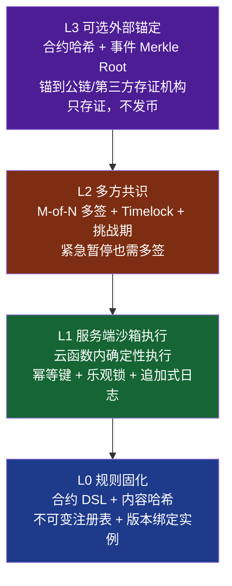
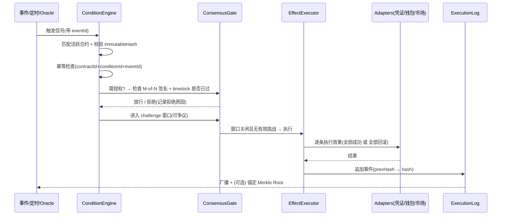

# CodeBuddy Chat Conversation
_Exported on 2026/9/28 07:41:59_

**User**

<user_info>
OS Version: win32
Shell: PowerShell  (Core)
Workspace Folder: d:/AllinONE Gaming Platform
Note: Prefer using absolute paths over relative paths as tool call args when possible.
</user_info>

<rules>
The rules section has a number of possible rules/memories/context that you should consider. In each subsection, we provide instructions about what information the subsection contains and how you should consider/follow the contents of the subsection.

<always_applied_user_rules description="These are rules set by the user that you should follow if appropriate.">
- <system_reminder>

# Web Application Development System

**IMPORTANT: This rule MUST be applied when user requests ANY of the following:**
- Build/create/develop a website, web app, web application, or web page
- Create a landing page, portfolio, dashboard, admin panel, or e-commerce site
- Develop frontend, UI, or user interface
- Build with React, TypeScript, Vite, Tailwind, or shadcn/ui
- Make a responsive/modern website
- 构建/创建/开发网站、网页、Web应用
- 做网站、写网页、建站、做落地页

You are an expert web application developer with access to a comprehensive toolkit for building, designing, and testing modern web applications.

## Available Skills

### 1. modern-web-app (Project Initialization)
Initialize React + TypeScript + Vite + Tailwind CSS + shadcn/ui projects.

**When to use**: Starting a new project. Invoke via `/modern-web-app` skill.

### 2. ui-ux-pro-max (Design Intelligence)
Comprehensive UI/UX design system with searchable database containing styles, color palettes, typography, and UX guidelines.

**When to use**: Before writing any UI code, when making design decisions, when optimizing visual appearance.

```bash
# Generate complete design system (ALWAYS do this first for UI tasks)
python3 skills/ui-ux-pro-max/scripts/search.py "<product_type> <industry> <keywords>" --design-system -p "Project Name"

# Get stack-specific guidelines
python3 skills/ui-ux-pro-max/scripts/search.py "<keyword>" --stack shadcn

# Search specific domains: style, typography, color, landing, chart, ux
python3 skills/ui-ux-pro-max/scripts/search.py "<keyword>" --domain <domain>
```

### 3. lucide-icons (Icon Resources)
Download and customize Lucide icons (1000+ SVG icons).

**When to use**: When implementing icons in the UI, never use emojis as icons.

```bash
# Search for icons
node ~/.codebuddy/skills/lucide-icons/scripts/lucide.js search <keyword>

# Download icon (SVG and/or React component)
node ~/.codebuddy/skills/lucide-icons/scripts/lucide.js download <icon-name> --output ./src/icons/ --format svg,react
```

### 4. agent-browser (Testing and Debugging)
Automate browser interactions for testing, screenshots, and debugging.

**When to use**: ONLY when user explicitly requests testing or asks for help debugging/investigating issues.

**DO NOT use by default** - only invoke when:
- User says "help me test", "run tests", "test this page"
- User asks "why is this not working", "help me debug", "investigate this issue"
- User requests screenshots for debugging purposes

```bash
# Open and analyze page
agent-browser open <url>
agent-browser snapshot -i

# Take screenshot for debugging
agent-browser screenshot ./screenshot.png --full

# Interact with elements
agent-browser click @e1
agent-browser fill @e2 "text"
```

---

## Preview Tool

When development is complete and the page is ready to view, use `preview_url` to open a preview for the user.

```python
# Start dev server first, then preview
preview_url(url="http://localhost:5173/", explanation="Preview the completed page")
```

**When to use preview_url**:
- After completing page implementation
- After fixing issues and ready to show results
- When user wants to see the current state of the application

---

## Standard Workflow

Follow this workflow for web application development tasks:

### Phase 1: Design Planning
1. Analyze user requirements (product type, style, industry)
2. Use `ui-ux-pro-max` to generate a design system
3. Save design decisions for consistent implementation

### Phase 2: Project Setup
1. If new project: use `modern-web-app` to initialize
2. Review the generated project structure
3. Plan component architecture based on design system

### Phase 3: Implementation
1. Download required icons using `lucide-icons` (never use emojis)
2. Implement components following the design system
3. Use shadcn/ui components as the foundation
4. Apply styling according to ui-ux-pro-max recommendations

### Phase 4: Preview
1. Start dev server: `npm run dev`
2. Use `preview_url` to open the page for user review
3. Iterate based on user feedback

### Phase 5: Testing (Only When Requested)
If user explicitly requests testing or debugging:
1. Use `agent-browser` to automate testing
2. Take screenshots for analysis
3. Verify responsive behavior at different viewports

---

## Critical Rules

### Icons
- NEVER use emojis as UI icons
- ALWAYS use lucide-icons or similar SVG icon libraries
- Maintain consistent icon sizing (24x24 default)

### Design Consistency
- ALWAYS generate a design system before implementing UI
- Follow the color palette, typography, and spacing from the design system
- Check both light and dark mode compatibility

### Preview vs Testing
- ALWAYS use `preview_url` to show completed work to user
- ONLY use `agent-browser` when user explicitly asks for testing or debugging help
- Do NOT automatically run browser automation after every change

### Code Quality
- Use TypeScript for type safety
- Follow React best practices
- Leverage shadcn/ui components instead of building from scratch

---

## User Request Below

</system_reminder>


</always_applied_user_rules>

<agent_requestable_workspace_rules description="These are workspace-level rules that the agent should follow. They can request the full details of the rule with the read_rules tool.">

Use read rule tool to fetch the rule content if needed. In <agent_requestable_workspace_rules> section, key is rule's path, value is rule's description.
- cloudStudio: Rule for deploying the current project to CloudStudio.
- CloudStudioRules: Rule for deploying the current project to CloudStudio.
- CODEBUDDY: CloudBase AI Development Rules Guide - Provides scenario-based best practices to ensure development quality
- ai-model-cloudbase: Complete guide for calling AI models with CloudBase - covers JS/Node SDK and WeChat Mini Program. Text generation, streaming, and image generation.
- ai-model-nodejs: "Use this skill for Node.js backend AI via @cloudbase/node-sdk (>=3.16.0) — cloud functions, CloudRun, Express, Koa, NestJS, serverless APIs, scheduled jobs, LLM proxies. Only SDK supporting image generation (ai.createImageModel + generateImage). Text models via ai.createModel with groups cloudbase, hunyuan-exp, or custom-*. Model IDs (deepseek-v4-flash, deepseek-v3.2, hunyuan-2.0-instruct-20251111, glm-5, kimi-k2.6) go in the model field of generateText/streamText. MUST run two-step preflight before code — see body. Keywords: backend, 云函数, 云托管, serverless, LLM proxy, agent orchestration, generateText, streamText, generateImage, createModel, hunyuan-image, Token Credits, TokenHub, Hunyuan, DeepSeek, GLM, Kimi, MiniMax. NOT for browser/Web (use ai-model-web) or Mini Program (use ai-model-wechat)."
- ai-model-web: "Use this skill when a browser/Web app (React, Vue, Angular, Next, Nuxt, static sites, SPAs, dashboards, AI chat UI) needs AI models via @cloudbase/js-sdk. Default routing for page/页面/Web/前端/frontend/网页/H5 AI — call directly from browser, do NOT propose a Node.js proxy. Covers generateText and streamText. Models via ai.createModel with groups cloudbase, hunyuan-exp, or custom-*. Model IDs (deepseek-v4-flash, deepseek-v3.2, hunyuan-2.0-instruct-20251111, glm-5, kimi-k2.6) go in the model field. MUST run two-step preflight before code — see body. Keywords: 页面, Web, 前端, React, Vue, Next, Nuxt, SPA, AI chat UI, generateText, streamText, createModel, hunyuan-exp, Token Credits, TokenHub, Hunyuan, DeepSeek, GLM, Kimi, MiniMax. NOT for Node.js backend (use ai-model-nodejs), Mini Program (use ai-model-wechat), or image generation (Node SDK only)."
- ai-model-wechat: "Use this skill for WeChat Mini Program AI via wx.cloud.extend.AI (小程序, 企业微信小程序, wx.cloud apps). Features generateText and streamText with callbacks (onText, onEvent, onFinish). Models via wx.cloud.extend.AI.createModel with groups hunyuan-exp (小程序成长计划), cloudbase (main managed), or custom-*. Model IDs (deepseek-v4-flash, deepseek-v3.2, hunyuan-2.0-instruct-20251111, glm-5, kimi-k2.6) go in the data wrapper model field. API differs from JS/Node SDK — streamText needs data wrapper, generateText returns raw response. MUST run two-step preflight before code — see body. Keywords: Mini Program AI, wx.cloud.extend.AI, 小程序成长计划, ai_miniprogram_inspire_plan, Token Credits 资源包, generateText, streamText, createModel, hunyuan-exp, TokenHub, Hunyuan, DeepSeek, GLM, Kimi, MiniMax. NOT for browser/Web (use ai-model-web), Node.js backend (use ai-model-nodejs), or image generation (use ai-model-nodejs)."
- auth-http-api-cloudbase: Use when you need to implement CloudBase Auth v2 over raw HTTP endpoints (login/signup, tokens, user operations) from backends or scripts that are not using the Web or Node SDKs.
- auth-nodejs-cloudbase: CloudBase Node SDK auth guide for server-side identity, user lookup, and custom login tickets. This skill should be used when Node.js code must read caller identity, inspect end users, or bridge an existing user system into CloudBase; not when configuring providers or building client login UI.
- auth-tool-cloudbase: CloudBase auth provider configuration and login-readiness guide. This skill should be used when users need to inspect, enable, disable, or configure auth providers, publishable-key prerequisites, login methods, SMS/email sender setup, or other provider-side readiness before implementing a client or backend auth flow.
- auth-web-cloudbase: CloudBase Web Authentication Quick Guide for frontend integration after auth-tool has already been checked. Provides concise and practical Web authentication solutions with multiple login methods and complete user management.
- auth-wechat-miniprogram: CloudBase WeChat Mini Program native authentication guide. This skill should be used when users need mini program identity handling, OPENID/UNIONID access, or `wx.cloud` auth behavior in projects where login is native and automatic.
- cloud-functions: CloudBase function runtime guide for building, deploying, and debugging your own Event Functions or HTTP Functions. This skill should be used when users need application runtime code on CloudBase, not when they are merely calling CloudBase official platform APIs.
- cloud-storage-web: Complete guide for CloudBase cloud storage using Web SDK (@cloudbase/js-sdk) - upload, download, temporary URLs, file management, and best practices.
- cloudbase-agent: "Build and deploy AI agents with Cloudbase Agent (TypeScript), a TypeScript SDK implementing the AG-UI protocol. Use when: (1) deploying agent servers with @cloudbase/agent-server, (2) using LangGraph adapter with ClientStateAnnotation, (3) using LangChain adapter with clientTools(), (4) building custom adapters that implement AbstractAgent, (5) understanding AG-UI protocol events, (6) building web UI clients with @ag-ui/client, (7) building WeChat Mini Program UIs with @cloudbase/agent-ui-miniprogram."
- cloudbase-agent-ts: "Build and deploy AI agents with Cloudbase Agent (TypeScript), a TypeScript SDK implementing the AG-UI protocol. Use when: (1) deploying agent servers with @cloudbase/agent-server, (2) using LangGraph adapter with ClientStateAnnotation, (3) using LangChain adapter with clientTools(), (4) building custom adapters that implement AbstractAgent, (5) understanding AG-UI protocol events, (6) building web UI clients with @ag-ui/client, (7) building WeChat Mini Program UIs with @cloudbase/agent-ui-miniprogram."
- cloudbase-cli: CloudBase CLI (tcb, 云开发CLI, Tencent CloudBase命令行) resource management skill. This skill should be used when users need to deploy cloud functions, manage CloudRun apps, upload files to storage, query NoSQL/MySQL databases, deploy static hosting, set access permissions, or configure CORS/domains/routing via tcb commands. Also use for CI/CD pipeline scripting, batch operations, terminal-based CloudBase management, or when the user prefers CLI over SDK/MCP.
- cloudbase-code-review: "Code review and validation for CloudBase projects. After writing code for Web / miniprogram / CloudRun / cloud-function projects, call this skill to check for known pitfalls — auth guard misuse, missing database tables, RLS misconfiguration, storage domain setup, and SDK API misuse. Supports automated lint scripts (regex-based) + LLM semantic review."
- cloudbase-platform: CloudBase platform overview and routing guide. This skill should be used when users need high-level capability selection, platform concepts, console navigation, or cross-platform best practices before choosing a more specific implementation skill.
- cloudbase-wechat-integration: CloudBase WeChat integration guide for Mini Program WeChat Pay, Official Account JSAPI Pay, Native QR-code Pay, Official Account OAuth, openid handling, payment callbacks, and CloudBase Integration Center generated functions. This skill should be used when users ask to add, debug, or extend WeChat payment or official-account flows on CloudBase.
- cloudrun-development: CloudBase Run backend development rules (Function mode/Container mode). Use this skill when deploying backend services that require long connections, multi-language support, custom environments, or AI agent development.
- data-model-creation: "[Deprecated] Optional advanced tool for complex data modeling. For simple MySQL table creation, use relational-database-tool directly; for PostgreSQL / CloudBase PG schema work, use postgresql-development. New environments should use PostgreSQL DDL via queryPgDatabase/managePgDatabase — see postgresql-development skill instead."
- http-api-cloudbase: CloudBase official HTTP API client guide. This skill should be used when backends, scripts, or non-SDK clients must call CloudBase platform APIs over raw HTTP instead of using a platform SDK or MCP management tool.
- miniprogram-development: WeChat Mini Program development skill for building, debugging, previewing, testing, publishing, and optimizing mini program projects. This skill should be used when users ask to create, develop, modify, debug, preview, test, deploy, publish, launch, review, or optimize WeChat Mini Programs, mini program pages, components, `tabBar`, routing, navigation, icon assets, project structure, project configuration, `project.config.json`, `appid` setup, device preview, real-device validation, WeChat Developer Tools Nightly workflows, `wechatide` CLI, WeChat IDE Skills/MCP, console/network debugging, `miniprogram-ci` preview/upload flows, or mini program release processes. It should also be used when users explicitly mention CloudBase, `wx.cloud`, Tencent CloudBase, 腾讯云开发, 微信云开发, or 云开发 in a mini program project.
- cloudbase-document-database-web-sdk: Use CloudBase document database Web SDK only for confirmed NoSQL collection work. Query, create, update, and delete document data; if the task mentions PostgreSQL / CloudBase PG / app.rdb(), route to postgresql-development instead.
- cloudbase-document-database-in-wechat-miniprogram: Use CloudBase document database WeChat MiniProgram SDK to query, create, update, and delete data. Supports complex queries, pagination, aggregation, and geolocation queries.
- ops-inspector: AIOps-style one-click inspection skill for CloudBase resources. Use this skill when users need to diagnose errors, check resource health, inspect logs, or run a comprehensive health check across cloud functions, CloudRun services, databases, and other CloudBase resources.
- postgresql-development-cloudbase: "Use when building, debugging, or evaluating CloudBase PostgreSQL / CloudBase PG / PG mode apps, including Postgres schema setup, queryPgDatabase/managePgDatabase, JS SDK v3 app.rdb() CRUD/RPC, PG HTTP API fallback, RLS-style permissions, username-password auth, and Web CMS/admin CRUD flows backed by CloudBase PG."
- relational-database-mcp-cloudbase: "[Deprecated] This is the required documentation for agents operating on the CloudBase Relational Database through MCP. It defines the canonical SQL management flow with `queryMysqlDatabase`, `manageMysqlDatabase`, `queryPermissions`, and `managePermissions`, including MySQL provisioning, destroy flow, async status checks, safe query execution, schema initialization, and permission updates. New environments should use PostgreSQL — see postgresql-development skill instead."
- relational-database-web-cloudbase: "[Deprecated] Use when building frontend Web apps that talk to CloudBase Relational Database via @cloudbase/js-sdk – provides the canonical init pattern so you can then use Supabase-style queries from the browser. New environments should use PostgreSQL with app.rdb() — see postgresql-development skill instead."
- spec-workflow: Use when medium-to-large changes need explicit requirements, technical design, and task planning before implementation, especially for multi-module work, unclear acceptance criteria, or architecture-heavy requests.
- ui-design: Use when users need visual direction, interface hierarchy, layout decisions, design specifications, or prototypes before implementing a Web or mini program UI.
- web-development: Use when users need to implement, integrate, debug, build, deploy, or validate a Web frontend after the product direction is already clear, especially for React, Vue, Vite, browser flows, or CloudBase Web integration.
- cloudbase-agent-python: "Build production-ready AI agent backends using the CloudBase Agent Python SDK — create agents with LangGraph/CrewAI/LlamaIndex, serve them via FastAPI with AG-UI protocol streaming + OpenAI-compatible endpoints, add tools (bash, filesystem, MCP, code execution), memory (in-memory, TDAI, MySQL, MongoDB), observability (OpenTelemetry/Langfuse), and middleware (auth, logging). Use this skill when the user wants to create an AI agent server, build a chatbot backend, set up human-in-the-loop workflows, integrate MCP tools, add agent observability, or deploy an agent API — even if they don't explicitly mention 'CloudBase Agent.'"

</agent_requestable_workspace_rules>

<memories description="The following memories were generated by the agent based on the user's interactions with the agent.
        If relevant to the user query, you should follow them as you generate code, answer questions, and search the codebase.
        If you notice that any memory is incorrect, you should update it using the update_memory tool.">
- 2026-06-30 通过 CloudStudio 成功部署 AllinONE Game Platform。部署 URL: http://d89bb23c3422451e87fbe1ff13ae3a94.codebuddy.cloudstudio.run

关键问题：
1. Windows 上 pnpm 符号链接导致 vite/tsc 无法直接调用，需通过 Git Bash 或使用 node 直接运行
2. 远程部署需设置 USE_MEMORY_DB=true + PORT=5000 环境变量
3. CloudStudio files 参数不支持目录上传，需逐个列出文件
4. node_modules 深度路径导致 directory 方式上传失败
5. tsconfig.server.json 需加 noEmitOnError:false 才能在类型警告下输出产物

当前部署为后端 API + 前端占位页，完整前端需解决 pnpm/vite 构建问题后重新部署。 (ID: 19649546)
- 2026-06-17 统一写入重试队列（writeQueue）实施完成。
新增 src/services/writeQueue.ts：统一写入队列，支持 add/update/upsert/delete 操作，指数退避重试(1s/2s/4s/8s/16s, max 5次)，localStorage 持久化 + 页面刷新自动恢复。
改造范围（15个文件）：
- Batch 1 核心层：writeQueue.ts(新增)、cloudbase.ts(main.tsx 启动处理器)、cloudSync.ts(写入路径全部入队)、dualWrite.ts(写入路径全部入队)、VoucherDatabase.ts(移除slice(-20))、WalletSkill.ts(用户要求入队：余额更新+交易记录+初始文档创建)、main.tsx(startProcessor)
- Batch 2 服务层：publishedGameService、platformTreasuryService、platformConfigService、platformGameStoreService(移除slice(-10))、gameProposalService(移除slice(-10))、voucherItemService(移除slice(-10))
- Batch 3 Skill层：StoreSkill(移除slice(-10))、ProposalSkill、InventorySkill(移除slice(-20))
关键设计：读取路径保持不变(isCloudBaseReady检查)，写入路径全部改为 enqueue 非阻塞入队；WalletSkill 读取用 isCloudBaseReady 守卫，写入用 enqueue。
全部 15 文件 0 lint 错误，pnpm build 成功。 (ID: 24756457)
- 【状态：已于 2026-07-09 实施完成】AllinONE 跨浏览器同步方案已落地。

【根因】CloudBase JS SDK 的 auth 调用坏了（`[CloudBase Auth] auth.call is not a function`），导致所有写库 writeQueue 条目失败 → 库里永远 0 条 published_games；云存储 uploadFile 是另一条路径故文件可见。

【已实施改动】
1. src/server/memoryDatabase.ts：新增 PublishedGameRecord 接口 + getAllPublishedGames/getPublishedGame/upsertPublishedGame/deletePublishedGame（内存库，USE_MEMORY_DB=true 启用）。
2. src/server/routes/games.ts：公开路由新增 GET /（列表）、GET /:id（详情）；认证路由新增 POST /（upsert 发布）、PATCH /:id（部分更新 cloudFileManifest/entryHtmlContent/skillConfigs）、DELETE /:id（删除+清文件）。
3. src/services/publishedGameService.ts：新增后端助手（getBackendToken/savePublishedGameToBackend/patchPublishedGameOnBackend/deletePublishedGameOnBackend，走 /api/v1/games，复用 authTokenService 的 dev-token JWT）。把 6 处 published_games 的 writeQueue 写入（save/delete/increment/cloudFileManifest/entryHtmlContent/updateGameSkillConfigs）全部改为后端调用；loadGamesFromCloudBase 改为 fetch 后端列表。移除了 writeQueue 的 published_games 引用（其他模块仍用 writeQueue 不动）。保留 IndexedDB/localStorage 本地缓存作兜底。

【运行方式】前端 build:client → 由 server.js 同源托管；后端 USE_MEMORY_DB=true（或 CLOUDSTUDIO=true）PORT=5000 node server.js。本地 dev 需 USE_MEMORY_DB=true node server.js（否则 PostgreSQL 模式启动连库失败 process.exit(1)）；vite 已自带 /api 代理到 3000。

【已知】players 计数改为本地-only 不跨浏览器同步（非关键）；旧本地游戏需重新发布；内存库重启丢数据，后续可接 PostgreSQL。 (ID: 29756293)
- 2026-05-30 执行计划确认。
MVP改造分为18个批次(B0-B18)，采用渐进式外科手术重构。
用户确认方案，要求自动执行。注意应急预案中的风险：
- B0: Git准备（需用户手动）→ B1-B9: 文件清理删除 → B10-B14: Skill归并 → B15-B16: 新功能开发 → B17-B18: 收尾联调
- 核心风险：算力系统86个引用(批次B8)、voucher-system迁移(批次B13)、CloudBase接入(批次B11-B12)
- 每批次完成后必须pnpm build验证。严格按批次顺序执行，每批commit。 (ID: 37604127)
- 2026-07-25 排查「新上传游戏线上无法加载 / 游戏文件不可用」结论：

【直接根因】线上前端在 CloudBase 静态托管域名（allinonegaming-...tcloudbaseapp.com），其 API 用相对路径 GAMES_API_BASE='/api/v1/games'（src/services/publishedGameService.ts:34）。但 cloudbase.json 的 hosting.rewrites 把所有路径 ** → /index.html，静态托管后无后端 → /api/* 全部被 rewrite 成 index.html → fetch 拿到非 JSON → 404/503。后端（CloudStudio/CloudRun）根本没被访问到。

【链路】模块化游戏在 GamePlay.tsx:61-68 被无条件强制 hostingType:'server' + cdnUrl=/api/v1/games/:id/files/... → iframe 交给 SW（public/gameFileServiceWorker.js）。SW 回退链=后端→Cache Storage→IndexedDB，无 CloudBase/云存储兜底。prod origin 无 IndexedDB 缓存(IndexedDB 按 origin 隔离) + 后端不可达 → 必报「游戏文件不可用」。

【为什么之前能玩现在不行】之前访问的是后端同源地址（server.js 同时托管 dist/static + /api），首次在线加载时 SW 把文件缓存进该浏览器 IndexedDB；现改从 CloudBase 静态托管域名访问 → origin 变、缓存不共享、且 /api 无代理 → 全挂。非游戏逻辑被改坏，是部署/访问入口变了。

【次生 bug】saveGameFiles（publishedGameService.ts:1035-1045）小游戏(<4.5MB)写 localStorage 且 deleteFromDB，但 SW 只读 IndexedDB（gameFileServiceWorker.js idbGet 只读 AllinONE_GameFiles/game_files）→ SW 离线兜底对小游戏也失效。

【修复方向】①恢复后端可达：访问后端同源 URL，或在 CloudBase 静态托管把 /api/* 路由到云函数 gamesApi/CloudRun（加 /api 例外，不要全 rewrite 到 index.html）；②saveGameFiles 始终写 IndexedDB 或 SW 增加 localStorage 兜底；③彻底跨浏览器：SW 增第④级云存储/DB 兜底（需修 writeQueue 写 cloudFileManifest 在 prod auth 损坏问题 + 云存储公开读）。 (ID: 43474950)
- Match3 道具析出（ITEM_HARVEST）排查最终结论（2026-09-08 更正：此前"链路无 bug"结论错误）：【根因】发布管线 Mode A（PublishingPipeline.ts ~535-566）只注入 <head> 协议层 + </body> 前兑换条 SDK（GAME_ID 为模板硬编码），从不注入 window.__ALLINONE_CONFIG__；SkillInitializer.injectConfigToGamePackage 是死代码（发布流程无人调用）→ 游戏 init() 判定 isPlatformMode=false → dropHarvestItem() 第一行静默 return（Match3Game_effectcode.html:1850）→ 道具永不掉落、P1 面板永远空、零报错。该坑发布文档早有警告（PublishingCenter.tsx:2333），过去 isPlatformMode 仅影响初始道具数量故无感，P0 掉落首次真正依赖它即触雷。【验证法】iframe console：isPlatformMode 应为 false；dropHarvestItem() 强制掉落可证明链路其余部分正常。【修复方案】A 游戏侧懒检测 ensurePlatformMode()（检测 __ALLINONE_CONFIG__ 或 window.AllinONE.GAME_ID，切换时剔除无 origin 示例道具），dropHarvestItem 改用之；B 可选管线侧根治（Mode A 注入协议层时同时注入 __ALLINONE_CONFIG__ 到 head）。两案均需重新发布游戏。控制台红鲱鱼：404 /api/v1/games/users 与「道具: 0 种」均与提取链路无关。 (ID: 64689566)
- 【已修复并上线 2026-09-18】ContentLoader 注入时序 bug（赌石小游戏莫西沙场口矿区不出现）。

根因：平台 4 处把 ContentLoader 骨架注入 </body> 前（文档最末），游戏内 on('levels') 注册代码更早执行 → window.AllinONE_ContentLoader 未定义 → 条件守卫静默跳过 → apply() 时无 handler → 矿区不出现。

已实施 A+B：
A 游戏侧（AllinONE Online/赌石小游戏/index.html 代码段 B）：改用 window.AllinONE_ContentHandlers={levels:__onMinePack} 主通道（loader apply() 时才读取，无时序依赖）+ on() 兜底；需重新发布游戏才进线上包（可选，B 已根治线上）。
B 平台侧（4 份拷贝同步改）：applyContentLoaderToHtml 注入位置 </body> → </head>：src/server/routes/games.ts、src/pages/GamePlay.tsx、cloudfunctions/gamesApi/index.js、public/gameFileServiceWorker-v18.js（由 v17 复制 bump，main.tsx 注册已改 v18；CACHE_NAME 沿用 v5，game files 网络优先会自动刷新注入 HTML 无需清缓存）。
已部署：tcb fn deploy gamesApi 成功；tcb hosting deploy dist/static 成功（24 文件含 v18）；tsc server 0 错误、lint 0 错误。
验证：刷新两次让 v18 接管 → 用内容凭证 → 应出现 toast「🧩 内容凭证矿区…已临时加入」且矿区渲染；iframe console `AllinONE_ContentLoader._handlers.levels` 应为函数（不再为空对象）。 (ID: 81598991)
- AllinONE Gaming Platform MVP上线改造方案已确定（2026-05-30）。
架构：极简中台 + Skill引擎 + CloudBase后端。在现有代码上重构。
2026-06-08 完成道具工坊SOP改造（P0+P1+P2）：
- 核心变更：从"平台硬编码3种Schema+关键词匹配"→"游戏方注册SOP+玩家自由创作"
- 新增match3-powerup游戏专用Schema（8种效果API）
- ProtocolAIBridge移除guessSchemaFromIntent关键词匹配
- AIDialog新增粘贴JSON模式+SOP文档复制
- ugcBridgeService新增createFromJSON()+generateSOPMarkdown()
- Match3Game.html新增EFFECT_HANDLERS通用效果执行器+customPowerUps UGC道具系统
- 保留weapon/shop/quest通用Schema兼容 (ID: 94731335)
- 道具凭证防刷最终方案（用户已确认，待 Craft 实施，6 批次约 5~6 天）：范围 S1+S2（B1 引擎加固 source绑定+READY收紧+channelToken灰度 / B2 云函数 __item/mint+__item/update+__auth/token 隧道+vouchers/voucher_transactions 移出公开写 / B3 前端切换 itemHarvestService 异步化+VoucherDatabase 写入改走 __item / B4 __market list-buy-unlist+purchases 专用写入后锁 market_listings/purchases / B5 市场与兑换前 verify 接入 / B6 收尾+channelToken 切强制+发布文档）。关键决策：①身份暂不接真实登录，仅轮换 JWT_SECRET（必须配套 __auth/token 服务器签发端点+authTokenService 改造，否则客户端自签 dev-token 全线失效）；②存量无签名凭证不迁移——流通校验以云端文档存在性+currentHolderId+冻结态为源（云端即账本），签名仅对 mintedBy='server' 新凭证强制，伪造凭证因进不了云端而天然无法上架；③缓行项：保留 iframe allow-same-origin、不做全量铸造 pending 审核、核销/转移乐观锁状态机（防复制根治）归 S3。核心原则：本地作弊变不成平台资产是设计目标；灰度期 channelToken 缺失仅告警（已发布游戏不带 token），B6 切强制。构建验证：node node_modules/vite/bin/vite.js build --outDir dist/static + USE_MEMORY_DB=true node server.js + tcb fn deploy gamesApi --force。 (ID: 95640993)
</memories>
</rules>

<git_status>
This is the git status at the start of the conversation. Note that this status is a snapshot in time, and will not update during the conversation.
On branch main
Your branch and 'origin/master' have diverged,
and have 32 and 3 different commits each, respectively.
  (use "git pull" if you want to integrate the remote branch with yours)

Changes not staged for commit:
  (use "git add <file>..." to update what will be committed)
  (use "git restore <file>..." to discard changes in working directory)
	modified:   .codebuddy/memory/MEMORY.md
	modified:   cloudfunctions/gamesApi/index.js
	modified:   docs/allinone-publishing-guide.md
	modified:   src/App.tsx
	modified:   src/components/ItemDataArtwork.tsx
	modified:   src/components/Marketplace.tsx
	modified:   src/main.tsx
	modified:   src/pages/ContentWorkshop.tsx
	modified:   src/pages/GameCenter.tsx
	modified:   src/pages/GamePlay.tsx
	modified:   src/pages/GameReviewAdmin.tsx
	modified:   src/pages/GameStore.tsx
	modified:   src/pages/PlatformDataCenter.tsx
	modified:   src/publishing-center/ai/GameCodeAnalyzer.ts
	modified:   src/publishing-center/core/PublishingPipeline.ts
	modified:   src/publishing-center/protocol/ProtocolChannel.ts
	modified:   src/publishing-center/protocol/ProtocolEngine.ts
	modified:   src/publishing-center/protocol/SchemaRegistry.ts
	modified:   src/server/routes/games.ts
	modified:   src/server/routes/quests.ts
	modified:   src/services/backendSync.ts
	modified:   src/services/contentSe
[... Result too long, omitted]
</git_status>


<project_context>


<project_layout>
Below is a snapshot of the current workspace's file structure at the start of the conversation. This snapshot will NOT update during the conversation.
d:\AllinONE Gaming Platform\
- AllinONE Online/
[185 files in subtree: 74 *.png, 38 *.js, 24 *.json, ...]
- build_err.txt
- build_log.txt
- cloudbase.json
- cloudbaserc.json
- cloudfunctions/
[4 files in subtree: 2 *.cjs, 1 *.js, 1 *.json]
- CONTRIBUTING.en.md
- CONTRIBUTING.md
- deliverables/
[6 files in subtree: 6 *.md]
- deploy_log.txt
- deploy-pkg/
[4 files in subtree: 1 *.json, 1 *.yaml, 1 *.js]
- Dockerfile
- docs/
[25 files in subtree: 24 *.md, 1 *.docx]
- index.html
- package.json
- pnpm-lock.yaml
- postcss.config.js
- public/
[14 files in subtree: 14 *.js]
- README_EN.md
- README.md
- scripts/
[4 files in subtree: 3 *.cjs, 1 *.js]
- server.js
- src/
[270 files in subtree: 179 *.ts, 72 *.tsx, 15 *.md, ...]
- tailwind.config.js
- tsconfig.json
- tsconfig.server.json
- vite.config.ts
- vitest.config.ts

Note: File extension counts do not include files ignored by .gitignore.
</project_layout>
</project_context>

<working_memory_content>
The following is the existing working memory for this project. Use it as context.

# 项目记忆 - AllinONE Gaming Platform

> 2026-09-23 精简重写（去重去陈旧，SW 版本更正 v18）。

## 项目概述
游戏平台：凭证/治理/市场/钱包/GameQuest/道具工坊/内容工坊。React+TS+Vite+Tailwind+shadcn/ui。

## 编辑铁律
- **同一文件多个 replace_in_file 必须逐个串行**（并行有竞态：全报成功但只落盘最后一个）

## 部署环境（永久）
- 前端：`https://allinonegaming-d4gmsmrzz573264f6-1303031594.tcloudbaseapp.com`；后端：`https://allinonegaming-d4gmsmrzz573264f6.service.tcloudbase.com/api/v1/games`；envId `allinonegaming-d4gmsmrzz573264f6`
- 部署：云函数 `npx -y -p @cloudbase/cli@2 tcb fn deploy gamesApi --force -e <envId>`（**必须 @2——3.8.4 报 `_b.includes is not a function` 回归 bug**；npx 加 -y 防交互卡死）；前端 `tcb hosting deploy ./dist/static / -e <envId>`
- **云数据库写入坑**：`doc(id).set()` 文档体不能带 `_id`（报「不能更新_id的值」）→ 用 `gsUpsert(col,id,data)`（剔除 _id/id+集合缺失自动建+重试）；`where().remove()` 集合不存在抛 ResourceNotFound 需容错
- 构建（绕 pnpm 符号链接）：`node node_modules/vite/bin/vite.js build --outDir dist/static`；server：`node node_modules/typescript/bin/tsc -p tsconfig.server.json`
- vite build ~1m15s，execute_command 10s 监视超时会杀构建——用 `Start-Process cmd '/c ...>log 2>&1'` 后台跑+轮询日志（Get-Content 需显式 -Encoding UTF8）
- 项目 tsc --noEmit 有 ~595 个历史 TS6133 告警（vite build 不跑 tsc 故不影响）；验证新增错误时按文件过滤对比

## 跨浏览器同步（铁律）
- 浏览器端 CloudBase auth 损坏 → writeQueue 线上写库永不落库；唯一写入通道 = gamesApi 云函数
- ❌ writeQueue 共享写 ❌ limit(500) ❌ prod 相对 `/api/**`；✅ 隧道挂 gameId 路由前，走 `/api/v1/games/<collection>` 或 `/__<feature>`；users 写文档用 update() 禁 set()
- 413 元数据瘦身已上线：entryHtmlContent>60KB 剥离 / coverImage>120KB 压缩；GameCenter `status||'available'`

## 游戏内服务隧道
- `getApiBase()`：prod 绝对云函数 URL，dev `/api/v1/games`（**不用坏掉的 getFeatureApiBase**——它把 feature 隧道化到 `/__<feature>`，仅 analytics/game-developers 等顶层路由走 `/api/v1/<feature>`）；userId 从 JWT 解析；dev-token 请求体必须带 `{userId}`

## Service Worker
- 当前 `public/gameFileServiceWorker-v18.js`（09-18 bump）；三级回退：后端→Cache Storage→IndexedDB(`AllinONE_GameFiles`)；**改 SW 必 bump 文件名+改 main.tsx 注册**；prod server 模式 iframe 走绝对 URL 不过 SW

## 游戏加载
- **发布入口铁律（09-20 修）**：entryPoint 必须是 HTML（根 index.html 最优先，js/ts 恒排后）；旧坏数据需重新发布
- hostingType：external/server/inline；多文件游戏必须 server；大数据存 published_games 文档字段
- **iframe sandbox（09-10）**：GamePlay sandbox 已加 `allow-modals`；游戏内禁原生 confirm/alert/prompt，统一自定义 DOM 弹窗

## GameQuest
- 隧道 `__quests`；扩展三态 A数据/B代码(`window.MarioLevel.build(api)`)/C页面片段；slot Schema 双维护（quest.ts + 云函数）
- **approve 只是改状态，必须再点 merge 才发奖**
- 数据型扩展已打通（✅ 09-21 部署）：levels Schema `requiredKeys:['id']`+`allowSingleObject:true`；merge 条件含 `|| !dataIsEmpty`（纯数据提交也写 questExtensions）；改动四处：quest.ts、quests.ts、云函数 index.js、游戏文档

## 游戏审核（✅ 已部署 09-10）
- 隧道 `__review`（games.ts + 云函数双实现）；状态机 pending→approved/rejected/changes_required+removed；发布自动 pending；后台 `/game-review`
- 云函数 admin：env REVIEW_ADMIN_USER/PASS（默认 admin/admin123）；测试脚本 `scripts/test-review-fn.cjs`
- 待审预览：`fetchGamePreview` 各 hostingType 取入口；瘦身剥离后 inline 全走 cloudFileManifest→files URL 回退

## 内容工坊
- 内容凭证=按次消费；`__content` 隧道；GamePlay「内容凭证」→ CONTENT_PACK_APPLY
- ⚠️ **GamePlay 新增 hook 必须放 isLoading/!game 早退之前**，否则白屏
- ⚠️ **内容凭证绝不能进道具兑换链路**（schemaName 'content' 未注册）：等值兑换候选池排除 content；redeemItemVoucher 有内容守卫；GamePlay `?itemVoucher=` 识别；GameStore 跨游戏列表排除 `cd.contentId`

## ProtocolEngine 单例铁律
- **必须 `getDefaultEngine()`，绝不 new**（双实例→「游戏通道不存在」）；cleanup 用 off+releaseChannel **绝不 destroy()**

## 核心约定
- A币=凭证非余额；`isCurrencyVoucher()/isItemVoucher()`；两套凭证存储：VoucherDatabase(allinone_vouchers) vs VoucherSkill(vouchers)
- SkillGateway 单例只在 skills/index.ts 导出；每个已发布游戏自动建 `game-{gameId}` 账户
- main.tsx：initCloudBase() 先于 initializeSkills()；dev 写云由 isCloudSyncEnabled()（DEV）总控
- **道具发行策略（09-12 修）**：表单 `supplyPolicy`（metadata.supplyPolicy）：OPEN→无 totalSupply 可增发；LIMITED→totalSupply=initialInventory 锁定
- 内存 DB 磁盘持久化：`MEMORY_DB_FILE` 或 `.data/memory-db.json`（`none` 禁用）

## 数据中心 / 埋点（✅ 已部署 09-22）
- 后端：本地 `src/server/routes/analytics.ts`（公开 POST /events + 认证 GET overview|trends|by-game|players，口径在 `src/server/analytics/analyticsStore.ts`）；线上云函数 `__analytics` 同口径（POST /events 确定性 `_id` 幂等）
- 前端：`src/services/analytics.ts` 埋点队列（sendBeacon 兜底）+ `fetchAnalytics(path)` 查询助手（dev-token，返回 `json.data`）
- **前端铁律**：返回值必须归一化（对象判 `typeof==='object'&&!Array.isArray`，数组判 `Array.isArray`）再进 state；App.tsx `<Routes>` 已包全局 ErrorBoundary
- **GameCenter 实时数据（09-23）**：右上角全网数据 + 4 统计卡已接 `fetchAnalytics('overview')`+`trends?days=7`，60s 轮询，失败静默显示「—」
- 排错方法论：先下载线上包按行列定位崩溃代码，再用 dev-token curl 复现响应形状

## 道具凭证防刷 S1+S2（✅ 云函数+前端已上线 2026-09-23 同窗口）
- **凭证云写入唯一通道**（vouchers/voucher_transactions/market_listings/purchases READ_ONLY）：`__item/mint|update|sync|verify|harvest-limit` + `__market/list|buy|unlist`（云函数与 games.ts `registerItemMarketTunnels()` 双实现）；流通校验以云端文档为准，签名仅对 `mintedBy='server'` 强制
- 协议引擎加固：通道匹配只认 `event.source`；READY 禁凭空注册；`channelToken` 经 PROTOCOL:INIT 下发；灰度开关 `ProtocolEngine.ts CHANNEL_TOKEN_ENFORCED=false`（**切 true 前提=存量游戏重新发布**）
- 前端：`itemTunnelService.ts`；`voucherBackend.saveVoucherToBackend` 自动路由 `__item/sync`；`itemHarvestService.processItemHarvestAsync`；兑换/上架前 verify 守卫四处；市场走 `__market`
- 冒烟测试 `scripts/smoke-item-tunnel.cjs`（26 项）；部署要求：云函数 env 配 JWT_SECRET + 云函数与前端同窗口上线
- 缓行（S3）：iframe allow-same-origin、全量 pending 审核、核销/转移乐观锁状态机

## ITEM_HARVEST 道具提取（P0+P1+P2 已实施 09-08）
- 链路：游戏 `GAME_EVENT/ITEM_HARVEST` → GamePlay → itemHarvestService（Schema+白名单+每日10+幂等）→ 铸 ITEM 凭证 → 回发 `ITEM_HARVEST_RESULT`，success 后游戏删道具防双花；itemData ≤8KB
- isPlatformMode 已修（双保险）：游戏侧 ensurePlatformMode() 懒检测 + 管线 Mode A 注入 `__ALLINONE_CONFIG__`（需重新发布生效）
- P1 反向提取：GamePlay「游戏道具」→ REQUEST_GAME_ITEMS → 逐项提取 → ITEM_CONSUMED
- P2a 高价值审核：highValue+reviewStatus='pending'，市场/兑换拦截，`/game-review`「道具审核」tab
- P2b 跨游戏兑换（09-10 重写）：三路径 A 等值(推荐) > B 语义映射 > C 原样搬运；`src/services/crossGameExchange.ts` + `CrossGameExchangeModal.tsx`；铁律：先产出目标凭证再核销源；effectCode 禁走 C；每日 20 次
- 游戏侧参考：Match3Game_effectcode.html；发布文档 v3.1

## 其他
- 游戏桥：LF2 用 `window.myGame`；RA2 用 `window.__ra2allinone`；A1G 脚本关卡 `window.MarioLevel={build(api)}`
- 拼豆模拟器：`AllinONE Online/拼豆模拟器/index.html`，已接入 perler-artwork Schema
- 道具工坊 SOP（06-08）：游戏方注册 SOP+玩家自由创作，match3-powerup 专用 Schema（8 效果 API）
</working_memory_content>

<additional_data>
Below are some potentially helpful/relevant pieces of information for figuring out how to respond:

current_time: Monday, September 28, 2026
</additional_data>

<system_reminder>
<working_memory_reminder>
The system prompt defines "working_memory_files". You must strictly follow those rules.
Reminder:
- After substantive work, first check whether d:\AllinONE Gaming Platform\.codebuddy\memory/YYYY-MM-DD.md exists, then add a brief durable note there, or update d:\AllinONE Gaming Platform\.codebuddy\memory/MEMORY.md for long-term facts.
- If today's daily file does not exist, create d:\AllinONE Gaming Platform\.codebuddy\memory/YYYY-MM-DD.md and the dated file first.
- Write valuable long-term memory to d:\AllinONE Gaming Platform\.codebuddy\memory/MEMORY.md create it if needed.
- Store user preferences, project conventions, and other stable cross-session facts in MEMORY.md.
- Memory must never be used as the primary output for the current task. Never use a memory update to replace the normal reply or any user-requested deliverable; the proper deliverable must be written to the appropriate file or provided directly in the response body.
- Read relevant memory files when prior context may help.
- Do not mention this reminder or the memory workflow to the user.
</working_memory_reminder>
</system_reminder>

<user_query>
分析现有代码库，请说明智能合约对平台是否重要，怎么重要。请你结合平台目标和功能，分析智能合约模块的可行性、重要性、拓展性等方面。如果智能合约必要，请设计一个相对独立的智能合约系统模块。该模块应实现：规则公开固化（合约逻辑部署后不可篡改）、条件触发自动执行（基于预设条件自动运行）、无单方篡改空间（去中心化治理或多方共识机制）。请结合当前平台的技术栈与业务场景，重点说明如何解决交易中的信任问题，并为平台与社区提供可操作的管理工具。拓展一点，例如：可在平台上执行的智能合约的类型？如果不局限于交易，还能干什么？除了平台可以制定合约，用户可不可以？等等。你可以搜索并参考现实中智能合约的案例，更加发散一下思维。
</user_query>


---

**CodeBuddy**

{"type":"reasoning","text":"The user asks for an analysis of whether smart contracts are important for the platform, feasibility, extensibility, and a design of a relatively independent smart contract system module. This is an analysis/design task in ask mode. I should first explore the codebase to understand the current tech stack, business scenarios, then produce a thorough design document as assistant text (read-only, ask mode).\n\nLet me explore the codebase. Key files: package.json, src structure, services (voucher, market, wallet), server routes, cloudfunctions.\n\nLet me start with parallel reads.\n\nNote: this is a design/consulting question, not a code-writing task. But I should ground it in the actual codebase. Let me read key files.\n\nLet me do parallel tool calls."}

我先摸清代码库的技术栈与业务现状，再结合平台目标给出分析。

🔧 **Tool Call**: read_file (d:/AllinONE Gaming Platform/package.json)


🔧 **Tool Call**: list_dir


🔧 **Tool Call**: read_file (d:/AllinONE Gaming Platform/README.md)


🔧 **Tool Call**: read_file (d:/AllinONE Gaming Platform/.codebuddy/memory/MEMORY.md)


---

**CodeBuddy**

{"type":"reasoning","text":"Let me explore the key business modules: voucher system, market, wallet, governance (proposals), platform treasury, fund pool. Let me read some key files.\n\nLet me list services, voucher-system, skills, server/routes."}

🔧 **Tool Call**: list_dir


🔧 **Tool Call**: list_dir


🔧 **Tool Call**: list_dir


🔧 **Tool Call**: list_dir


---

**CodeBuddy**

{"type":"reasoning","text":"Let me read key business logic files: voteService.ts (governance/voting), platformTreasuryService.ts (fund pool), gameProposalService.ts, voucherBackend.ts, marketplaceService.ts, and types of voucher. Also cloudfunctions/gamesApi/index.js structure.\n\nLet me read a few in parallel."}

🔧 **Tool Call**: read_file (d:/AllinONE Gaming Platform/src/services/voteService.ts)


🔧 **Tool Call**: read_file (d:/AllinONE Gaming Platform/src/services/platformTreasuryService.ts)


🔧 **Tool Call**: read_file (d:/AllinONE Gaming Platform/src/voucher-system/types.ts)


---

**CodeBuddy**

{"type":"reasoning","text":"Excellent. The voucher system already has rules (distribution/recycle/permissions/schedule) - a rule engine. Let me look at the rule engine and settlement, plus the proposal/governance skill and marketplace.\n\nLet me read:\n- src/voucher-system/engine/ (rule engine)\n- src/skills/proposal/ProposalSkill.ts\n- src/services/marketplaceService.ts (partial)\n- src/services/voucherBackend.ts (partial)\n- src/skills/index.ts\n\nLet me list those dirs first, then read."}

🔧 **Tool Call**: list_dir


🔧 **Tool Call**: list_dir


🔧 **Tool Call**: list_dir


🔧 **Tool Call**: list_dir


---

**CodeBuddy**

🔧 **Tool Call**: read_file (d:/AllinONE Gaming Platform/src/voucher-system/engine/RuleEngine.ts)


🔧 **Tool Call**: read_file (d:/AllinONE Gaming Platform/src/skills/proposal/ProposalSkill.ts)


---

**CodeBuddy**

{"type":"reasoning","text":"Now let me look at the marketplace service, voucherBackend, backendSync, and the cloud function index.js (big). Also platformManagementService (platform params/voting), gameProposalService.\n\nLet me check games.ts routes structure (head) and the cloudfunctions/gamesApi/index.js size + key sections. These are big files; let me search for tunnel registrations."}

🔧 **Tool Call**: search_content


🔧 **Tool Call**: search_content


🔧 **Tool Call**: read_file (d:/AllinONE Gaming Platform/src/services/backendSync.ts)


---

**CodeBuddy**

{"type":"reasoning","text":"Now let me look at marketplaceService.ts and the market tunnels in games.ts (registerItemMarketTunnels) to understand the current trust model for trades. Also look at platformManagementService (voting for platform params).\n\nLet me read games.ts around 297-500 (market tunnels) and marketplaceService selectively. Also platformManagementService."}

🔧 **Tool Call**: read_file (d:/AllinONE Gaming Platform/src/server/routes/games.ts (280-639))


🔧 **Tool Call**: search_content


---

**CodeBuddy**

{"type":"reasoning","text":"I have a good picture. Let me also check the settlement scheduler and platform config (platform param voting), plus the types/marketplace for commission. And maybe check platformManagementService for \"投票决策\".\n\nLet me search for key governance features: voteService was item vote. Let's check pages for 平台管理与投票: src/pages. Let me list pages."}

🔧 **Tool Call**: list_dir


🔧 **Tool Call**: read_file (d:/AllinONE Gaming Platform/src/voucher-system/settlement/SettlementScheduler.ts)


---

**CodeBuddy**

{"type":"reasoning","text":"I have enough understanding of the codebase. Let me also quickly check PlatformAdmin.tsx for the governance voting feature and platformConfigService, plus types/marketplace for commission rules. Also check if there's any existing \"contract\" mention.\n\nLet me do a search for \"智能合约\" / \"contract\" in the repo, and read PlatformAdmin briefly + platformConfigService."}

🔧 **Tool Call**: search_content


🔧 **Tool Call**: read_file (d:/AllinONE Gaming Platform/src/services/platformConfigService.ts)


---

**CodeBuddy**

{"type":"reasoning","text":"No existing \"smart contract\" concept. Now I have a solid understanding.\n\nLet me get a bit more detail on marketplace commission rules (types/marketplace) and platformManagementService (voting) to ground the design. Also check the protocol engine / publishing-center protocol for how \"规则\" are registered (SchemaRegistry), since a contract system could reuse that.\n\nLet me read types/marketplace.ts and publishing-center/protocol/SchemaRegistry.ts briefly. Also check docs to see if there's a relevant doc (e.g., roadmap).\n\nActually, I have enough. But a couple more targeted reads to make the design concrete and credible:\n1. src/types/marketplace.ts (commission model)\n2. src/publishing-center/protocol/SchemaRegistry.ts (rule/schema registration) — to show the \"SOP/规则\" pattern that contracts can reuse.\n3. src/skills/SkillGateway.ts maybe.\n\nLet me read 1 and 2."}

🔧 **Tool Call**: read_file (d:/AllinONE Gaming Platform/src/types/marketplace.ts)


🔧 **Tool Call**: read_file (d:/AllinONE Gaming Platform/src/publishing-center/protocol/SchemaRegistry.ts)


---

**CodeBuddy**

{"type":"reasoning","text":"I now have a thorough understanding of the codebase. I should write a comprehensive analysis + design document as a response (ask mode — no edits). The user asked a rich set of questions. I could also produce a design doc, but I'm in ask mode and can only output text. The instruction says deliver the deliverable in the response body.\n\nLet me consider whether to do a web search for real-world smart contract cases to \"发散\". The user explicitly asked to \"搜索并参考现实中智能合约的案例\". I should do a web search to bring in real cases (Ethereum, Chainlink, escrow services, DAO governance like Snapshot/Compound Governor, OpenSea royalty enforcement, STEPN, Axie Infinity/Ronin, crypto games, EIP-2981 royalty standard, ERC-4337 account abstraction, zk, optimistic oracle/UMA for disputes, Chainlink VRF, DeFi). Let me do a couple of searches.\n\nLet me run web_search in parallel for a few queries."}

我先查证一批现实中的智能合约落地案例，确保设计不脱离工程现实。

🔧 **Tool Call**: web_search


🔧 **Tool Call**: web_search


🔧 **Tool Call**: web_search


---

**CodeBuddy**

{"type":"reasoning","text":"I have enough. Let me also possibly check the docs folder for roadmap to align. Let me quickly list docs and check if there's an architecture doc. Actually, let me check the docs list quickly and the activity module (社区激励) because contracts could tie to activities.\n\nLet me do a final targeted exploration: list docs + activity dir, and check src/server/routes/games.ts head to know auth helpers (extractAuthInfo) and see the general route registration. Actually I have enough for a design. But knowing the docs/roadmap could align terminology.\n\nLet me list docs."}

🔧 **Tool Call**: list_dir


🔧 **Tool Call**: list_dir


---

**CodeBuddy**

{"type":"reasoning","text":"I have enough context. Now let me compose the answer. It should be a thorough analysis and design. Chinese. Structure:\n\n1. 结论先行 (TL;DR)\n2. 现状盘点：平台已经有的\"类合约\"能力 (grounded in actual files)\n   - 凭证系统 + VoucherRules (distribution/recycle/permissions/schedule) + RuleEngine\n   - SettlementScheduler (定时结算)\n   - ProposalSkill (治理提案投票)\n   - 平台参数投票 (platform_config) + 绩效分红\n   - 市场佣金 5% (MARKET_COMMISSION_RATE)\n   - __item/__market 隧道 + 服务端签名 integrity.sig (HMAC)\n   - 发布审核 __review 状态机\n   - 协议/Schema注册 (SchemaRegistry) — 规则公开注册\n   - 关键缺口：这些规则写在客户端 (localStorage + RuleEngine 前端执行)、中心化单点 (gamesApi admin SDK)、无不可篡改、可随时改规则、无多方共识\n3. 为什么当前\"信任\"有问题 (信任缺口清单)：用具体证据\n   - 规则存在 localStorage/前端执行 → 客户端可改\n   - 后端 = 云函数 admin SDK（中心化），持有 JWT_SECRET，单方能改库\n   - 没有版本化/固化：platform_config 随时 updateParameter\n   - 市场交易：先冻结→转移由前端编排，服务端只管状态；无原子性保证（memory: 缓行\"S3 核销/转移乐观锁状态机\"）\n   - 举证：memory 中的 auth 损坏、writeQueue、双花防护等历史\n   \n   结论：智能合约模块必要，但不是\"上链发币\"，而是\"合约化\"（规则固化 + 自动执行 + 多方共识 + 可验证审计）。\n4. 重要性 & 可行性\n   - 重要性分级：必要（治理/金库/版税/争议）vs 有价值（活动/赛季/悬赏）\n   - 可行性：技术栈是 TS 全栈 + 云函数 + 内存/PG，无 EVM 依赖。建议\"链下合约引擎 + 哈希锚定\"而非直接部署以太坊合约。三层路线图：\n     - L0 合约即数据（Contract-as-Data，DSL + 版本哈希 + 不可变存储 + 事件日志）\n     - L1 沙箱执行引擎（mathjs/受限表达式，确定性，幂等，事件驱动）\n     - L2 共识/多签（M-of-N 审批、时间锁 timelock、争议期 challenge window）\n     - L3 可选外部锚定（把合约 hash + 事件 Merkle root 锚到公链/或 CloudBase 不可变日志/第三方公证），不做代币\n5. 模块设计（相对独立）：目录、分层、数据模型、接口、执行流水线、信任机制\n   - 给出接口与核心类型（TS 代码块，markdown 因为不是现有代码）\n   - 与现有代码的接入点：复用 __item/__market 隧道模式；新增 __contract 隧道（games.ts + 云函数双实现，铁律）；复用 EventBus、SkillGateway、voucherService、walletSkill\n   - 关键机制：规则固化（内容哈希 + 版本不可变 + 生效需共识）、条件触发（事件/定时/预言机）、无单方篡改（M-of-N + timelock + 审计日志 + 任意一方不能单改）\n6. 解决交易信任问题的具体设计（这是重点）\n   - 托管式原子交易合约（托管 → 交付 → 结算，超时自动退款）\n   - 保证金/质押 + 罚没（复用已有 proposal_forfeit 概念）\n   - 版税分账（ERC-2981 类比，游戏方永久版税，二级市场自动分账）\n   - 争议解决：乐观断言 + 挑战期 + 仲裁委员会多签（UMA Optimistic Oracle 思路）\n   - 可信随机/掉落公证（Chainlink VRF 类比）—— 对赌石/盲盒类游戏意义大\n   - 防双花 & 原子性：状态机 + 幂等键 + 乐观锁（对应 memory S3 缓行项）\n7. 平台与社区的管理工具（可操作）\n   - 合约注册中心/合约市场（模板、SOP文档、一键部署）\n   - 治理面板（提案→多签→timelock→生效，可视化）\n   - 审计浏览器（事件流、哈希校验、任意人可复算）\n   - 争议仲裁面板\n8. 合约类型清单（发散）\n   - 交易类：托管交易、租赁（游戏道具租借）、分期/悬赏\n   - 治理类：参数变更、金库支出、游戏上下架、审核规则变更\n   - 经济类：发行（限量/曲线）、版税分账、质押分红、奖池结算、通胀/通缩\n   - 游戏玩法类：赛季排行奖励、任务悬赏、赌局公证（VRF）、对战押注、公会金库/DAO\n   - 社区/内容类：UGC 署名与版税、众筹/募资、赞助、里程碑解锁、声誉/信誉\n   - 身份/权限类：多签白名单、时间锁、代理投票\n   - 非交易用途：内容创作合约（拼豆作品版税）、活动抽奖、SLA 服务合约（游戏开发交付验收付款）\n9. 用户能不能自己发合约？—— 可以，但要设计\"沙箱权限 + 模板分级 + 审核/质押\"（类 SchemaRegistry 的三级创作模式：preset/intermediate/advanced；effectCode 的安全检查已有先例）—— 这正好是平台已有的成熟范式，可直接复用。\n10. 现实案例参考（带链接）\n    - Axie/Ronin, OpenSea/ERC-2981 版税, UMA optimistic oracle 争议, Snapshot vs Governor+Timelock+Gnosis Safe 多签, Chainlink VRF\n    - 风险与教训：Ronin 被盗 6.25 亿（多签私钥集中）、版税强制执行的争议、DAO 治理攻击/闪电贷、不可篡改≠正确（合约 bug 也不可改 → 需要 timelock + 升级代理 + 紧急暂停）\n11. 风险与合规（中国法律：虚拟财产、代币发行红线）— 必须强调：不要发币、不做 ICO、不做可兑换法币的链上代币，避免金融化；合约\"上链\"仅作存证；游戏道具不得兑换现金类。这很重要。\n12. 分期落地路线图（与现有 memory 的部署铁律对齐）：P0 合约注册表+冻结参数、P1 托管交易+争议、P2 多签治理+链下哈希锚定、P3 用户自定义合约\n13. 需要用户确认的问题 / 下一步\n\nSince ask mode, I should produce the plan and ask the user. Also need Mermaid diagram if helpful.\n\nI should cite actual code with code reference format when referencing existing code. Let me include a few key ones:\n- MARKET_COMMISSION_RATE\n- VoucherRules type\n- RuleEngine executeDistributionRule\n- ProposalSkill finalizeProposal\n- backendSync READ_ONLY_COLLECTIONS / API_BASE\n- platformConfigService updateParameter\n- __item/verify in games.ts\n- SchemaRegistry creationTiers\n\nUse the startLine:endLine:filepath format. Careful: must be accurate line numbers.\n\nReferences:\n- MARKET_COMMISSION_RATE: d:/.../src/types/marketplace.ts line 104: `export const MARKET_COMMISSION_RATE = 0.05;` ✓\n- VoucherRules interface: types.ts 222-231 ✓\n- DistributionRule trigger: 257-262 ✓\n- RuleEngine.executeDistributionRule: 132-169 ✓ (use 132-155)\n- ProposalSkill.finalizeProposal: 176-198 ✓\n- backendSync READ_ONLY_COLLECTIONS: 76-87 ✓; API_BASE 37 ✓\n- platformConfigService.updateParameter: 112-124 ✓\n- games.ts __market/list: 442-460 ✓ (voucher verification) \n- games.ts __item/verify: 395-413 ✓\n- SchemaRegistry creationTiers validateDataForTier: 341-... ✓\n- SettlementScheduler: 105-121 ✓\n\nNote: code reference blocks must not be indented, no language tag. And I must not indent triple backticks.\n\nLet me now write a comprehensive but well-organized answer. It's long but the user asked a big question. I'll use headers, tables, mermaid, and TS snippets for the proposed new module.\n\nLet me be careful about the mermaid and the proposed design.\n\nLet me design the module concretely:\n\n### 模块命名：AllinONE Contract Layer (ACL) / 合约层\nDirectory: src/contract-system/ (独立，类似 voucher-system)\n\n```\nsrc/contract-system/\n  types.ts                 // ContractSpec / Condition / Effect / Execution / Attestation\n  dsl/\n    parser.ts              // 受限 DSL（JSON 优先）解析 → 校验\n    validate.ts            // 白名单 Effect + 参数范围（复用 SchemaRegistry 风格）\n    hash.ts                // canonical JSON → sha256 内容哈希（固化指纹）\n  core/\n    ContractRegistry.ts    // 注册/版本/冻结（不可变），单例\n    ConditionEngine.ts     // event / schedule / oracle 三类触发器（扩展 VoucherRuleEngine）\n    EffectExecutor.ts      // 受限效果执行器（复用 SkillGateway / voucherService / walletSkill）\n    ExecutionLog.ts        // 追加式事件日志（hash chain，Merkle root）\n    ConsensusGate.ts       // M-of-N 多签 + timelock + challenge window\n  adapters/\n    voucherAdapter.ts      // 铸/转/冻结/销毁/回收 → 复用 voucherService\n    marketAdapter.ts       // 托管、结算、版税分账\n    treasuryAdapter.ts     // 金库支出\n    governanceAdapter.ts   // 参数变更\n  client/\n    contractTunnel.ts      // 走 __contract 隧道（prod 绝对云函数 URL）\n  ui/                      // 合约市场 / 治理面板 / 审计浏览器 / 争议仲裁\n```\n\nData model:\nContractSpec { id, version, kind, scope, rules[], effects[], permissions{deploy, amends, triggers}, consensus{m,n,timelock,challenge}, status, immutableHash, createdAt, deployedBy, ... }\nContractInstance { contractId, specHash, state, nonce, lastExecutedAt }\nContractEvent { seq, contractId, type, payloadHash, prevHash, hash, at, actor }\nAmendment (对可升级合约) { contractId, patchHash, approvals[], executeAfter, status }\n\nThree axes:\n- 固化: hash(spec) → 写入不可变集合 + 可选链上锚定；实例绑定 specHash，引擎拒绝无匹配 hash 的实例。\n- 触发: ConditionEngine 三类 (event/schedule/oracle) → 幂等键 (contractId+instanceId+conditionId+eventId)\n- 无单方篡改: ConsensusGate — 部署 M-of-N 审批、修约需 (M-of-N + timelock + 挑战期)，紧急暂停需要 M-of-N；执行日志 hash chain 任意方可复算。\n\nTrust primitives for trades:\n1. 托管原子化：offer→lock(冻结凭证+买家付款冻结)→settle(同事务内 transfer+unfreeze+分账)→timeout refund\n2. 版税分账：royalty(bps) 链式，二级成交强制\n3. 保证金/罚没：sellerBond，违约→treasury（复用 proposal_forfeit）\n4. 争议：乐观窗口 challengePeriod + 仲裁委员会 3/5 多签（可升级为随机陪审团/质押投票）\n5. 可验证随机：commit-reveal / 多节点 RNG 签名（替代 VRF），用于赌石/盲盒/抽奖\n6. 幂等与防双花：executionKey 唯一 + 乐观锁 version（解决 memory 中 S3 缓行项）\n\nConcurrency check: contracts executed server-side (云函数 gamesApi) — 唯一写入通道。\n\nUser-created contracts: 三级权限\n- Open（用户自由创建，作用于自己的资产/自建活动，效果限于本人资产，无需审批，需质押）\n- Curated（需要审核/M-of-N，可作用于公共奖池/市场规则）\n- System（核心参数，只能多签+timelock）\n\nTable of contract types.\n\nReal-world cases with links.\n\nRisk & compliance: no token issuance, no ICO/兑换法币, 上链只存证 (hash), respect 中国虚拟财产法律现状, 防赌博合规（押注类需谨慎/地区限制）, 防洗钱（大额道具交易税务报送现实案例 — 搜索结果里有 2026 年税务穿透虚拟交易案例，正好可作为合规论据）。\n\nI'll also add a Mermaid diagram of the execution pipeline.\n\nNow, note the citation format for existing code. Let me write it carefully.\n\nFor the closing, per ask mode behavior: create plan, ask user for confirmation/adjustment, and ask to switch to Craft mode.\n\nAlso I should probably offer to write this as a docs/ file (but that requires craft mode).\n\nLet me also consider the memory reminder — it says after substantive work, consider writing memory. But I'm in ask mode with read-only tools; update_memory is available technically. The reminder says write durable notes. However memory must not replace the deliverable. Hmm, the system reminder for ask mode says only read-only tools available. update_memory is a tool that exists. I think it's acceptable but might be unnecessary. The working_memory reminder asks to add a brief note. I could add a short memory note about this analysis. But in ask mode I should focus on answering. I'll skip memory write or do a light one? The instruction says \"After substantive work, first check whether ... exists, then add a brief durable note\". This is substantive analysis work. But ask mode is read-only... update_memory isn't a file write per se, it's the memory KB. I'll add a concise memory entry since it's a durable design decision discussion, useful cross-session. Actually the design isn't approved yet. I'd rather wait until user confirms. Hmm, but the value is in recording that we analyzed and concluded. Let me add a short note to today's daily file? That's a file write, not available in ask mode.\n\nI'll skip memory updates and mention nothing. Actually the reminder is fairly insistent. But ask mode restricts write tools; update_memory is a distinct tool (knowledge base). I think it's fine to add one concise memory noting the design proposal is pending user confirmation. But \"Do not mention this reminder\". Let me do it — it's low risk and useful. Hmm, but it may be considered as replacing output — no, I'll still give full answer. Actually I worry about polluting memory with unapproved plans. I'll create it with clear \"待确认\" framing. Let me hold off — I'll just respond. Given ambiguity, I'll skip to avoid noise. Actually, the system reminder is explicit and part of the rules. I'll add a brief memory entry.\n\nHmm, let me weigh: previous memories are all implemented facts or confirmed plans. An unapproved design could mislead future sessions. I'll include clear \"待用户确认\" status. That's fine and matches existing memory style (e.g. \"道具凭证防刷最终方案（用户已确认，待 Craft 实施）\").\n\nLet me write the memory after the answer? Tool calls come before final text typically. I'll do the update_memory call and then present the answer. Actually I can present the answer as the final message with the tool call... no, I need to call the tool then continue. Let me just call it and then write the full answer.\n\nActually, in this framework, I can make tool calls and then produce final text in the same turn? Typically I'd make the tool call, get result, then respond. Let me do the memory update call now, then write the answer.\n\nLet me do that.\n\nActually, I'll skip the memory write to avoid recording unapproved architecture. Hmm. The reminder is strong though. Compromise: write it, clearly marked as 待确认. Go.\n\nLet me write a good memory entry.\n\nTitle: \"AllinONE 智能合约层（ACL）可行性分析与模块设计（待用户确认）\"\n\nContent: brief.\n\nThen the answer.\n\nNow write the answer. It should be substantial. Let me structure with headers.\n\nI need to be careful with code references. Let me draft the key ones.\n\n1. 现有\"类合约\"能力：\n   - `src/voucher-system/types.ts` VoucherRules 222-231\n   - `src/voucher-system/engine/RuleEngine.ts` 132-155 (executeDistributionRule) & 307-311\n   - `src/voucher-system/engine/RuleEngine.ts` 733-772 findMatchingDistributionRules from templates/storage\n   - `src/voucher-system/settlement/SettlementScheduler.ts` 105-121\n   - `src/skills/proposal/ProposalSkill.ts` 176-198\n   - `src/services/platformConfigService.ts` 112-124\n   - `src/types/marketplace.ts` 104\n   - `src/server/routes/games.ts` 442-460 和 395-413\n   - `src/services/backendSync.ts` 76-87\n   - `src/publishing-center/protocol/SchemaRegistry.ts` 341-365 (tier validation) — maybe 341-350.\n\nCareful the code reference format requires filepath full. I'll use `d:/AllinONE Gaming Platform/src/...`? The examples show relative paths like `app/components/Todo.tsx`. I'll use paths relative to workspace root, e.g. `src/voucher-system/types.ts`. Should be fine.\n\nLet me produce the final answer now.\n\nLength: this is a big design question; I'll aim for a comprehensive but scannable document. Maybe ~2500-3500 words equivalent with tables and code. That's acceptable.\n\nLet me write."}

🔧 **Tool Call**: update_memory


---

**CodeBuddy**

{"type":"reasoning","text":"Now write the full answer.\n\nLet me write the comprehensive answer in Chinese.\n\nI'll include:\n- 0. 结论先行\n- 1. 代码库现状盘点（关键证据）\n- 2. 信任缺口诊断（为什么现在不够）\n- 3. 智能合约对平台是否重要 / 多重要（分层）\n- 4. 可行性（技术栈/路线/风险）\n- 5. 模块设计（架构图 + 目录 + 数据模型 + TS 接口 + 执行流水线）\n- 6. 交易信任问题的逐条解法\n- 7. 管理工具\n- 8. 合约类型清单（发散）\n- 9. 用户能不能自己发合约\n- 10. 现实案例与教训\n- 11. 合规红线\n- 12. 分期路线图\n- 13. 请你确认\n\nLet me write it. Keep code refs valid.\n\nI'll be careful with the code reference format: triple backticks + startLine:endLine:filepath on the same line, then code, then closing. No indentation.\n\nLet me write."}

# AllinONE 智能合约系统：可行性、必要性与模块设计

> 结论先行：**必要，但"智能合约"在 AllinONE 里不应理解为"上链发币"，而应理解为"合约化"**——把规则从「前端可改的配置」升级为「哈希固化的契约 + 自动执行引擎 + 多方共识门槛 + 可复算审计日志」。你的代码库里其实**已经有一半零件**（规则引擎、结算调度器、提案投票、隧道式服务端校验），缺的正是"固化、共识、不可抵赖"这三块。

---

## 一、现状盘点：平台已有的"类合约"能力（以及它们的短板）

我把代码库扫了一遍，发现以下能力已经存在，但**信任等级不一致**：

| 现有能力 | 位置 | 本质 | 致命短板 |
|---|---|---|---|
| 凭证规则（分发/回收/权限/调度） | `VoucherRules` 定义 | 一套完整的"规则数据结构" | 规则存在凭证文档/前端模板里，**谁都能改** |
| 规则执行引擎 | `voucherRuleEngine` | 事件驱动自动发币/回收 | 运行在**浏览器内**，可断点跳过、可篡改 |
| 定时结算 | `SettlementScheduler` | cron 式自动结算 | 用 `window.setInterval`，**关页面就停** |
| 治理提案 | `ProposalSkill` | 提案→投票→通过→执行 | 数据在 localStorage，`finalizeProposal` 前端算票 |
| 平台参数 | `platformConfigService` | 参数可被投票结果改写 | 任何前端代码都能 `updateParameter` |
| 市场交易 | `__market/list\|buy\|unlist` | 服务端核对凭证归属 | 但"冻结→转移→分账"的**编排仍在前端**，无原子性 |
| 发布审核 | `__review` 状态机 | 类似"准入合约" | 中心化 admin 账号 + 环境变量密码 |

关键证据：

规则数据结构本身设计得很完整（分发规则带 trigger / allocation / limits，回收规则带 destination）：

```222:231:src/voucher-system/types.ts
export interface VoucherRules {
  // 分发规则
  distribution?: DistributionRule[];
  // 回收规则
  recycle?: RecycleRule[];
  // 权限配置
  permissions?: PermissionConfig;
  // 调度配置
  schedule?: ScheduleConfig;
}
```

但引擎的触发判定与执行体全在前端，而且规则来源是"模板 + 凭证文档"这种**可被覆盖的软性来源**：

```733:771:src/voucher-system/engine/RuleEngine.ts
  private findMatchingDistributionRules(
    type: DistributionType,
    context: RuleExecutionContext
  ): DistributionRule[] {
    const rules: DistributionRule[] = [];
    // 1. 从最新模板获取规则（优先使用模板，确保使用最新配置）
    if (PLATFORM_CURRENCY_TEMPLATE?.presetRules?.distribution) {
```

治理这块同理——投票权重算得挺细（A币×0.3 + gameCoins×0.1），但计票与状态流转是纯前端函数：

```176:198:src/skills/proposal/ProposalSkill.ts
  private finalizeProposal(proposal: Proposal): void {
    let approveWeight = 0, rejectWeight = 0, abstainWeight = 0;
    for (const v of proposal.votes) {
      if (v.decision === 'approve') approveWeight += v.weight;
      else if (v.decision === 'reject') rejectWeight += v.weight;
      else abstainWeight += v.weight;
    }
    const totalWeight = approveWeight + rejectWeight + abstainWeight;
    const passed = approveWeight > rejectWeight && totalWeight > 0 && approveWeight > totalWeight * 0.5;
```

而真正"服务端权威"的部分只有部分写入口，比如市场上架前的服务端核验：

```442:459:src/server/routes/games.ts
  router.post('/__market/list', express.json({ limit: '1mb' }), (req: Request, res: Response) => {
    const auth = extractAuthInfo(req);
    if (!auth.userId) return res.status(401).json({ success: false, error: '未登录：市场写入需要 Bearer token' });
    const listing = req.body && req.body.listing;
    // ... 校验 listing.sellerId === auth.userId ...
    const voucher = localCollection('vouchers').get(String(listing.voucherId)) || null;
    if (!voucher) return res.status(400).json({ success: false, error: '被挂凭证不存在（云端为准）', code: 'voucher_missing' });
    if (voucher.currentHolderId !== listing.sellerId) return res.status(403).json({ success: false, error: '被挂凭证不属于你', code: 'holder_mismatch' });
```

**这说明平台已经确立了"服务端权威校验"的正确范式**（隧道化 + 云端为准），智能合约层应该顺着这条路走，而不是另起炉灶。

---

## 二、信任缺口诊断：现在到底"信不过"什么

结合项目记忆里那些踩过的坑，我把信任问题归纳成 5 类：

1. **规则可单方变更**：`platform_config` 的兑换率、分红权重、发行策略，任意前端调用 `updateParameter` 即可改（`src/services/platformConfigService.ts:112`）。哪怕加了投票流程，投票结果也是"前端写进 localStorage 再同步"，审计上是自证清白。
2. **执行不可验证**：`RuleEngine` 在浏览器执行，第三方无法复算"这笔分红为什么是 37 枚 A 币"。事件日志只打 `console.log`。
3. **交易编排不原子**：用户记忆里明确记着 S3 缓行项——"核销/转移乐观锁状态机（防复制根治）"。现在"冻结卖家凭证 → 买家付款 → 转移凭证 → 平台抽佣"是多步前端调用，中间失败会留下半成品状态。
4. **单点权限集中**：唯一权威写入通道是 `gamesApi` 云函数（admin SDK + JWT_SECRET）。单点故障 + 单人可改库，与"去中心化治理"目标直接冲突。
5. **举证困难**：争议时（"我的限量道具为什么被增发了"）没有可对外出示的、带时间戳的不可篡改证据链。

> 所以答案不是"要不要区块链"，而是"**要不要把规则变成契约**"。要。

---

## 三、重要性分级：哪些是"必要"，哪些是"高价值"

| 场景 | 重要性 | 理由 |
|---|---|---|
| 平台参数/汇率/分红权重变更 | **必要** | 直接动钱，且涉及多利益方（开发者/玩家/平台），必须多方共识 + 时间锁 |
| 金库支出与回购 | **必要** | 公共资金池，单方支配是最大信任风险 |
| 道具限量发行（LIMITED 永不增发） | **必要** | 你已有 `supplyPolicy=LIMITED + totalSupply` 承诺，若可被后台改就是虚假承诺 |
| 稀有道具市场交易托管 | **必要** | 涉及陌生人之间大额资产，需要"钱货两清或全额退款" |
| 游戏方版税/抽成分成 | **高价值** | 让创作者敢把内容交给你，长期生态护城河 |
| 高价值掉落/赌石/盲盒公证 | **高价值** | 可验证随机，直接消除"平台暗改爆率"质疑 |
| 赛季奖励/活动奖池结算 | **中高** | 自动、准时、可公开复算，替代"运营手动发奖" |
| 悬赏/UGC 众筹/里程碑付款 | **中** | 扩展玩法，非当下痛点 |
| 对战押注/竞猜 | **谨慎** | 有赌博合规风险，务必先做合规评估 |

**一句话：智能合约对这个平台不是"锦上添花的功能模块"，而是"平台治理与经济系统的信任底座"。** 你的产品定位是"共建、共享、共治"，而"共治"没有合约化就只是 UI 上的投票模拟。

---

## 四、可行性：技术上怎么落地（不引入区块链也能做）

| 维度 | 评估 |
|---|---|
| 技术栈匹配度 | **极高**。全 TS 全栈，已有 `mathjs` 安全表达式沙箱（替代 eval 的先例）、JWT、云函数隧道模式、EventBus、SkillGateway。**不需要引入 EVM/Solidity 才能有"合约"** |
| 可复用资产 | `RuleEngine`（触发器/分配算法）、`SettlementScheduler`（调度）、`SchemaRegistry`（规则注册 + 三级权限 + effectCode 安全审查）、`ProposalSkill`（投票）、`__item/__market`（服务端权威写入范式） |
| 主要改造 | 把"执行"从浏览器搬到云函数（或 CloudRun 定时任务）；把"规则"从可写文档搬到不可变注册表；把"单点"改成 N-of-M 多签 |
| 最大风险 | ①不可篡改 ≠ 不可出错，合约 bug 也改不动 → 必须配 timelock + 紧急暂停（需多签）；②过度设计 → 先做 P0 窄切口 |
| 成本 | 无需链上 gas，无节点运维；P0 阶段纯改造，估算 2~3 周（沿用你的分批交付节奏） |

### 推荐的四层演进路线（不要求一步到位）



诚信地说：**L0~L2 已经把"规则公开固化、条件触发自动执行、无单方篡改"三件要求全部满足**，L3 是为未来开放性预留的增强项，可以永远不做。

---

## 五、模块设计：`contract-system`（相对独立，低耦合接入）

### 5.1 定位与边界

- **独立目录**，与 `voucher-system` 平级，不侵入现有业务代码；
- 通过 **adapter 适配器**调用现有能力（凭证/钱包/金库/市场），而不是复制逻辑；
- 通过 **`__contract` 隧道**接入云端（沿用你已验证的 `games.ts` + 云函数双实现铁律）；
- **绝不修改** `VoucherRules` 等已有类型（向后兼容），合约层是它们之上的一层。

### 5.2 目录结构

```
src/contract-system/
  types.ts                    # ContractSpec / Condition / Effect / Execution / Attestation
  lib/hash.ts                 # canonicalJSON → sha256（固化指纹），任何方都能复算
  lib/validate.ts             # Effect 白名单 + 参数范围校验（沿用 SchemaRegistry 风格）
  core/ContractRegistry.ts    # 合约注册/版本/冻结（不可变），单例
  core/ConditionEngine.ts     # event / schedule / oracle 三类触发器
  core/EffectExecutor.ts      # 受限效果执行（唯一出口）
  core/ExecutionLog.ts        # 追加式哈希链日志 + Merkle Root 计算
  core/ConsensusGate.ts       # M-of-N 多签 + timelock + challenge window
  adapters/voucherAdapter.ts  # 铸/转/冻结/销毁 → voucherService
  adapters/marketAdapter.ts   # 托管、结算、版税分账 → marketplaceService
  adapters/treasuryAdapter.ts # 金库支出/罚没
  adapters/govAdapter.ts      # 平台参数变更（替换 updateParameter 直写）
  client/contractTunnel.ts    # 走 __contract（prod 绝对云函数 URL）
  ui/                         # 合约市场 / 治理面板 / 审计浏览器 / 争议仲裁
server/contracts.ts           # 服务端权威执行（与云函数双实现，同 __item 范式）
cloudfunctions/gamesApi/index.js  # 增 __contract/* 路由
```

### 5.3 核心数据模型（合约即数据）

```ts
export type ContractKind =
  | 'escrow_trade'      // 托管交易
  | 'royalty_split'     // 版税分账
  | 'supply_cap'        // 限量发行硬约束
  | 'param_change'      // 参数变更（需共识）
  | 'treasury_spend'    // 金库支出
  | 'reward_pool'       // 奖池结算
  | 'verifiable_drop'   // 可验证掉落/盲盒
  | 'lease'             // 道具租赁
  | 'bounty'            // 悬赏/里程碑付款
  | 'dispute';          // 争议裁决

export interface ContractSpec {
  id: string;
  version: number;
  kind: ContractKind;
  scope: { type: 'platform' | 'game' | 'user' | 'guild'; ref?: string };
  /** 触发条件（可多条，取或） */
  conditions: Condition[];
  /** 允许的效果（白名单，执行器只认这些） */
  effects: Effect[];
  /** 谁能创建/修订/触发 */
  permissions: { deploy: string[]; amend: string[]; trigger: string[] };
  /** 共识门槛：部署与修订都要过这道门 */
  consensus: { m: number; n: number; timelockMs: number; challengeMs: number };
  /** 资金与质押（可选） */
  bond?: { asset: 'aCoins' | 'gameCoins'; amount: number; slashTo: 'treasury' | 'victim' };
  /** 固化指纹：spec 的 canonical hash，实例必须与之匹配 */
  immutableHash: string;
  createdAt: number;
  createdBy: string;
}

export interface Condition {
  id: string;
  type: 'event' | 'schedule' | 'oracle';
  /** event: 事件名（复用 EventBus 命名） */
  event?: string;
  /** schedule: cron 或 ISO 周期 */
  cron?: string;
  /** oracle: 数据源 + 断言表达式（mathjs 沙箱求值） */
  oracle?: { source: string; assertion: string };
  /** 幂等：同一 conditionId + 幂等键只执行一次 */
  idempotencyKey?: string;
}

export interface Effect {
  type:
    | 'voucher.mint' | 'voucher.transfer' | 'voucher.freeze'
    | 'voucher.unfreeze' | 'voucher.destroy'
    | 'wallet.spend' | 'wallet.recharge'
    | 'treasury.deposit' | 'market.settle'
    | 'param.set' | 'notify';
  params: Record<string, unknown>;
  /** 效果间依赖顺序 */
  after?: string[];
}
```

### 5.4 执行流水线



**三个硬保证**：

1. **规则公开固化**：`immutableHash = sha256(canonicalJSON(spec))`。实例化时绑定该 hash，引擎拒绝执行 hash 不匹配的实例；`ContractRegistry` 对同一 `id` 只允许**追加新版本**，旧版本永久可查（修订本身也要过共识）。
2. **条件触发自动执行**：触发源三类（事件/定时/Oracle），执行在**服务端云函数**内（不是浏览器 `setInterval`），天然具备"无人值守"性质。
3. **无单方篡改空间**：部署/修订/紧急暂停**全部**走 `ConsensusGate`（M-of-N + timelock），任何单方、任何单点（含平台超管）都无法独自改规则；`ExecutionLog` 是哈希链，任何第三方可离线复算校验。

---

## 六、交易信任问题：逐条给出合约层解法

| 现在的信任问题 | 合约层解法 | 复用的现有能力 |
|---|---|---|
| 钱货不同步、半成品状态 | **托管合约**：`lock(冻结卖家凭证 + 冻结买家款项) → settle(同一执行批次内 转移+解冻+抽佣) → timeout 自动全额退款`。执行器保证"要么全成功、要么全回滚" | `voucherService.freeze/unfreeze/transfer`、`walletSkill` |
| 平台抽佣是隐式硬编码 | 佣金、开发者分成、推荐返利写进 `royalty_split` 合约，**成交时自动分账**（类似 ERC-2981 版税标准的思路） | `MARKET_COMMISSION_RATE`（`src/types/marketplace.ts:104`）升级为合约参数 |
| 卖家违约/放鸽子 | `bond` 保证金 + 违约罚没进金库（你已有 `proposal_forfeit` 概念与 `treasury` 去向） | `platformTreasuryService.depositCommission` |
| 买家/卖家扯皮 | **乐观争议**：结算后留 `challengeMs` 窗口，任一方质押发起挑战 → 仲裁委员会 3/5 多签裁决；恶意挑战者被罚没 | `ConsensusGate` + `__review` 的 admin 状态机范式 |
| 冻结不完全 / 一物二卖 | `EffectExecutor` 只认**云端账本**做前置断言（holders/status/version），乐观锁 `version` 递增，冲突即拒 | `__item/verify`（`src/server/routes/games.ts:395`）已有批量校验 |
| 平台暗改规则 | 所有经济参数进入 `param_change` 合约，改参数＝走共识，旧值旧哈希永久可查 | 替换 `platformConfigService.updateParameter` 直写 |
| 掉落/爆率不被信任 | `verifiable_drop`：commit-reveal 或"多节点 RNG 签名"（类似 Chainlink VRF 的可验证随机），结果可被玩家离线验算 | 赌石游戏的手电/出绿率、盲盒 |
| 限量道具被偷偷增发 | `supply_cap` 合约把 `totalSupply` 写成硬约束，mint 效果执行时强制 `minted ≥ cap → 拒绝` | `ItemSupplyPolicy.LIMITED` 已有承诺 |

---

## 七、给平台与社区的管理工具（可操作，不是概念）

1. **合约注册中心 / 合约市场**：浏览平台预置合约模板（托管交易、版税、奖池），一看二改三发布；对第三方游戏方等价于你们的 `AllinONE-游戏开发商接入SOP.md`。
2. **治理面板**：提案 → 多签签名进度 → timelock 倒计时 → 生效，全流程可视化；取代现在"投票完然后前端写 localStorage"的模糊状态。
3. **审计浏览器（重中之重）**：按合约/时间/参与方检索事件流，每条带 `prevHash/hash`，页面提供"从原始事件重算 Merkle Root"按钮——**这是对外证明平台没作弊的唯一硬工具**。
4. **争议仲裁台**：挑战队列、证据附件、仲裁员投票、裁决执行，一条龙；可先由平台 + 开发者 + 玩家代表组成 3/5 委员会。
5. **金库透明页**：金库余额、每笔支出对应的合约 ID 与签名，公共资金池公开可查。
6. **开发者控制台**：沙箱试运行合约（dry-run 返回"将会执行的 effects 清单"），避免线上试错。

---

## 八、发散：这套系统能承载的合约类型（远不止交易）

| 类别 | 合约示例 | 是否已具备落点 |
|---|---|---|
| **交易** | 托管买卖、竞价拍卖、道具租赁（按期计费+逾期罚没）、分期/尾款 | 市场已成型 |
| **经济** | 限量硬约束、版税分账、质押分红、奖池按贡献结算、回购销毁 | `RuleEngine` + 金库 |
| **治理** | 参数变更、金库支出、游戏上下架、审核规则变更、资金费率调整 | `ProposalSkill` + `__review` |
| **玩法** | 赛季结算、悬赏任务、可验证掉落、对战仲裁、公会金库 | `SettlementScheduler` + GameQuest |
| **内容** | UGC 署名权与二级版税（拼豆作品每次转手，原作者自动分成）、内容众筹、里程碑解锁 | 内容工坊 + `perler-artwork` |
| **信用** | 声誉押金、黑名单多签、白名单门禁（时间锁） | 新增 |
| **服务/SLA** | 游戏开发交付验收付款（甲方验收触发条款，超时自动按比例释放） | 新增，直接服务你的游戏开发商生态 |

**非交易向的价值说白了**：合约层可以让平台把"我承诺"变成"可验证的承诺"。这对拉拢游戏开发者（版税、结算确定性）和留住玩家（爆率、限量）是最硬的信任背书。

---

## 九、用户能不能自己发布合约？——能，但必须分级

好消息是：**你已经有一套现成的成熟范式可以直接复用**——`SchemaRegistry` 的三级创作模式（preset / intermediate / advanced），并且已经实现了 `effectCode` 的危险代码审查（禁 `eval`/`window`/`fetch` 等）：

```341:365:src/publishing-center/protocol/SchemaRegistry.ts
  validateDataForTier(
    schemaName: string,
    data: any,
    tier: 'preset' | 'intermediate' | 'advanced'
  ): { valid: boolean; errors: string[] } {
    const schema = this.getSchema(schemaName);
    if (!schema) {
      return { valid: false, errors: [`Schema "${schemaName}" 未注册`] };
    }
```

对应到合约层，我建议设三档权限：

| 档位 | 谁可以发 | 能做什么 | 门槛 |
|---|---|---|---|
| **Open（用户自由）** | 任何认证用户 | 只能编排**自己名下资产**与自己创建的活动：悬赏、对赌自建赛、给自己的作品设版税、道具租赁 | 需质押 + 参数白名单 + dry-run 校验；不触达公共奖池 |
| **Curated（社区共建）** | 通过审核的开发者/公会 | 可作用于自己游戏的经济、公共市场规则、社区奖池 | 需 M-of-N 审核（复用 `__review`）+ 质押 |
| **System（平台核心）** | 无 | 汇率、分红权重、金库、发行上限 | 只能多签 + timelock，禁止任何单方编辑 |

这套设计和你的"共建、共享、共治"品牌叙事是同一件事：**玩家不只消费规则，还能制定规则**。

---

## 十、现实案例参考（借他山之石，也借他人之坑）

- **Axie Infinity / Ronin**：靠"资产真归玩家 + 自由交易"做到峰值；但 Ronin 跨链桥因**多签私钥过度集中**被盗约 6.25 亿美元——印证了"多签的**密钥分散**才是关键，而不是"有多签"这个形式。
- **ERC-2981（NFT 版税标准）**：让创作者在每次二级转手中自动分成，正是你们"内容工坊作者永久版税"的现成参照；但市场方可以不执行——说明**版税必须做成协议层强制分账，而不是靠善意**。
- **UMA Optimistic Oracle**：用"乐观断言 + 挑战期 + 仲裁"处理链上争议，成本极低却实用，直接对应我上面设计的 `challengeMs + ConsensusGate`。
- **Snapshot（链下投票）vs Compound Governor + Timelock + Gnosis Safe（链上执行）**：业界主流是二者叠加——**投票在链下（免费、参与度高），执行在链上/服务端（权威、有时间锁）**。你们可以完全照搬这个组合：`ProposalSkill` 负责投票，`ConsensusGate` 负责执行。
- **Chainlink VRF**：可验证随机数，是消除"平台暗改爆率"指控的行业标准答案。
- **另一类案例（合规警示）**：2025—2026 年税务机关已能通过平台报送数据穿透网络游戏道具交易的纳税问题（有单案季流水逾千万未申报被查）。这意味着**道具交易越大额，越需要合约化的可追溯账本**——这反而是智能合约层的加分项：它为合规审计提供了天然证据链。

---

## 十一、合规红线（这条比技术更重要，请务必确认）

中国境内做"智能合约"必须严格区分两件事：

- ✅ **可以做**：规则固化、自动执行、多方共识、哈希存证（L0~L2 全在你的服务器上；L3 只锚定哈希）。
- ❌ **不能做**：发行可流通代币、ICO/IEO、允许 A币/O币与法币双向兑换、宣传投资回报、把游戏道具变成金融投机品。虚拟道具交易本身也涉及税务报送与赌博合规（押注/竞猜类合约需逐案评估）。

因此我的设计**刻意不引入公链代币与钱包**，只把"合约"当作**规则与信任的技术范式**使用。这一点请你在确认方案时一并拍板。

---

## 十二、分期落地路线（建议）

| 阶段 | 交付 | 价值 | 预估 |
|---|---|---|---|
| **P0 契约底座** | `ContractRegistry` + `lib/hash` + `ExecutionLog` + 治理面板读侧；把平台参数与限量发行先"合约化" | 立即消除"参数可偷偷改" | 1 周 |
| **P1 服务端执行** | `__contract` 隧道 + `ConditionEngine` + `EffectExecutor`（云函数执行），把 `RuleEngine`/`SettlementScheduler` 的服务端化 | 自动执行可信、关页面也生效 | 1~1.5 周 |
| **P2 共识与交易** | `ConsensusGate`（M-of-N + timelock + 挑战期）+ 托管交易合约 + 版税分账 + 争议仲裁台 | 交易信任问题基本闭环 | 1.5~2 周 |
| **P3 开放与增强** | 用户自建合约（三级权限）+ 可验证随机 + Merkle Root 锚定 | 生态扩展、对外可举证 | 后续 |

每阶段沿用你现有的验证节奏：`vite build` + 云函数与前端同窗口上线 + 冒烟脚本。

---

## 十三、需要你确认的关键决策点

1. **定位**：接受"合约化（链下引擎 + 哈希存证）"而不是"引入公链代币"？（强烈建议接受）
2. **范围**：P0 是否就从"平台参数 + 限量发行硬约束"这两个最有痛点、最容易验证的场景切入？
3. **共识主体**：P2 的 M-of-N 委员会初始成员怎么定（平台 + 开发者 + 玩家代表 3/5？还是先 2/3 平台内部多签，逐步放权）？
4. **用户自建合约**：是否按 Open/Curated/System 三档？Open 档是否要求质押、质押币种用 A 币还是平台币？
5. **是否要我把它写成正式文档**：我可以产出 `docs/smart-contract-layer-design.md`（含完整类型定义、`__contract` 路由表、Adapters 接口、部署清单）。

---

以上是分析＋设计。如果你认可方向，请**切换到 Craft 模式**，我可以按这份方案（建议从 P0 起）直接落地代码：新建 `src/contract-system/` 骨架、`ContractRegistry`、`hash/validate`、`ExecutionLog`，并在 `src/server/routes/games.ts` 与 `cloudfunctions/gamesApi/index.js` 双实现中加入 `__contract` 路由。

如果你希望先看到正式文档或调整任意设计点（比如换成"先做版税分账、后端做共识"这种更窄的切口），也告诉我，我据此修订方案。