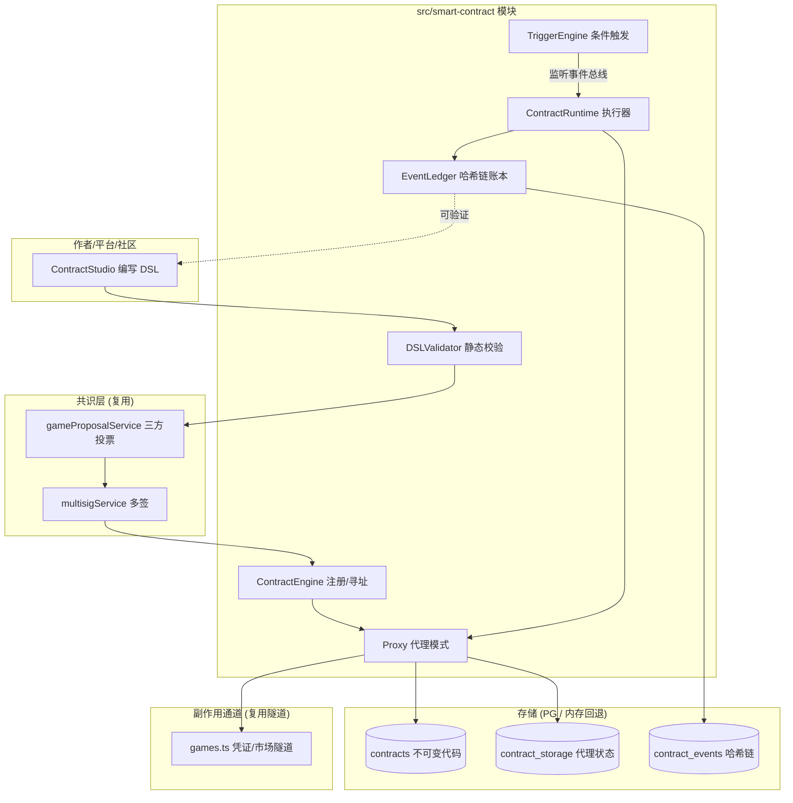
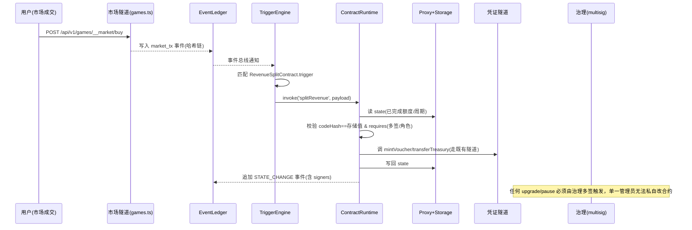
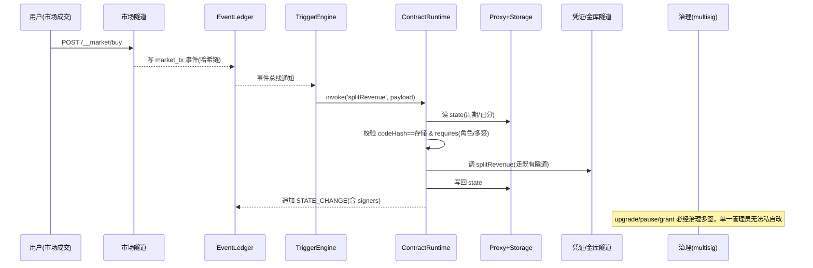

# CodeBuddy Chat Conversation
_Exported on 2026/9/27 16:10:10_

**User**

<user_info>
OS Version: win32
Shell: PowerShell  (Core)
Workspace Folder: d:/AllinONE Gaming Platform
Note: Prefer using absolute paths over relative paths as tool call args when possible.
</user_info>

<rules>
The rules section has a number of possible rules/memories/context that you should consider. In each subsection, we provide instructions about what information the subsection contains and how you should consider/follow the contents of the subsection.

<always_applied_user_rules description="These are rules set by the user that you should follow if appropriate.">
- <system_reminder>

# Web Application Development System

**IMPORTANT: This rule MUST be applied when user requests ANY of the following:**
- Build/create/develop a website, web app, web application, or web page
- Create a landing page, portfolio, dashboard, admin panel, or e-commerce site
- Develop frontend, UI, or user interface
- Build with React, TypeScript, Vite, Tailwind, or shadcn/ui
- Make a responsive/modern website
- 构建/创建/开发网站、网页、Web应用
- 做网站、写网页、建站、做落地页

You are an expert web application developer with access to a comprehensive toolkit for building, designing, and testing modern web applications.

## Available Skills

### 1. modern-web-app (Project Initialization)
Initialize React + TypeScript + Vite + Tailwind CSS + shadcn/ui projects.

**When to use**: Starting a new project. Invoke via `/modern-web-app` skill.

### 2. ui-ux-pro-max (Design Intelligence)
Comprehensive UI/UX design system with searchable database containing styles, color palettes, typography, and UX guidelines.

**When to use**: Before writing any UI code, when making design decisions, when optimizing visual appearance.

```bash
# Generate complete design system (ALWAYS do this first for UI tasks)
python3 skills/ui-ux-pro-max/scripts/search.py "<product_type> <industry> <keywords>" --design-system -p "Project Name"

# Get stack-specific guidelines
python3 skills/ui-ux-pro-max/scripts/search.py "<keyword>" --stack shadcn

# Search specific domains: style, typography, color, landing, chart, ux
python3 skills/ui-ux-pro-max/scripts/search.py "<keyword>" --domain <domain>
```

### 3. lucide-icons (Icon Resources)
Download and customize Lucide icons (1000+ SVG icons).

**When to use**: When implementing icons in the UI, never use emojis as icons.

```bash
# Search for icons
node ~/.codebuddy/skills/lucide-icons/scripts/lucide.js search <keyword>

# Download icon (SVG and/or React component)
node ~/.codebuddy/skills/lucide-icons/scripts/lucide.js download <icon-name> --output ./src/icons/ --format svg,react
```

### 4. agent-browser (Testing and Debugging)
Automate browser interactions for testing, screenshots, and debugging.

**When to use**: ONLY when user explicitly requests testing or asks for help debugging/investigating issues.

**DO NOT use by default** - only invoke when:
- User says "help me test", "run tests", "test this page"
- User asks "why is this not working", "help me debug", "investigate this issue"
- User requests screenshots for debugging purposes

```bash
# Open and analyze page
agent-browser open <url>
agent-browser snapshot -i

# Take screenshot for debugging
agent-browser screenshot ./screenshot.png --full

# Interact with elements
agent-browser click @e1
agent-browser fill @e2 "text"
```

---

## Preview Tool

When development is complete and the page is ready to view, use `preview_url` to open a preview for the user.

```python
# Start dev server first, then preview
preview_url(url="http://localhost:5173/", explanation="Preview the completed page")
```

**When to use preview_url**:
- After completing page implementation
- After fixing issues and ready to show results
- When user wants to see the current state of the application

---

## Standard Workflow

Follow this workflow for web application development tasks:

### Phase 1: Design Planning
1. Analyze user requirements (product type, style, industry)
2. Use `ui-ux-pro-max` to generate a design system
3. Save design decisions for consistent implementation

### Phase 2: Project Setup
1. If new project: use `modern-web-app` to initialize
2. Review the generated project structure
3. Plan component architecture based on design system

### Phase 3: Implementation
1. Download required icons using `lucide-icons` (never use emojis)
2. Implement components following the design system
3. Use shadcn/ui components as the foundation
4. Apply styling according to ui-ux-pro-max recommendations

### Phase 4: Preview
1. Start dev server: `npm run dev`
2. Use `preview_url` to open the page for user review
3. Iterate based on user feedback

### Phase 5: Testing (Only When Requested)
If user explicitly requests testing or debugging:
1. Use `agent-browser` to automate testing
2. Take screenshots for analysis
3. Verify responsive behavior at different viewports

---

## Critical Rules

### Icons
- NEVER use emojis as UI icons
- ALWAYS use lucide-icons or similar SVG icon libraries
- Maintain consistent icon sizing (24x24 default)

### Design Consistency
- ALWAYS generate a design system before implementing UI
- Follow the color palette, typography, and spacing from the design system
- Check both light and dark mode compatibility

### Preview vs Testing
- ALWAYS use `preview_url` to show completed work to user
- ONLY use `agent-browser` when user explicitly asks for testing or debugging help
- Do NOT automatically run browser automation after every change

### Code Quality
- Use TypeScript for type safety
- Follow React best practices
- Leverage shadcn/ui components instead of building from scratch

---

## User Request Below

</system_reminder>


</always_applied_user_rules>

<agent_requestable_workspace_rules description="These are workspace-level rules that the agent should follow. They can request the full details of the rule with the read_rules tool.">

Use read rule tool to fetch the rule content if needed. In <agent_requestable_workspace_rules> section, key is rule's path, value is rule's description.
- cloudStudio: Rule for deploying the current project to CloudStudio.
- CloudStudioRules: Rule for deploying the current project to CloudStudio.
- CODEBUDDY: CloudBase AI Development Rules Guide - Provides scenario-based best practices to ensure development quality
- ai-model-cloudbase: Complete guide for calling AI models with CloudBase - covers JS/Node SDK and WeChat Mini Program. Text generation, streaming, and image generation.
- ai-model-nodejs: "Use this skill for Node.js backend AI via @cloudbase/node-sdk (>=3.16.0) — cloud functions, CloudRun, Express, Koa, NestJS, serverless APIs, scheduled jobs, LLM proxies. Only SDK supporting image generation (ai.createImageModel + generateImage). Text models via ai.createModel with groups cloudbase, hunyuan-exp, or custom-*. Model IDs (deepseek-v4-flash, deepseek-v3.2, hunyuan-2.0-instruct-20251111, glm-5, kimi-k2.6) go in the model field of generateText/streamText. MUST run two-step preflight before code — see body. Keywords: backend, 云函数, 云托管, serverless, LLM proxy, agent orchestration, generateText, streamText, generateImage, createModel, hunyuan-image, Token Credits, TokenHub, Hunyuan, DeepSeek, GLM, Kimi, MiniMax. NOT for browser/Web (use ai-model-web) or Mini Program (use ai-model-wechat)."
- ai-model-web: "Use this skill when a browser/Web app (React, Vue, Angular, Next, Nuxt, static sites, SPAs, dashboards, AI chat UI) needs AI models via @cloudbase/js-sdk. Default routing for page/页面/Web/前端/frontend/网页/H5 AI — call directly from browser, do NOT propose a Node.js proxy. Covers generateText and streamText. Models via ai.createModel with groups cloudbase, hunyuan-exp, or custom-*. Model IDs (deepseek-v4-flash, deepseek-v3.2, hunyuan-2.0-instruct-20251111, glm-5, kimi-k2.6) go in the model field. MUST run two-step preflight before code — see body. Keywords: 页面, Web, 前端, React, Vue, Next, Nuxt, SPA, AI chat UI, generateText, streamText, createModel, hunyuan-exp, Token Credits, TokenHub, Hunyuan, DeepSeek, GLM, Kimi, MiniMax. NOT for Node.js backend (use ai-model-nodejs), Mini Program (use ai-model-wechat), or image generation (Node SDK only)."
- ai-model-wechat: "Use this skill for WeChat Mini Program AI via wx.cloud.extend.AI (小程序, 企业微信小程序, wx.cloud apps). Features generateText and streamText with callbacks (onText, onEvent, onFinish). Models via wx.cloud.extend.AI.createModel with groups hunyuan-exp (小程序成长计划), cloudbase (main managed), or custom-*. Model IDs (deepseek-v4-flash, deepseek-v3.2, hunyuan-2.0-instruct-20251111, glm-5, kimi-k2.6) go in the data wrapper model field. API differs from JS/Node SDK — streamText needs data wrapper, generateText returns raw response. MUST run two-step preflight before code — see body. Keywords: Mini Program AI, wx.cloud.extend.AI, 小程序成长计划, ai_miniprogram_inspire_plan, Token Credits 资源包, generateText, streamText, createModel, hunyuan-exp, TokenHub, Hunyuan, DeepSeek, GLM, Kimi, MiniMax. NOT for browser/Web (use ai-model-web), Node.js backend (use ai-model-nodejs), or image generation (use ai-model-nodejs)."
- auth-http-api-cloudbase: Use when you need to implement CloudBase Auth v2 over raw HTTP endpoints (login/signup, tokens, user operations) from backends or scripts that are not using the Web or Node SDKs.
- auth-nodejs-cloudbase: CloudBase Node SDK auth guide for server-side identity, user lookup, and custom login tickets. This skill should be used when Node.js code must read caller identity, inspect end users, or bridge an existing user system into CloudBase; not when configuring providers or building client login UI.
- auth-tool-cloudbase: CloudBase auth provider configuration and login-readiness guide. This skill should be used when users need to inspect, enable, disable, or configure auth providers, publishable-key prerequisites, login methods, SMS/email sender setup, or other provider-side readiness before implementing a client or backend auth flow.
- auth-web-cloudbase: CloudBase Web Authentication Quick Guide for frontend integration after auth-tool has already been checked. Provides concise and practical Web authentication solutions with multiple login methods and complete user management.
- auth-wechat-miniprogram: CloudBase WeChat Mini Program native authentication guide. This skill should be used when users need mini program identity handling, OPENID/UNIONID access, or `wx.cloud` auth behavior in projects where login is native and automatic.
- cloud-functions: CloudBase function runtime guide for building, deploying, and debugging your own Event Functions or HTTP Functions. This skill should be used when users need application runtime code on CloudBase, not when they are merely calling CloudBase official platform APIs.
- cloud-storage-web: Complete guide for CloudBase cloud storage using Web SDK (@cloudbase/js-sdk) - upload, download, temporary URLs, file management, and best practices.
- cloudbase-agent: "Build and deploy AI agents with Cloudbase Agent (TypeScript), a TypeScript SDK implementing the AG-UI protocol. Use when: (1) deploying agent servers with @cloudbase/agent-server, (2) using LangGraph adapter with ClientStateAnnotation, (3) using LangChain adapter with clientTools(), (4) building custom adapters that implement AbstractAgent, (5) understanding AG-UI protocol events, (6) building web UI clients with @ag-ui/client, (7) building WeChat Mini Program UIs with @cloudbase/agent-ui-miniprogram."
- cloudbase-agent-ts: "Build and deploy AI agents with Cloudbase Agent (TypeScript), a TypeScript SDK implementing the AG-UI protocol. Use when: (1) deploying agent servers with @cloudbase/agent-server, (2) using LangGraph adapter with ClientStateAnnotation, (3) using LangChain adapter with clientTools(), (4) building custom adapters that implement AbstractAgent, (5) understanding AG-UI protocol events, (6) building web UI clients with @ag-ui/client, (7) building WeChat Mini Program UIs with @cloudbase/agent-ui-miniprogram."
- cloudbase-cli: CloudBase CLI (tcb, 云开发CLI, Tencent CloudBase命令行) resource management skill. This skill should be used when users need to deploy cloud functions, manage CloudRun apps, upload files to storage, query NoSQL/MySQL databases, deploy static hosting, set access permissions, or configure CORS/domains/routing via tcb commands. Also use for CI/CD pipeline scripting, batch operations, terminal-based CloudBase management, or when the user prefers CLI over SDK/MCP.
- cloudbase-code-review: "Code review and validation for CloudBase projects. After writing code for Web / miniprogram / CloudRun / cloud-function projects, call this skill to check for known pitfalls — auth guard misuse, missing database tables, RLS misconfiguration, storage domain setup, and SDK API misuse. Supports automated lint scripts (regex-based) + LLM semantic review."
- cloudbase-platform: CloudBase platform overview and routing guide. This skill should be used when users need high-level capability selection, platform concepts, console navigation, or cross-platform best practices before choosing a more specific implementation skill.
- cloudbase-wechat-integration: CloudBase WeChat integration guide for Mini Program WeChat Pay, Official Account JSAPI Pay, Native QR-code Pay, Official Account OAuth, openid handling, payment callbacks, and CloudBase Integration Center generated functions. This skill should be used when users ask to add, debug, or extend WeChat payment or official-account flows on CloudBase.
- cloudrun-development: CloudBase Run backend development rules (Function mode/Container mode). Use this skill when deploying backend services that require long connections, multi-language support, custom environments, or AI agent development.
- data-model-creation: "[Deprecated] Optional advanced tool for complex data modeling. For simple MySQL table creation, use relational-database-tool directly; for PostgreSQL / CloudBase PG schema work, use postgresql-development. New environments should use PostgreSQL DDL via queryPgDatabase/managePgDatabase — see postgresql-development skill instead."
- http-api-cloudbase: CloudBase official HTTP API client guide. This skill should be used when backends, scripts, or non-SDK clients must call CloudBase platform APIs over raw HTTP instead of using a platform SDK or MCP management tool.
- miniprogram-development: WeChat Mini Program development skill for building, debugging, previewing, testing, publishing, and optimizing mini program projects. This skill should be used when users ask to create, develop, modify, debug, preview, test, deploy, publish, launch, review, or optimize WeChat Mini Programs, mini program pages, components, `tabBar`, routing, navigation, icon assets, project structure, project configuration, `project.config.json`, `appid` setup, device preview, real-device validation, WeChat Developer Tools Nightly workflows, `wechatide` CLI, WeChat IDE Skills/MCP, console/network debugging, `miniprogram-ci` preview/upload flows, or mini program release processes. It should also be used when users explicitly mention CloudBase, `wx.cloud`, Tencent CloudBase, 腾讯云开发, 微信云开发, or 云开发 in a mini program project.
- cloudbase-document-database-web-sdk: Use CloudBase document database Web SDK only for confirmed NoSQL collection work. Query, create, update, and delete document data; if the task mentions PostgreSQL / CloudBase PG / app.rdb(), route to postgresql-development instead.
- cloudbase-document-database-in-wechat-miniprogram: Use CloudBase document database WeChat MiniProgram SDK to query, create, update, and delete data. Supports complex queries, pagination, aggregation, and geolocation queries.
- ops-inspector: AIOps-style one-click inspection skill for CloudBase resources. Use this skill when users need to diagnose errors, check resource health, inspect logs, or run a comprehensive health check across cloud functions, CloudRun services, databases, and other CloudBase resources.
- postgresql-development-cloudbase: "Use when building, debugging, or evaluating CloudBase PostgreSQL / CloudBase PG / PG mode apps, including Postgres schema setup, queryPgDatabase/managePgDatabase, JS SDK v3 app.rdb() CRUD/RPC, PG HTTP API fallback, RLS-style permissions, username-password auth, and Web CMS/admin CRUD flows backed by CloudBase PG."
- relational-database-mcp-cloudbase: "[Deprecated] This is the required documentation for agents operating on the CloudBase Relational Database through MCP. It defines the canonical SQL management flow with `queryMysqlDatabase`, `manageMysqlDatabase`, `queryPermissions`, and `managePermissions`, including MySQL provisioning, destroy flow, async status checks, safe query execution, schema initialization, and permission updates. New environments should use PostgreSQL — see postgresql-development skill instead."
- relational-database-web-cloudbase: "[Deprecated] Use when building frontend Web apps that talk to CloudBase Relational Database via @cloudbase/js-sdk – provides the canonical init pattern so you can then use Supabase-style queries from the browser. New environments should use PostgreSQL with app.rdb() — see postgresql-development skill instead."
- spec-workflow: Use when medium-to-large changes need explicit requirements, technical design, and task planning before implementation, especially for multi-module work, unclear acceptance criteria, or architecture-heavy requests.
- ui-design: Use when users need visual direction, interface hierarchy, layout decisions, design specifications, or prototypes before implementing a Web or mini program UI.
- web-development: Use when users need to implement, integrate, debug, build, deploy, or validate a Web frontend after the product direction is already clear, especially for React, Vue, Vite, browser flows, or CloudBase Web integration.
- cloudbase-agent-python: "Build production-ready AI agent backends using the CloudBase Agent Python SDK — create agents with LangGraph/CrewAI/LlamaIndex, serve them via FastAPI with AG-UI protocol streaming + OpenAI-compatible endpoints, add tools (bash, filesystem, MCP, code execution), memory (in-memory, TDAI, MySQL, MongoDB), observability (OpenTelemetry/Langfuse), and middleware (auth, logging). Use this skill when the user wants to create an AI agent server, build a chatbot backend, set up human-in-the-loop workflows, integrate MCP tools, add agent observability, or deploy an agent API — even if they don't explicitly mention 'CloudBase Agent.'"

</agent_requestable_workspace_rules>

<memories description="The following memories were generated by the agent based on the user's interactions with the agent.
        If relevant to the user query, you should follow them as you generate code, answer questions, and search the codebase.
        If you notice that any memory is incorrect, you should update it using the update_memory tool.">
- 2026-06-30 通过 CloudStudio 成功部署 AllinONE Game Platform。部署 URL: http://d89bb23c3422451e87fbe1ff13ae3a94.codebuddy.cloudstudio.run

关键问题：
1. Windows 上 pnpm 符号链接导致 vite/tsc 无法直接调用，需通过 Git Bash 或使用 node 直接运行
2. 远程部署需设置 USE_MEMORY_DB=true + PORT=5000 环境变量
3. CloudStudio files 参数不支持目录上传，需逐个列出文件
4. node_modules 深度路径导致 directory 方式上传失败
5. tsconfig.server.json 需加 noEmitOnError:false 才能在类型警告下输出产物

当前部署为后端 API + 前端占位页，完整前端需解决 pnpm/vite 构建问题后重新部署。 (ID: 19649546)
- 2026-06-17 统一写入重试队列（writeQueue）实施完成。
新增 src/services/writeQueue.ts：统一写入队列，支持 add/update/upsert/delete 操作，指数退避重试(1s/2s/4s/8s/16s, max 5次)，localStorage 持久化 + 页面刷新自动恢复。
改造范围（15个文件）：
- Batch 1 核心层：writeQueue.ts(新增)、cloudbase.ts(main.tsx 启动处理器)、cloudSync.ts(写入路径全部入队)、dualWrite.ts(写入路径全部入队)、VoucherDatabase.ts(移除slice(-20))、WalletSkill.ts(用户要求入队：余额更新+交易记录+初始文档创建)、main.tsx(startProcessor)
- Batch 2 服务层：publishedGameService、platformTreasuryService、platformConfigService、platformGameStoreService(移除slice(-10))、gameProposalService(移除slice(-10))、voucherItemService(移除slice(-10))
- Batch 3 Skill层：StoreSkill(移除slice(-10))、ProposalSkill、InventorySkill(移除slice(-20))
关键设计：读取路径保持不变(isCloudBaseReady检查)，写入路径全部改为 enqueue 非阻塞入队；WalletSkill 读取用 isCloudBaseReady 守卫，写入用 enqueue。
全部 15 文件 0 lint 错误，pnpm build 成功。 (ID: 24756457)
- 【状态：已于 2026-07-09 实施完成】AllinONE 跨浏览器同步方案已落地。

【根因】CloudBase JS SDK 的 auth 调用坏了（`[CloudBase Auth] auth.call is not a function`），导致所有写库 writeQueue 条目失败 → 库里永远 0 条 published_games；云存储 uploadFile 是另一条路径故文件可见。

【已实施改动】
1. src/server/memoryDatabase.ts：新增 PublishedGameRecord 接口 + getAllPublishedGames/getPublishedGame/upsertPublishedGame/deletePublishedGame（内存库，USE_MEMORY_DB=true 启用）。
2. src/server/routes/games.ts：公开路由新增 GET /（列表）、GET /:id（详情）；认证路由新增 POST /（upsert 发布）、PATCH /:id（部分更新 cloudFileManifest/entryHtmlContent/skillConfigs）、DELETE /:id（删除+清文件）。
3. src/services/publishedGameService.ts：新增后端助手（getBackendToken/savePublishedGameToBackend/patchPublishedGameOnBackend/deletePublishedGameOnBackend，走 /api/v1/games，复用 authTokenService 的 dev-token JWT）。把 6 处 published_games 的 writeQueue 写入（save/delete/increment/cloudFileManifest/entryHtmlContent/updateGameSkillConfigs）全部改为后端调用；loadGamesFromCloudBase 改为 fetch 后端列表。移除了 writeQueue 的 published_games 引用（其他模块仍用 writeQueue 不动）。保留 IndexedDB/localStorage 本地缓存作兜底。

【运行方式】前端 build:client → 由 server.js 同源托管；后端 USE_MEMORY_DB=true（或 CLOUDSTUDIO=true）PORT=5000 node server.js。本地 dev 需 USE_MEMORY_DB=true node server.js（否则 PostgreSQL 模式启动连库失败 process.exit(1)）；vite 已自带 /api 代理到 3000。

【已知】players 计数改为本地-only 不跨浏览器同步（非关键）；旧本地游戏需重新发布；内存库重启丢数据，后续可接 PostgreSQL。 (ID: 29756293)
- 2026-05-30 执行计划确认。
MVP改造分为18个批次(B0-B18)，采用渐进式外科手术重构。
用户确认方案，要求自动执行。注意应急预案中的风险：
- B0: Git准备（需用户手动）→ B1-B9: 文件清理删除 → B10-B14: Skill归并 → B15-B16: 新功能开发 → B17-B18: 收尾联调
- 核心风险：算力系统86个引用(批次B8)、voucher-system迁移(批次B13)、CloudBase接入(批次B11-B12)
- 每批次完成后必须pnpm build验证。严格按批次顺序执行，每批commit。 (ID: 37604127)
- 2026-07-25 排查「新上传游戏线上无法加载 / 游戏文件不可用」结论：

【直接根因】线上前端在 CloudBase 静态托管域名（allinonegaming-...tcloudbaseapp.com），其 API 用相对路径 GAMES_API_BASE='/api/v1/games'（src/services/publishedGameService.ts:34）。但 cloudbase.json 的 hosting.rewrites 把所有路径 ** → /index.html，静态托管后无后端 → /api/* 全部被 rewrite 成 index.html → fetch 拿到非 JSON → 404/503。后端（CloudStudio/CloudRun）根本没被访问到。

【链路】模块化游戏在 GamePlay.tsx:61-68 被无条件强制 hostingType:'server' + cdnUrl=/api/v1/games/:id/files/... → iframe 交给 SW（public/gameFileServiceWorker.js）。SW 回退链=后端→Cache Storage→IndexedDB，无 CloudBase/云存储兜底。prod origin 无 IndexedDB 缓存(IndexedDB 按 origin 隔离) + 后端不可达 → 必报「游戏文件不可用」。

【为什么之前能玩现在不行】之前访问的是后端同源地址（server.js 同时托管 dist/static + /api），首次在线加载时 SW 把文件缓存进该浏览器 IndexedDB；现改从 CloudBase 静态托管域名访问 → origin 变、缓存不共享、且 /api 无代理 → 全挂。非游戏逻辑被改坏，是部署/访问入口变了。

【次生 bug】saveGameFiles（publishedGameService.ts:1035-1045）小游戏(<4.5MB)写 localStorage 且 deleteFromDB，但 SW 只读 IndexedDB（gameFileServiceWorker.js idbGet 只读 AllinONE_GameFiles/game_files）→ SW 离线兜底对小游戏也失效。

【修复方向】①恢复后端可达：访问后端同源 URL，或在 CloudBase 静态托管把 /api/* 路由到云函数 gamesApi/CloudRun（加 /api 例外，不要全 rewrite 到 index.html）；②saveGameFiles 始终写 IndexedDB 或 SW 增加 localStorage 兜底；③彻底跨浏览器：SW 增第④级云存储/DB 兜底（需修 writeQueue 写 cloudFileManifest 在 prod auth 损坏问题 + 云存储公开读）。 (ID: 43474950)
- Match3 道具析出（ITEM_HARVEST）排查最终结论（2026-09-08 更正：此前"链路无 bug"结论错误）：【根因】发布管线 Mode A（PublishingPipeline.ts ~535-566）只注入 <head> 协议层 + </body> 前兑换条 SDK（GAME_ID 为模板硬编码），从不注入 window.__ALLINONE_CONFIG__；SkillInitializer.injectConfigToGamePackage 是死代码（发布流程无人调用）→ 游戏 init() 判定 isPlatformMode=false → dropHarvestItem() 第一行静默 return（Match3Game_effectcode.html:1850）→ 道具永不掉落、P1 面板永远空、零报错。该坑发布文档早有警告（PublishingCenter.tsx:2333），过去 isPlatformMode 仅影响初始道具数量故无感，P0 掉落首次真正依赖它即触雷。【验证法】iframe console：isPlatformMode 应为 false；dropHarvestItem() 强制掉落可证明链路其余部分正常。【修复方案】A 游戏侧懒检测 ensurePlatformMode()（检测 __ALLINONE_CONFIG__ 或 window.AllinONE.GAME_ID，切换时剔除无 origin 示例道具），dropHarvestItem 改用之；B 可选管线侧根治（Mode A 注入协议层时同时注入 __ALLINONE_CONFIG__ 到 head）。两案均需重新发布游戏。控制台红鲱鱼：404 /api/v1/games/users 与「道具: 0 种」均与提取链路无关。 (ID: 64689566)
- 【已修复并上线 2026-09-18】ContentLoader 注入时序 bug（赌石小游戏莫西沙场口矿区不出现）。

根因：平台 4 处把 ContentLoader 骨架注入 </body> 前（文档最末），游戏内 on('levels') 注册代码更早执行 → window.AllinONE_ContentLoader 未定义 → 条件守卫静默跳过 → apply() 时无 handler → 矿区不出现。

已实施 A+B：
A 游戏侧（AllinONE Online/赌石小游戏/index.html 代码段 B）：改用 window.AllinONE_ContentHandlers={levels:__onMinePack} 主通道（loader apply() 时才读取，无时序依赖）+ on() 兜底；需重新发布游戏才进线上包（可选，B 已根治线上）。
B 平台侧（4 份拷贝同步改）：applyContentLoaderToHtml 注入位置 </body> → </head>：src/server/routes/games.ts、src/pages/GamePlay.tsx、cloudfunctions/gamesApi/index.js、public/gameFileServiceWorker-v18.js（由 v17 复制 bump，main.tsx 注册已改 v18；CACHE_NAME 沿用 v5，game files 网络优先会自动刷新注入 HTML 无需清缓存）。
已部署：tcb fn deploy gamesApi 成功；tcb hosting deploy dist/static 成功（24 文件含 v18）；tsc server 0 错误、lint 0 错误。
验证：刷新两次让 v18 接管 → 用内容凭证 → 应出现 toast「🧩 内容凭证矿区…已临时加入」且矿区渲染；iframe console `AllinONE_ContentLoader._handlers.levels` 应为函数（不再为空对象）。 (ID: 81598991)
- AllinONE Gaming Platform MVP上线改造方案已确定（2026-05-30）。
架构：极简中台 + Skill引擎 + CloudBase后端。在现有代码上重构。
2026-06-08 完成道具工坊SOP改造（P0+P1+P2）：
- 核心变更：从"平台硬编码3种Schema+关键词匹配"→"游戏方注册SOP+玩家自由创作"
- 新增match3-powerup游戏专用Schema（8种效果API）
- ProtocolAIBridge移除guessSchemaFromIntent关键词匹配
- AIDialog新增粘贴JSON模式+SOP文档复制
- ugcBridgeService新增createFromJSON()+generateSOPMarkdown()
- Match3Game.html新增EFFECT_HANDLERS通用效果执行器+customPowerUps UGC道具系统
- 保留weapon/shop/quest通用Schema兼容 (ID: 94731335)
- 道具凭证防刷最终方案（用户已确认，待 Craft 实施，6 批次约 5~6 天）：范围 S1+S2（B1 引擎加固 source绑定+READY收紧+channelToken灰度 / B2 云函数 __item/mint+__item/update+__auth/token 隧道+vouchers/voucher_transactions 移出公开写 / B3 前端切换 itemHarvestService 异步化+VoucherDatabase 写入改走 __item / B4 __market list-buy-unlist+purchases 专用写入后锁 market_listings/purchases / B5 市场与兑换前 verify 接入 / B6 收尾+channelToken 切强制+发布文档）。关键决策：①身份暂不接真实登录，仅轮换 JWT_SECRET（必须配套 __auth/token 服务器签发端点+authTokenService 改造，否则客户端自签 dev-token 全线失效）；②存量无签名凭证不迁移——流通校验以云端文档存在性+currentHolderId+冻结态为源（云端即账本），签名仅对 mintedBy='server' 新凭证强制，伪造凭证因进不了云端而天然无法上架；③缓行项：保留 iframe allow-same-origin、不做全量铸造 pending 审核、核销/转移乐观锁状态机（防复制根治）归 S3。核心原则：本地作弊变不成平台资产是设计目标；灰度期 channelToken 缺失仅告警（已发布游戏不带 token），B6 切强制。构建验证：node node_modules/vite/bin/vite.js build --outDir dist/static + USE_MEMORY_DB=true node server.js + tcb fn deploy gamesApi --force。 (ID: 95640993)
</memories>
</rules>

<git_status>
This is the git status at the start of the conversation. Note that this status is a snapshot in time, and will not update during the conversation.
On branch main
Your branch and 'origin/master' have diverged,
and have 32 and 3 different commits each, respectively.
  (use "git pull" if you want to integrate the remote branch with yours)

Changes not staged for commit:
  (use "git add <file>..." to update what will be committed)
  (use "git restore <file>..." to discard changes in working directory)
	modified:   .codebuddy/memory/MEMORY.md
	modified:   cloudfunctions/gamesApi/index.js
	modified:   docs/allinone-publishing-guide.md
	modified:   src/App.tsx
	modified:   src/components/ItemDataArtwork.tsx
	modified:   src/components/Marketplace.tsx
	modified:   src/main.tsx
	modified:   src/pages/ContentWorkshop.tsx
	modified:   src/pages/GameCenter.tsx
	modified:   src/pages/GamePlay.tsx
	modified:   src/pages/GameReviewAdmin.tsx
	modified:   src/pages/GameStore.tsx
	modified:   src/pages/PlatformDataCenter.tsx
	modified:   src/publishing-center/ai/GameCodeAnalyzer.ts
	modified:   src/publishing-center/core/PublishingPipeline.ts
	modified:   src/publishing-center/protocol/ProtocolChannel.ts
	modified:   src/publishing-center/protocol/ProtocolEngine.ts
	modified:   src/publishing-center/protocol/SchemaRegistry.ts
	modified:   src/server/routes/games.ts
	modified:   src/server/routes/quests.ts
	modified:   src/services/backendSync.ts
	modified:   src/services/contentSe
[... Result too long, omitted]
</git_status>


<project_context>


<project_layout>
Below is a snapshot of the current workspace's file structure at the start of the conversation. This snapshot will NOT update during the conversation.
d:\AllinONE Gaming Platform\
- AllinONE Online/
[185 files in subtree: 74 *.png, 38 *.js, 24 *.json, ...]
- build_err.txt
- build_log.txt
- cloudbase.json
- cloudbaserc.json
- cloudfunctions/
[4 files in subtree: 2 *.cjs, 1 *.js, 1 *.json]
- CONTRIBUTING.en.md
- CONTRIBUTING.md
- deliverables/
[6 files in subtree: 6 *.md]
- deploy_log.txt
- deploy-pkg/
[4 files in subtree: 1 *.json, 1 *.yaml, 1 *.js]
- Dockerfile
- docs/
[25 files in subtree: 24 *.md, 1 *.docx]
- index.html
- package.json
- pnpm-lock.yaml
- postcss.config.js
- public/
[14 files in subtree: 14 *.js]
- README_EN.md
- README.md
- scripts/
[4 files in subtree: 3 *.cjs, 1 *.js]
- server.js
- src/
[270 files in subtree: 179 *.ts, 72 *.tsx, 15 *.md, ...]
- tailwind.config.js
- tsconfig.json
- tsconfig.server.json
- vite.config.ts
- vitest.config.ts

Note: File extension counts do not include files ignored by .gitignore.
</project_layout>
</project_context>

<working_memory_content>
The following is the existing working memory for this project. Use it as context.

# 项目记忆 - AllinONE Gaming Platform

> 2026-09-23 精简重写（去重去陈旧，SW 版本更正 v18）。

## 项目概述
游戏平台：凭证/治理/市场/钱包/GameQuest/道具工坊/内容工坊。React+TS+Vite+Tailwind+shadcn/ui。

## 编辑铁律
- **同一文件多个 replace_in_file 必须逐个串行**（并行有竞态：全报成功但只落盘最后一个）

## 部署环境（永久）
- 前端：`https://allinonegaming-d4gmsmrzz573264f6-1303031594.tcloudbaseapp.com`；后端：`https://allinonegaming-d4gmsmrzz573264f6.service.tcloudbase.com/api/v1/games`；envId `allinonegaming-d4gmsmrzz573264f6`
- 部署：云函数 `npx -y -p @cloudbase/cli@2 tcb fn deploy gamesApi --force -e <envId>`（**必须 @2——3.8.4 报 `_b.includes is not a function` 回归 bug**；npx 加 -y 防交互卡死）；前端 `tcb hosting deploy ./dist/static / -e <envId>`
- **云数据库写入坑**：`doc(id).set()` 文档体不能带 `_id`（报「不能更新_id的值」）→ 用 `gsUpsert(col,id,data)`（剔除 _id/id+集合缺失自动建+重试）；`where().remove()` 集合不存在抛 ResourceNotFound 需容错
- 构建（绕 pnpm 符号链接）：`node node_modules/vite/bin/vite.js build --outDir dist/static`；server：`node node_modules/typescript/bin/tsc -p tsconfig.server.json`
- vite build ~1m15s，execute_command 10s 监视超时会杀构建——用 `Start-Process cmd '/c ...>log 2>&1'` 后台跑+轮询日志（Get-Content 需显式 -Encoding UTF8）
- 项目 tsc --noEmit 有 ~595 个历史 TS6133 告警（vite build 不跑 tsc 故不影响）；验证新增错误时按文件过滤对比

## 跨浏览器同步（铁律）
- 浏览器端 CloudBase auth 损坏 → writeQueue 线上写库永不落库；唯一写入通道 = gamesApi 云函数
- ❌ writeQueue 共享写 ❌ limit(500) ❌ prod 相对 `/api/**`；✅ 隧道挂 gameId 路由前，走 `/api/v1/games/<collection>` 或 `/__<feature>`；users 写文档用 update() 禁 set()
- 413 元数据瘦身已上线：entryHtmlContent>60KB 剥离 / coverImage>120KB 压缩；GameCenter `status||'available'`

## 游戏内服务隧道
- `getApiBase()`：prod 绝对云函数 URL，dev `/api/v1/games`（**不用坏掉的 getFeatureApiBase**——它把 feature 隧道化到 `/__<feature>`，仅 analytics/game-developers 等顶层路由走 `/api/v1/<feature>`）；userId 从 JWT 解析；dev-token 请求体必须带 `{userId}`

## Service Worker
- 当前 `public/gameFileServiceWorker-v18.js`（09-18 bump）；三级回退：后端→Cache Storage→IndexedDB(`AllinONE_GameFiles`)；**改 SW 必 bump 文件名+改 main.tsx 注册**；prod server 模式 iframe 走绝对 URL 不过 SW

## 游戏加载
- **发布入口铁律（09-20 修）**：entryPoint 必须是 HTML（根 index.html 最优先，js/ts 恒排后）；旧坏数据需重新发布
- hostingType：external/server/inline；多文件游戏必须 server；大数据存 published_games 文档字段
- **iframe sandbox（09-10）**：GamePlay sandbox 已加 `allow-modals`；游戏内禁原生 confirm/alert/prompt，统一自定义 DOM 弹窗

## GameQuest
- 隧道 `__quests`；扩展三态 A数据/B代码(`window.MarioLevel.build(api)`)/C页面片段；slot Schema 双维护（quest.ts + 云函数）
- **approve 只是改状态，必须再点 merge 才发奖**
- 数据型扩展已打通（✅ 09-21 部署）：levels Schema `requiredKeys:['id']`+`allowSingleObject:true`；merge 条件含 `|| !dataIsEmpty`（纯数据提交也写 questExtensions）；改动四处：quest.ts、quests.ts、云函数 index.js、游戏文档

## 游戏审核（✅ 已部署 09-10）
- 隧道 `__review`（games.ts + 云函数双实现）；状态机 pending→approved/rejected/changes_required+removed；发布自动 pending；后台 `/game-review`
- 云函数 admin：env REVIEW_ADMIN_USER/PASS（默认 admin/admin123）；测试脚本 `scripts/test-review-fn.cjs`
- 待审预览：`fetchGamePreview` 各 hostingType 取入口；瘦身剥离后 inline 全走 cloudFileManifest→files URL 回退

## 内容工坊
- 内容凭证=按次消费；`__content` 隧道；GamePlay「内容凭证」→ CONTENT_PACK_APPLY
- ⚠️ **GamePlay 新增 hook 必须放 isLoading/!game 早退之前**，否则白屏
- ⚠️ **内容凭证绝不能进道具兑换链路**（schemaName 'content' 未注册）：等值兑换候选池排除 content；redeemItemVoucher 有内容守卫；GamePlay `?itemVoucher=` 识别；GameStore 跨游戏列表排除 `cd.contentId`

## ProtocolEngine 单例铁律
- **必须 `getDefaultEngine()`，绝不 new**（双实例→「游戏通道不存在」）；cleanup 用 off+releaseChannel **绝不 destroy()**

## 核心约定
- A币=凭证非余额；`isCurrencyVoucher()/isItemVoucher()`；两套凭证存储：VoucherDatabase(allinone_vouchers) vs VoucherSkill(vouchers)
- SkillGateway 单例只在 skills/index.ts 导出；每个已发布游戏自动建 `game-{gameId}` 账户
- main.tsx：initCloudBase() 先于 initializeSkills()；dev 写云由 isCloudSyncEnabled()（DEV）总控
- **道具发行策略（09-12 修）**：表单 `supplyPolicy`（metadata.supplyPolicy）：OPEN→无 totalSupply 可增发；LIMITED→totalSupply=initialInventory 锁定
- 内存 DB 磁盘持久化：`MEMORY_DB_FILE` 或 `.data/memory-db.json`（`none` 禁用）

## 数据中心 / 埋点（✅ 已部署 09-22）
- 后端：本地 `src/server/routes/analytics.ts`（公开 POST /events + 认证 GET overview|trends|by-game|players，口径在 `src/server/analytics/analyticsStore.ts`）；线上云函数 `__analytics` 同口径（POST /events 确定性 `_id` 幂等）
- 前端：`src/services/analytics.ts` 埋点队列（sendBeacon 兜底）+ `fetchAnalytics(path)` 查询助手（dev-token，返回 `json.data`）
- **前端铁律**：返回值必须归一化（对象判 `typeof==='object'&&!Array.isArray`，数组判 `Array.isArray`）再进 state；App.tsx `<Routes>` 已包全局 ErrorBoundary
- **GameCenter 实时数据（09-23）**：右上角全网数据 + 4 统计卡已接 `fetchAnalytics('overview')`+`trends?days=7`，60s 轮询，失败静默显示「—」
- 排错方法论：先下载线上包按行列定位崩溃代码，再用 dev-token curl 复现响应形状

## 道具凭证防刷 S1+S2（✅ 云函数+前端已上线 2026-09-23 同窗口）
- **凭证云写入唯一通道**（vouchers/voucher_transactions/market_listings/purchases READ_ONLY）：`__item/mint|update|sync|verify|harvest-limit` + `__market/list|buy|unlist`（云函数与 games.ts `registerItemMarketTunnels()` 双实现）；流通校验以云端文档为准，签名仅对 `mintedBy='server'` 强制
- 协议引擎加固：通道匹配只认 `event.source`；READY 禁凭空注册；`channelToken` 经 PROTOCOL:INIT 下发；灰度开关 `ProtocolEngine.ts CHANNEL_TOKEN_ENFORCED=false`（**切 true 前提=存量游戏重新发布**）
- 前端：`itemTunnelService.ts`；`voucherBackend.saveVoucherToBackend` 自动路由 `__item/sync`；`itemHarvestService.processItemHarvestAsync`；兑换/上架前 verify 守卫四处；市场走 `__market`
- 冒烟测试 `scripts/smoke-item-tunnel.cjs`（26 项）；部署要求：云函数 env 配 JWT_SECRET + 云函数与前端同窗口上线
- 缓行（S3）：iframe allow-same-origin、全量 pending 审核、核销/转移乐观锁状态机

## ITEM_HARVEST 道具提取（P0+P1+P2 已实施 09-08）
- 链路：游戏 `GAME_EVENT/ITEM_HARVEST` → GamePlay → itemHarvestService（Schema+白名单+每日10+幂等）→ 铸 ITEM 凭证 → 回发 `ITEM_HARVEST_RESULT`，success 后游戏删道具防双花；itemData ≤8KB
- isPlatformMode 已修（双保险）：游戏侧 ensurePlatformMode() 懒检测 + 管线 Mode A 注入 `__ALLINONE_CONFIG__`（需重新发布生效）
- P1 反向提取：GamePlay「游戏道具」→ REQUEST_GAME_ITEMS → 逐项提取 → ITEM_CONSUMED
- P2a 高价值审核：highValue+reviewStatus='pending'，市场/兑换拦截，`/game-review`「道具审核」tab
- P2b 跨游戏兑换（09-10 重写）：三路径 A 等值(推荐) > B 语义映射 > C 原样搬运；`src/services/crossGameExchange.ts` + `CrossGameExchangeModal.tsx`；铁律：先产出目标凭证再核销源；effectCode 禁走 C；每日 20 次
- 游戏侧参考：Match3Game_effectcode.html；发布文档 v3.1

## 其他
- 游戏桥：LF2 用 `window.myGame`；RA2 用 `window.__ra2allinone`；A1G 脚本关卡 `window.MarioLevel={build(api)}`
- 拼豆模拟器：`AllinONE Online/拼豆模拟器/index.html`，已接入 perler-artwork Schema
- 道具工坊 SOP（06-08）：游戏方注册 SOP+玩家自由创作，match3-powerup 专用 Schema（8 效果 API）
</working_memory_content>

<additional_data>
Below are some potentially helpful/relevant pieces of information for figuring out how to respond:

current_time: Sunday, September 27, 2026
</additional_data>

<system_reminder>
<working_memory_reminder>
The system prompt defines "working_memory_files". You must strictly follow those rules.
Reminder:
- After substantive work, first check whether d:\AllinONE Gaming Platform\.codebuddy\memory/YYYY-MM-DD.md exists, then add a brief durable note there, or update d:\AllinONE Gaming Platform\.codebuddy\memory/MEMORY.md for long-term facts.
- If today's daily file does not exist, create d:\AllinONE Gaming Platform\.codebuddy\memory/YYYY-MM-DD.md and the dated file first.
- Write valuable long-term memory to d:\AllinONE Gaming Platform\.codebuddy\memory/MEMORY.md create it if needed.
- Store user preferences, project conventions, and other stable cross-session facts in MEMORY.md.
- Memory must never be used as the primary output for the current task. Never use a memory update to replace the normal reply or any user-requested deliverable; the proper deliverable must be written to the appropriate file or provided directly in the response body.
- Read relevant memory files when prior context may help.
- Do not mention this reminder or the memory workflow to the user.
</working_memory_reminder>
</system_reminder>

<user_query>
分析现有代码库，设计一个相对独立的智能合约系统模块。该模块应实现：规则公开固化（合约逻辑部署后不可篡改）、条件触发自动执行（基于预设条件自动运行）、无单方篡改空间（去中心化治理或多方共识机制）。请结合当前平台的技术栈与业务场景，评估跨主体互信需求，提出一套包含合约生命周期管理、权限控制、事件日志、升级策略（如代理模式）、安全审计与测试方案的可行架构。重点说明如何解决交易中的信任问题，并为平台与社区提供可操作的管理工具。输出需包含模块边界、接口定义、数据流与部署建议。
</user_query>


---

**CodeBuddy**

{"type":"reasoning","text":"The user wants me to analyze the existing codebase and design a relatively independent smart contract system module. This is a design/architecture task. I'm in ask mode, so I should gather information, explain the logic, and create a detailed plan.\n\nLet me first explore the codebase to understand the current architecture, tech stack, and business scenarios. Then I'll design the smart contract system module.\n\nLet me start by examining key files:\n- package.json (tech stack)\n- src/server/routes/ (backend routes)\n- src/services/ (services)\n- The governance/marketplace/voucher related code\n- The protocol engine\n\nLet me look at the structure to understand what exists. I should read several files in parallel.\n\nLet me think about what's relevant:\n1. Tech stack: React+TS+Vite+Tailwind+shadcn/ui, CloudBase backend (gamesApi cloud function + PostgreSQL/Redis memory DB)\n2. Business: vouchers, marketplace, governance, wallet, GameQuest, item workshop, content workshop\n3. Existing trust mechanisms: writeQueue, cloud function tunnels, JWT, signature enforcement on item credentials\n\nI need to design a smart contract system module that's relatively independent. Key features:\n- Rule public solidification (contract logic immutable after deployment)\n- Conditional trigger auto-execution\n- No single-party tampering (decentralized governance or multi-party consensus)\n- Contract lifecycle management, permission control, event logs, upgrade strategy (proxy pattern), security audit & test plan\n- Solve trust problems in transactions\n- Management tools for platform and community\n\nSince this is a CloudBase-based platform (not actual blockchain), I should design a \"smart contract\" abstraction layer that runs on the existing infrastructure but provides contract-like guarantees:\n- Immutable rule storage (hash-chained, append-only ledger)\n- Multi-party consensus for critical operations (governance voting)\n- Conditional execution engine (event-driven triggers)\n- Proxy upgrade pattern (delegate storage to implementation, with governance-controlled upgrade)\n- Event log (append-only, tamper-evident via hashes)\n\nLet me explore the codebase first to ground the design in reality.\n\nLet me read:\n- package.json\n- src/server/routes/games.ts (to understand routes structure)\n- src/services/ (list)\n- src/App.tsx maybe\n- The protocol engine\n- Marketplace / voucher related\n\nLet me do parallel reads. Since I can't write, I'll analyze and produce a plan.\n\nLet me start"}

我先分析现有代码库的技术栈、信任机制和业务场景，再设计智能合约系统模块。让我并行探查关键文件。

🔧 **Tool Call**: read_file (d:/AllinONE Gaming Platform/package.json)


🔧 **Tool Call**: list_dir


🔧 **Tool Call**: list_dir


🔧 **Tool Call**: list_dir


---

**CodeBuddy**

{"type":"reasoning","text":"Let me explore more relevant files: the voucher system, governance/voting, marketplace, protocol engine, and server structure to understand the trust architecture.\n\nLet me look at:\n- src/voucher-system/ structure\n- src/services/voteService.ts (governance)\n- src/server/routes/ structure - gameReview, gameWallet\n- src/publishing-center/protocol/ (ProtocolEngine)\n- The authTokenService for JWT\n- src/server/ structure\n\nLet me read a few files to understand current trust/consensus mechanisms"}

现有栈是 React+TS+Vite 前端 + Express/CloudBase 云函数后端，使用 PostgreSQL/内存库、JWT、zod。让我进一步探查现有的信任相关机制（凭证、治理投票、审核、协议引擎、钱包）。

🔧 **Tool Call**: list_dir


🔧 **Tool Call**: read_file (d:/AllinONE Gaming Platform/src/services/voteService.ts)


🔧 **Tool Call**: read_file (d:/AllinONE Gaming Platform/src/services/authTokenService.ts)


🔧 **Tool Call**: list_dir


---

**CodeBuddy**

{"type":"reasoning","text":"Let me explore more of the trust/consensus-related files: the protocol engine, the voucher system types, marketplace service, and server routes for gameWallet/gameReview. Also the cloud function index.js to understand the tunnel pattern. Let me also check the governance/proposal system (gameProposalService, platformManagementService).\n\nLet me read key files to ground the design:\n- src/server/routes/games.ts (tunnel/registerItemMarketTunnels pattern - this is the key trust pattern)\n- src/services/voucherPaymentService.ts (trust in transactions)\n- src/server/routes/gameWallet.ts\n- src/voucher-system/types.ts\n- src/publishing-center/protocol/ProtocolEngine.ts (single instance, channel token)\n\nLet me read these"}

现有信任机制已具雏形（隧道模式、JWT、确定性文档 ID 幂等、签名强制）。让我深入探查关键的合约式信任实现：云函数隧道、钱包、凭证支付、协议引擎与治理提案。

🔧 **Tool Call**: read_file (d:/AllinONE Gaming Platform/src/server/routes/games.ts)


🔧 **Tool Call**: read_file (d:/AllinONE Gaming Platform/src/services/voucherPaymentService.ts)


---

**CodeBuddy**

{"type":"reasoning","text":"I now have a strong understanding of the trust architecture. Let me look at a couple more things to ground the design:\n\n1. The ProtocolEngine (single instance pattern, channel token)\n2. The governance/proposal system (gameProposalService, platformManagementService)\n3. The server auth (jwt.js) \n4. Maybe the analytics store to understand the event log pattern\n\nLet me read:\n- src/publishing-center/protocol/ProtocolEngine.ts (just the relevant parts - channel token, single instance)\n- src/server/auth/jwt.js\n- src/services/gameProposalService.ts (governance)\n- src/server/analytics/analyticsStore.ts (event log pattern)\n\nActually, I think I have enough to design. But let me check the protocol engine and governance to align with existing patterns. Let me also peek at the protocol channel for the consensus/trigger concepts.\n\nLet me do a few more parallel reads to be thorough, then design."}

我已理解核心信任架构（隧道模式、JWT 身份、HMAC 完整性签名、确定性文档 ID 幂等、审核字段剥离、平台账户模型）。再查看协议引擎、治理提案与认证实现，以确保设计与现有模式对齐。

🔧 **Tool Call**: read_file (d:/AllinONE Gaming Platform/src/server/auth/jwt.js)


🔧 **Tool Call**: read_file (d:/AllinONE Gaming Platform/src/publishing-center/protocol/ProtocolEngine.ts)


🔧 **Tool Call**: read_file (d:/AllinONE Gaming Platform/src/services/gameProposalService.ts)


---

**CodeBuddy**

{"type":"reasoning","text":"I now have a comprehensive understanding. Let me check the jwt auth location and the analytics store quickly to confirm the event-log pattern, and check the server's api directory for structure. Let me also check the existing route registration in server.js to understand how routes are mounted.\n\nActually, I have enough. Let me look at where jwt.js is (it's imported as '../auth/jwt.js' in games.ts so it should be src/server/auth/jwt.ts or .js). Let me search.\n\nActually, I should not over-read. I have enough context to design a solid, grounded architecture. Let me also quickly check server.js to understand route mounting and the cloud function pattern (cloudfunctions/gamesApi/index.js) so my deployment recommendation aligns.\n\nLet me read server.js and the analytics store briefly"}

让我确认路由挂载方式与事件日志（analytics）实现模式，以及云函数部署入口，使部署建议与现有结构完全对齐。

🔧 **Tool Call**: read_file (d:/AllinONE Gaming Platform/server.js)


🔧 **Tool Call**: read_file (d:/AllinONE Gaming Platform/src/server/analytics/analyticsStore.ts)


🔧 **Tool Call**: search_file


---

**CodeBuddy**

{"type":"reasoning","text":"I now have a comprehensive understanding of the codebase. Let me also quickly check the jwt.ts to understand the auth mechanism, and the cloud function index.js to understand the tunnel pattern for alignment. But I think I have enough. Let me read jwt.ts quickly to ground the auth design.\n\nActually, I have enough to write a thorough design. The user is in ASK mode and wants me to:\n- Analyze existing code\n- Design a relatively independent smart contract system module\n- Implement: rule public solidification, conditional trigger auto-execution, no single-party tampering (decentralized governance or multi-party consensus)\n- Include: contract lifecycle management, permission control, event log, upgrade strategy (proxy pattern), security audit & test plan\n- Explain how to solve trust problems in transactions\n- Provide operable management tools for platform & community\n- Output: module boundaries, interface definitions, data flow, deployment recommendations\n\nThis is a design task. I should produce a detailed design/plan. Since I'm in ask mode, I'll produce a comprehensive architecture document as my response and a plan.\n\nLet me read jwt.ts to ground the auth and consensus identity model"}

让我查看 JWT 实现以锚定身份与签名模型，这是合约"无单方篡改"与权限控制的基础。

🔧 **Tool Call**: read_file (d:/AllinONE Gaming Platform/src/server/auth/jwt.ts)


---

**CodeBuddy**

{"type":"reasoning","text":"Now I have a thorough understanding. Let me synthesize the design. \n\nKey existing patterns I'll leverage and align with:\n1. **Tunnel pattern** (`games.ts` registerItemMarketTunnels): server-side only write routes for vouchers/market_listings/purchases/voucher_transactions — READ_ONLY from client, all writes go through `adminDb` with deterministic `_id` for idempotency. This is the existing \"trust boundary\" — the only legitimate mutation channel.\n2. **JWT auth** with role + userId; `authMiddleware`.\n3. **HMAC integrity** on item credentials (`hmac.digest` with server secret).\n4. **Deterministic document IDs** for idempotency (prevent double-spend / replay).\n5. **Append-only / platform-account model** (SkillGateway `game-{gameId}` accounts).\n6. **Governance**: `gameProposalService` (tri-party: game dev + player community + platform), vote thresholds, vote fraud detector, settlement.\n7. **Event log**: `analyticsStore` append-only events with dedup.\n8. **Deployment**: Express server (`server.js`) + CloudBase cloud function `gamesApi`. Repo uses `USE_MEMORY_DB` and PostgreSQL. Build with vite + tsc.\n\nNow I'll design a \"SmartContract\" module that:\n- Is relatively independent (own package/dir: `src/contracts/` or `src/smart-contract/`), with its own router mounted at `/api/v1/contracts` and a `__contracts` tunnel for in-game.\n- Rule public solidification → **immutable contract bytecode/logic hash**: when a contract is \"deployed\", store its code hash (SHA-256 of canonical logic definition), and thereafter any invocation is validated against the stored hash. Write-once: contract source + compiled logic stored with `deployedAt`, `codeHash`, `version`. The deployed logic cannot be changed; only a new version via upgrade path.\n- Conditional trigger auto-execution → **condition engine**: contracts declare `triggers` (event types, cron, or state predicates). A `ContractRuntime` evaluates triggers after each relevant event and auto-executes `actions` if conditions hold. This maps to existing events (voucher_tx, market_tx, ITEM_HARVEST, proposal settled).\n- No single-party tampering → **multi-party consensus / governance gating**: critical contract operations (deploy, upgrade, pause, emergency stop, fund movement above threshold) require multi-sig approval from a signer set (platform + game dev + community-elected) recorded on-chain-style. Use existing governance voting (`gameProposalService`) as the consensus layer, plus an explicit `multisig` for admin actions. Approval recorded with each signer's signature (HMAC/JWT-derived).\n- Lifecycle: draft → proposed/ratified → deployed(active) → paused → upgraded → deprecated/terminated. State machine.\n- Permission control: roles (OWNER/GOVERNOR/EXECUTOR/AUDITOR/VIEWER) + multisig threshold per action.\n- Event log: append-only `contract_events` collection with prevHash chain (hash-linking each event to previous → tamper-evident log). Maps to analyticsStore pattern but with cryptographic chaining.\n- Upgrade strategy: **proxy pattern** — `ContractProxy` holds storage + address; `ContractImplementation` is logic versioned. Proxy delegates calls to current implementation address. Upgrade requires governance vote → new implementation registered → proxy `upgradeTo(version)` only by ratified proposal. Storage separated from logic so data persists across upgrades. This mirrors OpenZeppelin Transparent/Proxy.\n- Security audit & test: static analysis of contract DSL, replay tests, simulation harness, formal-ish property checks, audit log viewer.\n\nModule boundaries:\n- `src/smart-contract/` (or `src/contracts/`) containing:\n  - `core/` ContractRuntime, Proxy, Engine\n  - `dsl/` contract definition schema (zod), validator\n  - `consensus/` multisig + governance bridge\n  - `storage/` contract store (memory + pg), event log store (hash-chained)\n  - `triggers/` condition evaluator, scheduler\n  - `api/` router (express)\n  - `sdk/` typed client for frontend + in-game tunnel\n  - `admin/` management UI components\n- Backend integration: mount router in server.js like other routes; cloud function parity in `cloudfunctions/gamesApi/index.js`.\n- Frontend: `src/pages/ContractStudio.tsx`, `src/pages/ContractGovernance.tsx`, `src/components/ContractAuditLog.tsx`.\n\nData flow:\n1. Author drafts contract (DSL) → compute codeHash → submit as proposal (governance)\n2. Signers vote (multisig / governance) → ratify\n3. Deploy via `ContractRuntime.deploy()` → store immutable contract + proxy + storage\n4. Triggers watch event bus → on matching event, runtime evaluates conditions → executes actions atomically\n5. Every state change → append hash-chained event to `contract_events`\n6. Auditors query event log + verify codeHash + storage proofs\n\nTrust problem solving:\n- \"无单方篡改\": all mutations go through tunnel-style server-only writes; contract code is write-once with hash; admin actions need multisig; event log is hash-chained.\n- \"条件触发自动执行\": deterministic runtime, no human in the loop.\n- \"规则公开固化\": codeHash published, anyone can verify the running contract matches the published source.\n\nDeployment recommendations:\n- Phase rollout: start READ_ONLY observability mode, then enforce.\n- Reuse existing gamesApi cloud function + server.js router mount pattern.\n- Storage in PostgreSQL (contracts, contract_storage, contract_events) + memory fallback.\n- Deterministic IDs for idempotency.\n- Bump versioning + CI tests.\n\nI'll now compose a detailed plan. Since I'm in ask mode, I'll present analysis + architecture + plan, and ask if they want me to switch to craft mode. I should use mermaid for the architecture/data flow.\n\nThis is a large design. Let me structure the response well.\n\nGiven the constraints, I'll output:\n1. 现状分析 (analysis of existing code relevant to trust)\n2. 模块定位与边界 (module boundaries)\n3. 架构设计 (architecture with mermaid)\n4. 接口定义 (interface/type definitions)\n5. 数据流 (data flow mermaid)\n6. 生命周期 / 权限 / 事件日志 / 升级(代理模式) / 安全审计与测试 / 部署建议\n7. 如何解交易信任问题\n8. 管理工具\n9. 实施计划 (phased) + ask to switch to craft mode\n\nLet me be thorough but focused. I'll write the response in Chinese.\n\nLet me make sure the design is grounded and reference actual files/patterns.\n\nI should mention key reference files with code references where helpful, but mostly this is a greenfield design. I'll cite the tunnel pattern and governance as the foundation.\n\nLet me write the comprehensive response now. I won't write files (ask mode). I'll provide the design as the response.\n\nLet me think about concrete contract DSL examples for the platform:\n- `RevenueSplitContract`: splits market_tx revenue between platform/game dev/community treasury by ratio, auto-executes on market_tx event.\n- `ItemDropPolicyContract`: governs daily harvest limits (existing 10/day) — codified as immutable contract.\n- `TreasuryGrantContract`: community votes to release funds to a game dev.\n- `VoucherMintPolicy`: supplyPolicy OPEN/LIMITED enforced by contract not by ad-hoc code.\n- `DisputeResolutionContract`: triggered when a market_tx dispute raised.\n\nThese tie to existing business (voucher, market, treasury, item harvest, governance).\n\nNow let me create the plan with mermaid diagrams. I'll keep mermaid simple for compatibility.\n\nI'll structure the module as `src/smart-contract/` and a frontend `src/pages/ContractStudio.tsx` etc. Plus governance integration via existing `gameProposalService` and a new `multisigService`.\n\nLet me write it. I'll also propose interface definitions in TypeScript.\n\nI need to be mindful: this is a big answer. I'll make it organized with headers. Let me ensure I cite existing code with code references for the foundations.\n\nLet me provide concrete type definitions.\n\nI'll now write the final response"}

我已经把代码库的关键信任基础设施梳理清楚了。下面先给出**现状分析**，再给出一套**可落地的智能合约系统模块架构设计**，并附上实施计划。

---

## 一、现状分析：已有的"准合约式"信任底座

你的平台其实已经沉淀了构建智能合约模块的 4 块基石，设计应当**复用而非另起炉灶**：

**1. 隧道式服务端唯一写入通道（最重要）**
`games.ts` 的 `registerItemMarketTunnels()` 把所有凭证/市场/交易的写操作收口到 admin SDK，前端对 `vouchers / voucher_transactions / market_listings / purchases` 只读。这就是你现有的"可信执行环境"边界。

```227:305:d:/AllinONE Gaming Platform/src/server/routes/games.ts
// 隧道：对客户端只读，写操作全部由云函数 admin 执行
async function gsList(collection, query, limit, orderBy) {...}
async function gsGet(collection, docId) {...}
async function gsUpsert(collection, docId, data) {...}   // 剔除 _id，确定性 _id
async function gsDelete(collection, docId) {...}
// 凭证铸造 / 市场买卖 / 上架 / 核销 全部走这里，签名仅对 mintedBy='server' 强制
```

**2. 确定性文档 ID + 幂等**（防双花/重放）：`gsUpsert` 用确定性 `_id`，`analyticsStore.addEvents` 用 `userId+type+timestamp` 去重——可直接复用为合约事件的**防重放**机制。

**3. 三方治理与投票**：`gameProposalService` 已是"游戏方 + 玩家社区 + 平台方"三方提案/投票/结算模型，并带 `VoteFraudDetector` 与阈值（`GameVoteThreshold`）。这是"无单方篡改"的天然共识层。

**4. 身份与完整性**：`jwt.ts` 提供 `userId+role` 身份；凭证用 `hmac.digest` 做完整性签名。可用于合约调用的**签名授权**与 multisig。

**结论**：链上合约本质=「不可变代码 + 自动执行 + 共识治理 + 可验证账本」。你已有后三者的雏形，缺的是**把业务逻辑显式固化为"合约"的运行时与账本**。

---

## 二、模块定位与边界

| 关注点 | 归属 | 说明 |
|---|---|---|
| 合约运行时 / DSL / 代理 / 事件账本 | **新模块 `src/smart-contract/`** | 自包含，不污染现有业务 |
| 共识/投票/阈值/防刷 | 复用 `gameProposalService` + 新增 `multisigService` | 治理层不重写 |
| 凭证/市场/钱包实际落库 | 复用现有隧道 (`games.ts`) | 合约只"调用"，不直连 DB |
| 身份/JWT/HMAC | 复用 `auth/jwt.ts` | 调用方鉴权 |
| 管理 UI | 新增 `ContractStudio` / `ContractGovernance` / `ContractAuditLog` 页面 | 平台+社区工具 |

**模块边界原则**：合约模块对外只暴露 `deploy / invoke / query / ratify / upgrade` 五个动词，所有对凭证/市场的真实副作用都通过既有的 `registerItemMarketTunnels` 隧道，保证"**一份代码，两条信任链**"。

---

## 三、架构总览



---

## 四、核心接口定义（TypeScript）

```typescript
// src/smart-contract/types.ts
export type ContractState =
  | 'DRAFT' | 'RATIFYING' | 'ACTIVE' | 'PAUSED'
  | 'DEPRECATED' | 'TERMINATED';

export type Role = 'OWNER' | 'GOVERNOR' | 'EXECUTOR' | 'AUDITOR' | 'VIEWER';

export interface ContractAction {
  op: 'mintVoucher' | 'transferTreasury' | 'splitRevenue'
     | 'setHarvestLimit' | 'emitEvent' | 'callContract';
  params: Record<string, unknown>;
  // 该动作执行所需的角色/多签门槛
  requires: { minRoles: Role[]; multisigThreshold: number };
}

export interface ContractTrigger {
  on: 'EVENT' | 'CRON' | 'STATE_PREDICATE';
  // EVENT: 订阅 contract_events / market_tx / voucher_tx / ITEM_HARVEST
  match: Record<string, unknown>;
  when: string; // 条件表达式（DSL 受限子集，见 §安全）
}

export interface ContractDefinition {
  id: string;
  name: string;
  version: number;
  author: string;            // userId
  codeHash: string;          // SHA-256(规范化 DSL) —— 固化标识
  triggers: ContractTrigger[];
  actions: ContractAction[];
  stateSchema: Record<string, unknown>; // 代理存储的字段定义
  roles: Record<string, Role[]>;        // 地址/角色映射
  multisig: { signers: string[]; threshold: number };
  deployedAt: number;
}

// 代理：逻辑版本与状态分离
export interface ContractProxy {
  contractId: string;
  implVersion: number;       // 当前实现版本，仅治理可改
  storageId: string;         // 指向 contract_storage 的持久状态
  state: ContractState;
}

// 哈希链事件
export interface ContractEvent {
  _id: string;               // 确定性：contractId:seq
  contractId: string;
  seq: number;
  type: string;              // DEPLOY | INVOKE | STATE_CHANGE | UPGRADE | RATIFY
  payload: unknown;
  prevHash: string;          // 上一事件 hash
  hash: string;              // SHA-256(prevHash+seq+payload)
  signers: { userId: string; sig: string }[]; // 多签痕迹
  ts: number;
}
```

**引擎接口**
```typescript
export interface ContractEngine {
  deploy(def: ContractDefinition, signers: Signature[]): Promise<ContractProxy>;
  invoke(contractId: string, action: string, args: unknown, caller: CallerCtx): Promise<InvokeResult>;
  ratify(proposalId: string, votes: Vote[]): Promise<void>;     // 接治理层
  upgradeTo(contractId: string, newVersion: number, votes: Vote[]): Promise<void>;
  pause(contractId: string, sigs: Signature[]): Promise<void>;  // 紧急停止需多签
  verify(contractId: string): Promise<VerificationReport>;      // 校验 codeHash 一致 + 账本连续
}
```

---

## 五、数据流（自动执行的闭环）



**关键点**：合约不是"新数据库"，而是**订阅现有事件 → 用既有隧道产生副作用**的纯函数式编排层。这天然满足：
- 规则公开固化：部署时 `codeHash` 入链，运行时每次校验一致；
- 条件触发自动执行：TriggerEngine 监听事件总线，无人肉环节；
- 无单方篡改：写隧道是 admin-only，且 upgrade/pause 必经 multisig。

---

## 六、生命周期 / 权限 / 账本 / 升级 / 安全

**1. 生命周期状态机**：`DRAFT → RATIFYING(治理投票) → ACTIVE → PAUSED(多签紧急停) → ACTIVE/DEPRECATED → TERMINATED`。每个跃迁都是一条带 `signers` 的哈希链事件，不可回滚改写。

**2. 权限控制**：复用 `jwt.ts` 的 `userId+role`，叠加合约内 `multisig`（平台 + 游戏方 + 社区代表三方签名）。`requires` 字段声明每个 action 的门槛，Runtime 强制执行。

**3. 事件日志（可验证账本）**：`contract_events` 用 `prevHash` 链式哈希，任何篡改都会断链；提供 `verify()` 返回连续性报告。直接复刻 `analyticsStore` 的幂等去重思路（确定性 `_id`）。

**4. 升级策略——代理模式（OpenZeppelin 式）**：
- `ContractProxy` 持有 `storageId`（永久状态）与 `implVersion`（逻辑版本）；
- 逻辑以**版本化不可变代码**存储，`upgradeTo(v)` 仅能将 `implVersion` 指到已 ratify 的新版本；
- 存储与逻辑分离 → 升级不丢状态、不丢账本；旧版本代码因 `codeHash` 锁定永远可审计。

**5. 安全审计与测试方案**
- **DSL 静态校验**：DSL 限定为白名单操作 + 受限条件表达式（禁止任意 `eval`/循环/外部网络），`DSLValidator` 在部署前做 AST 校验；
- **模拟回放测试**：`scripts/sim-contract.cjs` 用历史 `market_tx/voucher_tx` 事件重放，断言合约输出与预期一致（可复用 `smoke-item-tunnel.cjs` 的 26 项骨架）；
- **属性检查**：codeHash 不可变、多签门槛不可被单一签名绕过、账本连续性；
- **审计 UI**：`ContractAuditLog` 页面展示账本、可下载事件做本地哈希校验、显示每合约当前 `implVersion` 与 `codeHash`。

---

## 七、如何解决"交易信任问题"（落到你的业务）

针对平台最敏感的**市场交易/凭证流通/收入分配**，给出 3 个开箱合约：

| 合约 | 触发 | 自动执行 | 解决的不信任 |
|---|---|---|---|
| `RevenueSplitContract` | `market_tx` 事件 | 按比例切分平台/游戏方/社区金库（调到既有 `platformTreasuryService`） | 分成规则公开不可改，平台无法暗改比例 |
| `ItemHarvestPolicyContract` | `ITEM_HARVEST` | 校验每日额度（现有 10 次/天）、高价值审核拦截 | 掉落策略固化，运营无法临时放水 |
| `TreasuryGrantContract` | 治理 `proposal.settled` | 社区投票通过后自动拨款给游戏方 | 拨款须经社区共识，非平台独断 |

这些合约的状态变更全走 `registerItemTunnels` 的 admin 隧道，且每次副作用都落哈希链，买卖双方都能在审计页验证"这笔分成/这笔授权确实是合约按公开规则自动产生"。

---

## 八、部署建议

1. **复用现有部署通道**：在 `server.js` 以 `app.use('/api/v1/contracts', contractRouter)` 挂载（仿 `gameWalletRouter`/`gameReviewRouter`），并在 `games.ts` 增加 `__contracts` 隧道供游戏内调用；云函数 `cloudfunctions/gamesApi/index.js` 同步实现（你已有双实现惯例）。
2. **存储**：新增集合 `contracts`(不可变) / `contract_storage`(代理状态) / `contract_events`(哈希链)，PG 模式建表、`USE_MEMORY_DB` 走内存回退（沿用 `memoryDB`）。
3. **灰度上线**（对齐你"灰度期 CHANNEL_TOKEN_ENFORCED=false"的做法）：
   - 阶段一：合约**只读观察**——只记录事件、不触发副作用，验证触发匹配；
   - 阶段二：对 `RevenueSplit` 等低风险合约开启自动执行；
   - 阶段三：高价值合约（金库拨款）要求 multisig 全开。
4. **CI**：`pnpm build` + 新增合约模拟回放测试；构建方式沿用 `node node_modules/vite/bin/vite.js build` + `tsc -p tsconfig.server.json`。

---

## 九、实施计划（建议批次）

| 批次 | 内容 |
|---|---|
| B1 | `src/smart-contract/types.ts` + `dsl/DSLValidator.ts`（DSL 白名单与静态校验） |
| B2 | `storage/`（contracts/storage/events 内存+PG）+ `EventLedger` 哈希链 |
| B3 | `core/ContractEngine` + `ContractRuntime`（调用既有隧道产生副作用） |
| B4 | `core/Proxy` 代理模式 + `upgradeTo` |
| B5 | `triggers/TriggerEngine` 事件总线订阅（接入现有 analytics/市场/凭证事件） |
| B6 | `consensus/multisigService.ts` + 桥接 `gameProposalService`（ratify/upgrade/pause 必经多签） |
| B7 | `api/contractRouter.ts` + `games.ts` 的 `__contracts` 隧道 + 云函数双实现 |
| B8 | 前端 `ContractStudio` / `ContractGovernance` / `ContractAuditLog` + 3 个示例合约 |
| B9 | 模拟回放测试 `scripts/sim-contract.cjs` + 灰度开关 + 部署文档 |

---

这套设计的特点是：**不引入区块链依赖，却用"不可变 codeHash + 哈希链账本 + 治理多签 + 隧道式 admin 写入"在现有技术栈上复刻了智能合约的四大属性**，且完全复用你已验证的信任通道，风险可控。

你希望我**切换到 Craft 模式**从第 B1 批开始落地，还是先就某一部分（比如 DSL 设计、代理模式细节、或某个具体业务合约）深入展开？

---

**User**

<additional_data>
Below are some potentially helpful/relevant pieces of information for figuring out how to respond:

current_time: Sunday, September 27, 2026
</additional_data>

<system_reminder>
<working_memory_reminder>
The system prompt defines "working_memory_files". You must strictly follow those rules.
Reminder:
- After substantive work, first check whether d:\AllinONE Gaming Platform\.codebuddy\memory/YYYY-MM-DD.md exists, then add a brief durable note there, or update d:\AllinONE Gaming Platform\.codebuddy\memory/MEMORY.md for long-term facts.
- If today's daily file does not exist, create d:\AllinONE Gaming Platform\.codebuddy\memory/YYYY-MM-DD.md and the dated file first.
- Write valuable long-term memory to d:\AllinONE Gaming Platform\.codebuddy\memory/MEMORY.md create it if needed.
- Store user preferences, project conventions, and other stable cross-session facts in MEMORY.md.
- Memory must never be used as the primary output for the current task. Never use a memory update to replace the normal reply or any user-requested deliverable; the proper deliverable must be written to the appropriate file or provided directly in the response body.
- Read relevant memory files when prior context may help.
- Do not mention this reminder or the memory workflow to the user.
</working_memory_reminder>
</system_reminder>

<user_query>
你主要从执行的角度设计了一套可行的方案，但我认为深度不够，没有分析智能合约对平台是否重要，怎么重要等方面。请你结合平台目标和功能，分析智能合约模块的可行性、重要性、拓展性等方面。
</user_query>


---

**CodeBuddy**

{"type":"reasoning","text":"The user wants me to go deeper — not just the execution plan, but the strategic analysis: is a smart contract module actually important/feasible/extensible for THIS platform, given its goals and functions. I need to analyze from a product/business/strategy standpoint, grounded in the actual platform's goals and features.\n\nLet me think about what I know about the platform from the codebase and memories:\n\nPlatform goals/functions (from working memory and code):\n- 凭证系统 (vouchers): A币凭证, 道具凭证 (item vouchers), 双系统\n- 治理/GameQuest: 三方治理 (game dev + player community + platform), proposals/voting\n- 市场 (marketplace): market_listings, purchases, cross-game exchange\n- 钱包 (wallet): per-game accounts `game-{gameId}`, platform pool\n- 内容工坊 (content workshop): content vouchers, on-demand consumption\n- 数据中心 (analytics/埋点)\n- 游戏审核 (review)\n- 道具提取 (item harvest): P0/P1/P2\n- 跨游戏兑换 (cross-game exchange)\n\nKey trust problems that EXIST on the platform (from memories):\n1. 道具凭证防刷 S1+S2 — there's an ongoing anti-fraud effort. Signatures only enforced for mintedBy='server'. Local cheating can't become platform assets (design goal).\n2. ITEM_HARVEST bug — dropHarvestItem relies on isPlatformMode; silent failures.\n3. Cross-browser sync — writeQueue broken in prod (CloudBase auth broken), only gamesApi cloud function is the write channel.\n4. The fundamental issue: rules are currently enforced by scattered ad-hoc server code (e.g., ITEM_DAILY_LIMIT=10 hardcoded in games.ts, HIGH_VALUE_RARITIES, supplyPolicy OPEN/LIMITED). These are mutable, single-admin-changeable.\n\nSo the strategic angle: \n\n**Importance — why smart contracts matter for THIS platform:**\n1. The platform is fundamentally about **trust between multiple independent subjects**: platform ↔ game developers ↔ players ↔ community. This is EXACTLY what smart contracts solve. The platform already has a \"三方治理\" model but it's informal (gameProposalService is localStorage + backend batch upsert, not enforced at the rule level — it's a voting UI, not binding execution).\n2. Current business rules are **implicit and mutable**: e.g., harvest limit 10/day, high-value review gating, revenue split ratios, supply policy — these live as hardcoded constants in `games.ts` that a single deploy can change silently. For a platform that markets \"玩家自由创作\" and \"社区治理\", this is a credibility gap: the platform says \"community governs\" but actually platform can change rules unilaterally.\n3. The anti-fraud narrative (防刷 S1+S2) is about **preventing one party cheating**. Smart contracts generalize this: not just preventing player cheating, but preventing platform/developer cheating too (credible neutrality).\n4. Asset ownership: item vouchers, A币, content vouchers are \"platform assets\" — players invest time/money. If rules can change retroactively, asset value is uncertain. Contracts make asset rules deterministic.\n\n**Feasibility — can it actually work on THIS stack:**\n- Pro: already has admin-only write tunnel (the \"trusted execution environment\" primitive), JWT identity, HMAC integrity, deterministic IDs, hash-chain event log pattern (analyticsStore), governance voting. So the building blocks exist.\n- Con / risks:\n  - It's NOT a real blockchain — \"credible neutrality\" relies on trusting the platform's server. The \"no single-party tampering\" can only be *approximated* via multisig of signers whose keys ALSO live on the same server. This is a fundamental limitation: multisig on a single server is just organizational policy, not cryptographic guarantee. I should be honest about this.\n  - Performance/complexity: a DSL runtime + hash-chained ledger adds latency and operational burden; for a gaming platform where fun > ideology, over-engineering could hurt.\n  - Governance apathy: existing voteVoucherService uses *simulated players* (`generateSimulatedPlayers`) — i.e., voting is partly fake. So \"community consensus\" may be theatrical. A contract module that depends on real governance needs real governance first.\n  - Maintenance burden: another subsystem to test/deploy on an already fragile deploy pipeline (pnpm symlink issues, cloud function @2 regression).\n- Verdict on feasibility: feasible as a **\"credible-rules engine\"** (deterministic, auditable, governance-gated config), but NOT as true decentralized trust. Position it honestly: it's a \"trusted rule registry + automated executor + verifiable audit log\", not a blockchain.\n\n**Extensibility — where it can grow:**\n1. New contract types plug in via DSL without touching core (plugin registry).\n2. Cross-game economy: crossGameExchange already exists; a contract could formalize cross-game settlement rules.\n3. External chain bridge later: if platform ever adopts a real L2, the contract event ledger could be anchored (hash root published to chain) — the hash-chain design is future-proof for this.\n4. Composable contracts: one contract's event triggers another (e.g., TreasuryGrant → RevenueSplit).\n5. Community-owned games: a game fully governed by its community contract.\n6. Regulatory / compliance: auditable ledger helps with game-item regulations.\n\n**The honest \"is it worth it\" recommendation:**\n- For a platform at this stage, the smart contract module is **strategically important but should be scoped as a \"Rules-as-Code\" governance layer, not a blockchain**. The biggest immediate value is *consolidating the scattered hardcoded trust rules into one auditable, governance-gated registry* — which directly serves the platform's stated goals of community governance and anti-fraud.\n- It's NOT a must-have for launch; it's a *credibility/maturity* investment. Recommend phased: first a read-only \"Rules Registry + Audit Log\" (low risk, high transparency value), then automated execution for the 3 example contracts, then multisig gating.\n\nI should also tie back to platform GOALS stated in memory/code:\n- \"社区治理\" (community governance) — contracts make it *enforced* not just *advisory*\n- \"防刷/资产可信\" — contracts generalize credible rules\n- \"跨游戏互通\" — contracts formalize cross-game economic agreements\n- \"玩家自由创作\" — UGC content/vouchers need deterministic rules so creators trust the platform\n\nI should present this analysis clearly, perhaps with a \"should we build it\" decision matrix, and be honest about the single-server limitation. I'll also reference specific code constants to ground it (ITEM_DAILY_LIMIT, HIGH_VALUE_RARITIES, supplyPolicy).\n\nLet me reference specific existing hardcoded rules to make the \"importance\" concrete:\n- `games.ts` line 135: `const ITEM_DAILY_LIMIT = 10;`\n- line 171: `const HIGH_VALUE_RARITIES = [...]`\n- voucher supplyPolicy in memory.\n- gameProposalService simulated players.\n\nLet me also bring in the working memory point that writeQueue is broken in prod and gamesApi is the only write channel — meaning the \"trusted execution environment\" is already centralized on one cloud function. So the honest framing: the contract module would run INSIDE that same trusted boundary; its value is making the rules *explicit, immutable-by-policy, and auditable*, not making them *cryptographically decentralized*.\n\nI should produce a deep strategic analysis. The user is in ask mode and wants analysis, not code. I'll give:\n1. 重要性: why it matters for THIS platform's goals (credible neutrality, governance, asset value, anti-fraud generalization)\n2. 可行性: what's already there (pro) + honest limitations (single-server trust, governance theater, complexity) \n3. 拓展性: plugin DSL, cross-game, chain anchoring future, composability\n4. 战略定位与建议: \"Rules-as-Code governance layer\" not blockchain; phased; decision matrix\n5. Revised module scope recommendation\n\nI'll keep code references where I cite existing constants. Let me write a thorough but well-structured response in Chinese.\n\nLet me reference the specifics accurately. From games.ts:\n- line 135 `const ITEM_DAILY_LIMIT = 10;`\n- line 171 `const HIGH_VALUE_RARITIES = ['epic', 'legendary', 'mythic', ...];`\n- supplyPolicy from memory: \"表单 supplyPolicy（metadata.supplyPolicy）：OPEN→无 totalSupply 可增发；LIMITED→totalSupply=initialInventory 锁定\"\n\nAnd the working memory: \"浏览器端 CloudBase auth 损坏 → writeQueue 线上写库永不落库；唯一写入通道 = gamesApi 云函数\" — this is the critical feasibility constraint: the trusted boundary is already a single cloud function.\n\nAlso \"CHANNEL_TOKEN_ENFORCED=false\" and \"存量游戏重新发布\" shows the platform is still in a controlled, platform-gated regime — so \"no single-party tampering\" via multisig is currently more about internal org policy than external crypto guarantees.\n\nAnd gameProposalService uses `generateSimulatedPlayers` — governance is partly simulated. That's a real caveat for \"multi-party consensus.\"\n\nI'll be honest and analytical. Let me write.\n\nI should not be overly long but this is a depth request so a thorough structured answer is warranted. Let me use tables and clear sections. Maybe a mermaid decision matrix isn't needed; I'll use a table.\n\nLet me make sure I address: 可行性 (feasibility), 重要性 (importance), 拓展性 (extensibility), and tie to platform goals and functions.\n\nI'll conclude with a recommendation and ask whether to proceed (in ask mode, I can offer to switch to craft or to drill into strategy further). Since I already gave an execution plan last turn, this turn is the strategic depth they asked for. I should synthesize into a clear \"verdict\" and possibly refine the module's strategic scope, then ask if they want me to proceed to craft with this refined scope.\n\nLet me write it"}

你提得对——上一轮偏"怎么实现"，缺了"该不该做、为什么做、能做多大"的战略判断。我结合平台**真实目标与现有功能**重新做深度分析。先纠正一个前提：本平台**不是区块链**，所有写入最终都收敛到 `gamesApi` 云函数（这是 working memory 明确的事实——"线上唯一写入通道 = 云函数"）。所以"去中心化"在本栈上是**不可达**的，能做的只是"可信中性化的规则层"。这个边界决定了整个模块的估值。

---

## 一、重要性：智能合约对"这个平台"为什么重要

平台的核心商业模式是**多方跨主体价值交换**——平台 ↔ 游戏开发者 ↔ 玩家 ↔ 社区。这正是智能合约要解决的"信任最小化"问题。逐条对应平台目标：

**1. 把"口号式治理"变成"可执行治理"（直击平台目标）**
平台已宣传"三方治理"，但现有 `gameProposalService` 本质是个**投票 UI + 后端批量 upsert**（`saveBatchToBackend('proposals', ...)`），投票结果**不自动执行**，落库后可被后续代码覆盖。也就是说：社区"治理"是建议性的，平台仍可单方改规则。合约模块的价值在于——**治理结果 = 绑定执行**，让"社区治理"从话术变成机制。

**2. 把散落的硬编码信任规则"显式固化"（最直接的痛点）**
当前大量关键经济规则是服务器里可被单次部署静默改写的常量，例如：

```135:135:d:/AllinONE Gaming Platform/src/server/routes/games.ts
const ITEM_DAILY_LIMIT = 10;
```
```171:171:d:/AllinONE Gaming Platform/src/server/routes/games.ts
const HIGH_VALUE_RARITIES = ['epic', 'legendary', 'mythic', '史诗', '传说', '神话'];
```

加上 memory 里记录的 `supplyPolicy`（OPEN 可增发 / LIMITED 锁量）、分成比例、高价值审核门槛——这些都**藏在 `games.ts` 函数体里，玩家不可见、不可验证、平台可暗改**。对于一个以"玩家自由创作""社区治理"为卖点的平台，这是**可信度硬伤**。合约模块让这些规则变成**公开、可哈希验证、需治理多签才能改**的资产。

**3. 把"防刷"从被动修补升维为"规则可信"（复用既有投入）**
你已投入大量精力做凭证防刷（S1+S2、HMAC 签名、确定性 ID、隧道写）。但这些只防**玩家作弊**；平台/开发者侧的规则变更仍是"信任平台"。合约让"防作弊"对称化——**不仅玩家不能双花，平台也不能暗改分成/掉落/增发**，这正是"本地作弊变不成平台资产是设计目标"的对称补完。

**4. 保护玩家资产价值（留存与付费的底层逻辑）**
A币凭证、道具凭证、内容凭证都是玩家投入时间/金钱换来的"平台资产"。若规则可被回溯性改写（如突然增发导致通胀、突然改分成），资产预期崩塌→付费意愿降。合约的不可变 `codeHash` 给资产一个**确定性规则锚点**。

---

## 二、可行性：能做成什么样，做不成什么样（诚实边界）

**✅ 已具备的底座（可行性高）**
| 已有能力 | 来源 | 合约复用为 |
|---|---|---|
| admin-only 写隧道 | `registerItemMarketTunnels` | 可信执行环境（TEE 雏形） |
| JWT 身份 + HMAC 完整性 | `auth/jwt.ts`、凭证签名 | 调用鉴权 + 多签痕迹 |
| 确定性 ID + 幂等去重 | `gsUpsert`、analyticsStore | 防重放事件账本 |
| 三方投票 + 防刷检测 | `gameProposalService`/`VoteFraudDetector` | 共识层 |
| 哈希链事件日志范式 | `analyticsStore` 去重思路 | 可验证账本 |

**⚠️ 根本性限制（必须正视，否则方案是空中楼阁）**
1. **单服务器信任边界**：所有逻辑与 multisig 私钥都运行在同一云函数内。"多方共识"在此栈上只是**组织流程约束**，不是密码学保证。诚实结论：本模块是**"规则可信注册表 + 自动执行器 + 可验证审计"**，不是区块链。把它包装成"去中心化"会误导用户、透支信任。
2. **共识可能是"表演性"的**：`gameProposalService` 用了 `generateSimulatedPlayers`（模拟玩家投票）。若社区共识本身是填充的，合约的"治理多签"就成了空壳。→ **先有真治理，再有真合约**。
3. **复杂度与脆弱部署**：平台部署本就脆弱（pnpm 符号链接、云函数 `@2` 回归、SW 版本 bump 铁律）。再加一套 DSL 运行时 + 哈希链，运维面扩大，需评估 ROI。
4. **玩家不关心意识形态，只关心好玩**：过度"合约化"若带来延迟/交互摩擦，反而伤体验。

**可行性 verdict**：作为**"Rules-as-Code 治理层"**完全可行且高价值；作为**"去中心化信任"**不可行，不应承诺。

---

## 三、拓展性：能长多大

| 维度 | 拓展路径 | 与本栈衔接 |
|---|---|---|
| 合约类型 | DSL 插件式注册，新规则零改核心 | 仿 `SchemaRegistry` 的注册表模式 |
| 跨游戏经济 | 把现有 `crossGameExchange` 的兑换规则合约化 | 跨游戏结算自动执行 |
| 合约可组合 | A 合约事件触发 B 合约（TreasuryGrant→RevenueSplit） | 订阅同一事件总线 |
| 社区自有游戏 | 某游戏完全由其社区合约治理（开发者让权） | 复用 `game-{gameId}` 账户模型 |
| **未来上链锚定** | 哈希链账本定期将根哈希**锚定**到真实 L2 | 当前 hash-chain 设计天然兼容，是"预备式架构" |
| 合规/监管 | 可验证账本应对游戏虚拟资产监管 | 审计页直接导出 |

特别注意最后一行：**即便今天不上链，采用哈希链账本也是"期权式"投资**——将来若平台接真实链，只需定期把账本根哈希上链，即可获得外部可验证性，无需重构。

---

## 四、战略定位与决策建议

**核心判断**：对现阶段平台，智能合约模块**不是上线必备，而是"可信成熟度"投资**。最大的即时价值不是"自动执行"，而是**把散落的硬编码信任规则，收敛成一个公开、可验证、治理门控的规则注册中心**——这直接服务"社区治理"与"防刷资产可信"两大既定目标，且风险极低。

**推荐的务实范围（分阶段，与平台当前"灰度期"文化一致）**：

| 阶段 | 交付 | 风险 | 价值 |
|---|---|---|---|
| **P0 规则注册表 + 审计日志（只读）** | 把 ITEM_DAILY_LIMIT、supplyPolicy、分成比等迁为"合约文档"并公开哈希；审计页可读 | 极低（不改执行） | 透明性即时提升，建立可信叙事 |
| **P1 自动执行（低风险合约）** | RevenueSplit / ItemHarvestPolicy 经隧道自动跑 | 中 | 规则首次"说了算" |
| **P2 治理多签门控** | upgrade/pause/拨款需多方签名 | 中高（依赖真治理） | 对称防平台篡改 |

**不建议**：一上来做完整代理升级 + 全量 multisig + 链锚定——在治理还是模拟、部署仍脆弱的阶段，这是过度工程。

---

## 五、对上一轮方案的反省与收敛

上一轮我给的 B1–B9 偏"完整实现"。结合本论分析，建议**砍掉 B4 代理模式的优先级到 P2 之后**——代理模式是"可升级不可变代码"的优雅解，但对一个**规则本就应由治理显式变更**的平台，先用"版本化不可变合约 + 治理投票生成新版本"已足够，代理存储分离是锦上添花而非刚需。DSL 白名单校验（B1）和哈希链账本（B2）才是**价值与风险比最高**的起点。

---

**总结一句话**：这个模块对平台**重要且可行**，但重要在"把隐性规则变为显性可信治理"，可行在"规则注册表+自动执行+可验证账本"而非"去中心化"；它是可信成熟度投资，应**从只读规则注册表起步、用灰度换取低风险**。

需要我接下来：
- (A) 展开 **P0 规则注册表**的具体契约清单（哪些现有常量该先"合约化"）与审计页交互草图；
- (B) 深入 **DSL 白名单设计**（如何做到"能表达业务又不可能写出死循环/越权"）；
- (C) 评估 **现有治理真实性**（模拟玩家投票要不要先治理化，再谈合约）；
- 还是你认可方向后，切到 **Craft 模式**从 P0 落地？

---

**User**

<additional_data>
Below are some potentially helpful/relevant pieces of information for figuring out how to respond:

current_time: Sunday, September 27, 2026
</additional_data>

<system_reminder>
<working_memory_reminder>
The system prompt defines "working_memory_files". You must strictly follow those rules.
Reminder:
- After substantive work, first check whether d:\AllinONE Gaming Platform\.codebuddy\memory/YYYY-MM-DD.md exists, then add a brief durable note there, or update d:\AllinONE Gaming Platform\.codebuddy\memory/MEMORY.md for long-term facts.
- If today's daily file does not exist, create d:\AllinONE Gaming Platform\.codebuddy\memory/YYYY-MM-DD.md and the dated file first.
- Write valuable long-term memory to d:\AllinONE Gaming Platform\.codebuddy\memory/MEMORY.md create it if needed.
- Store user preferences, project conventions, and other stable cross-session facts in MEMORY.md.
- Memory must never be used as the primary output for the current task. Never use a memory update to replace the normal reply or any user-requested deliverable; the proper deliverable must be written to the appropriate file or provided directly in the response body.
- Read relevant memory files when prior context may help.
- Do not mention this reminder or the memory workflow to the user.
</working_memory_reminder>
</system_reminder>

<user_query>
这篇分析的不错，但我希望能更加拓展一点，例如：可在平台上执行的智能合约的类型？如果不局限于交易，还能干什么？除了平台可以制定合约，用户可不可以？等等。你可以搜索并参考现实中智能合约的案例，更加发散一下思维。
</user_query>


---

**CodeBuddy**

{"type":"reasoning","text":"The user wants me to expand the analysis more broadly — what types of smart contracts can run on the platform, beyond transactions. Can users create contracts, not just the platform? They want me to reference real-world smart contract examples and think more divergently.\n\nThis is a brainstorming/analysis task in ask mode. I should NOT write code, but I can do some research on real-world smart contract use cases to enrich the analysis. The user explicitly says \"你可以搜索并参考现实中智能合约的案例\" — I can use web_search to get real-world examples.\n\nLet me think about real-world smart contract categories and map them to this gaming platform:\n1. DeFi primitives: AMM, lending, staking, yield farming, bonding curves\n2. DAOs / governance: quadratic voting, conviction voting, moloch, token-gated\n3. Gaming: on-chain items, loot boxes, play-to-earn, tournaments with escrow\n4. Social/identity: soulbound tokens, reputation, attestations\n5. Insurance: parametric insurance (weather, flight delay)\n6. Subscriptions / recurring payments (EIP-4907, streaming money like Superfluid)\n7. Crowdfunding / grants (Gitcoin grants, quadratic funding)\n8. Escrow / dispute resolution (Kleros, Aragon court)\n9. Atomic swaps / HTLC\n10. Royalties / EIP-2981, NFT royalties\n11. Conditional payments / vesting / cliffs\n12. Lotteries / provably fair (chainlink VRF)\n13. Content monetization / pay-per-view\n14. Agent/oracle interactions (Chainlink)\n15. Token-curated registries (TCR)\n16. Prediction markets (Augur, Polymarket)\n17. Fractional ownership\n18. Rental (ERC-4907)\n19. Bounties / bounties boards\n\nNow map these to the AllinONE platform's actual functions:\n- Vouchers (A币/道具/内容凭证) — these ARE the platform's \"tokens\"\n- Marketplace / cross-game exchange\n- Wallet (per-game accounts)\n- GameQuest (quests, extensions)\n- Content workshop\n- Governance (gameProposalService)\n- Review/audit\n- Item harvest\n- Treasury (platformTreasuryService)\n- Analytics\n\nSo I can map real-world contract types onto these. Let me categorize and be divergent:\n\n**A. 价值/金融类 (DeFi-style primitives)** — beyond simple trade:\n- 自动做市商(AMM)式定价：社区内容/道具的算法定价池\n- 质押(staking)：玩家质押 A币 给某游戏→获得治理权重或收益分成\n- 借贷：用道具凭证作抵押借出 A币\n- 流式支付(Superfluid)：按游玩时长实时给创作者分账\n- 债券曲线(bonding curve)：社区金库筹资曲线\n- 收益农耕/yield：参与测试新游戏得激励\n\n**B. 治理/组织类 (DAO-style)** — users CAN create:\n- 游戏公会/社区自治组织：玩家群体自定规则（这直接回答\"用户可不可以\"）\n- 二次方资助(QF, Gitcoin)：社区资金按\"匹配池+小额多捐\"分配\n- 信仰投票(conviction voting)：持续押注表达偏好\n- 提案小费/赏金(bounties)：开发者发布任务，玩家接单拿凭证\n- 代币策划注册表(TCR)：社区策展\"优质游戏清单\"\n\n**C. 游戏机制类 (on-chain game logic)** — beyond trade:\n- 战利品/掉落概率合约（把现有 ITEM_DAILY_LIMIT 升维成\"可验证公平掉落\"，用 VRF 式随机）\n- 锦标赛/赛事托管(escrow)：报名费锁仓，赛果上链自动派奖（Kleros式争议裁决）\n- 租赁(ERC-4907式)：租道具/租游戏时长\n- 订阅/连续支付：月卡自动续费且可随时撤销\n- 条件解锁：达成成就自动铸造凭证（成就即合约）\n\n**D. 社交/身份/声誉类** — very divergent, not transaction:\n- 灵魂绑定令牌(SBT)：不可转让的成就/身份/信誉\n- 声誉/信用分：跨游戏信用（借还记录上合约）\n- 内容确权/归因：UGC 内容创作者的署名与分成权\n- 推荐/邀请归因合约：邀请关系链上记录，自动返佣\n- 时间去哪儿了：玩家投入时间凭证(Proof of Play)\n\n**E. 保险/保障类**:\n- 参数化保险：游戏停服/未达承诺活跃度→自动理赔给玩家\n-  escrow 托管：预付定金，条件满足才释放给开发者\n\n**F. 预测/博彩类 (合规边界需谨慎)**:\n- 预测市场：赌某游戏下月活跃度\n- 可证明公平抽奖(VRF)\n\n**G. 创作者经济/内容类**:\n- 版税(royalty)：道具二次交易自动抽成给原创者（直接解决\"跨游戏兑换\"中原创者被绕过的痛点）\n- 按次计费(pay-per-use)：内容凭证每次消费自动分账\n- 众筹/预售：新游戏开发众筹，达标才放款(与 TreasuryGrant 结合)\n\n**H. Agent/自动化类**:\n- 定时任务(chrono)：每周自动把金库收益分红\n- 预言机联动：外部事件触发（如现实赛事结果→游戏内事件）\n\nNow, the \"users can create contracts\" question — this is key and divergent. Two levels:\n1. Platform templates: platform provides vetted contract templates (safe DSL), users instantiate with parameters (e.g., a game dev deploys a \"Tournament escrow\" contract by filling params). → safe, controlled.\n2. Community-authored: full DSL authoring, requires audit/ratification (governance vote) before activation. → mirrors \"publish game requires review\". \n\nThis maps perfectly to the platform's existing review/publish pipeline! A user-authored contract is like a user-published game: goes through a review/ratification gate. So \"用户能不能\" = 能，但走治理审阅门控，就像游戏发布走审核。\n\nThis is a great insight: **合约发布 ≈ 游戏发布**，复用 `__review` 审核通道 + 沙箱 DSL（类比 iframe sandbox + allow-same-origin 限制）。\n\nNow I should also address feasibility of each — which are realistic on THIS stack vs. which need real chain. E.g., \"可证明随机(VRF)\" needs an oracle; \"流式支付\" needs block-time; on a single server these are *approximations* but can be built as deterministic server-side logic with audit.\n\nI should do a web search to ground the real-world references (Gitcoin QF, Superfluid, ERC-4907, Kleros, Chainlink VRF, moloch DAO, bonding curve, SBT). Let me do a couple of targeted searches to cite real examples accurately. Actually, I have good knowledge of these. But the user explicitly asked to search and reference real cases. Let me do a few web searches to be faithful and current.\n\nLet me search for:\n1. Real-world smart contract use cases beyond DeFi (DAO, gaming, SBT, etc.)\n2. Gitcoin quadratic funding / Superfluid streaming / ERC-4907 rental / Kleros dispute\n\nLet me do parallel web searches. Then synthesize.\n\nActually, I should be judicious — a few searches to ground claims. Let me do 2-3 searches."}

很好的方向——让我先检索几个现实世界的典型案例作为参照，再把这些发散思维映射回平台能落地的形态。

🔧 **Tool Call**: web_search


🔧 **Tool Call**: web_search


---

**CodeBuddy**

{"type":"reasoning","text":"Good, I have real-world references. Now let me synthesize a divergent, expansive analysis. The user wants:\n1. Types of smart contracts executable on the platform (not just trade)\n2. What else beyond transactions\n3. Can users create contracts, not just platform?\n4. Reference real-world cases, think divergently\n\nLet me structure this as a broad taxonomy mapped to the platform, with real-world anchors. I'll be organized but expansive. I should ground in the platform's actual features (vouchers, market, quests, content workshop, governance, treasury, review, item harvest, analytics).\n\nLet me organize into categories:\n\n1. 金融/价值流类 (DeFi primitives) — AMM, staking, lending, streaming (Superfluid), bonding curve, yield\n2. 组织/治理类 (DAO) — QF (Gitcoin), conviction voting, bounties, TCR, moloch\n3. 游戏机制类 — tournaments escrow (Kleros), rental (ERC-4907), subscriptions, conditional unlock, verifiable RNG (Chainlink VRF)\n4. 社交/身份/声誉类 — SBT, reputation, attribution, proof-of-play\n5. 保险/保障类 — parametric insurance (InsuranceDAO), escrow\n6. 创作者经济/内容类 — royalties (EIP-2981), pay-per-use, crowdfunding\n7. 预测/博彩类 — prediction markets, provably fair\n8. 自动化/Agent类 — chrono tasks, oracle-triggered\n\nThen address the \"user-authored contracts\" question with a tiered model:\n- Tier 0: Platform templates (instantiate params) — safe\n- Tier 1: Community templates vetted\n- Tier 2: User-authored DSL → governance ratification gate (like game publish review)\n\nAnd map \"contract publish ≈ game publish\" insight.\n\nThen feasibility reality-check: which are doable on single-server (approximations) vs need real chain/oracle. Be honest: streaming money = need a clock/scheduler (doable server-side with cron), VRF = need randomness source (server pseudo or commit-reveal), AMM = pure math (doable). \n\nThen a \"divergent possibilities\" brainstorm section — wild ideas:\n- 玩家自治公会 (guild DAO) that owns a game's `game-{gameId}` account\n- 跨游戏信用护照 (reputation SBT) that follows player across games\n- 内容创作者版税自动抽成 on every cross-game exchange\n- 玩家成就即合约 (achievement = automatically minted SBT)\n- 游戏开发众筹 (crowdfund dev) with milestone escrow\n- 预测市场 on game metrics\n- 租赁道具 (rent a legendary item for a tournament)\n- 锦标赛托管 (escrow prize pool)\n\nThen conclude: the most valuable divergent expansion is reframing the platform from \"a gaming platform with some vouchers\" to \"a programmable economic & social layer for games where rules are contracts\". This is the strategic moonshot.\n\nI should keep it readable with tables. Let me write a comprehensive but well-structured response. This is ask mode, analysis only.\n\nLet me make sure I cite the real-world references: Gitcoin QF, Superfluid streaming, ERC-4907 rental, Kleros dispute, Chainlink VRF/on-chain gaming, InsuranceDAO, SBT, bonding curve, TCR, conviction voting.\n\nI'll write it"}

检索到了一批真实案例（Gitcoin 二次方资助/流式资助、Superfluid 流式支付、ERC-4907 租赁、Kleros 争议裁决、Chainlink VRF/链游、InsuranceDAO 参数化保险、SBT 灵魂绑定）。下面把这些发散思维映射回你的平台。核心观点先抛出来：**智能合约在你们平台最大的想象力，不是"更好的交易"，而是把整个平台从"一个游戏平台"升级为"游戏的可编程经济与社会层"**——规则、身份、声誉、组织都能被写成合约。

---

## 一、合约类型全景：从"交易"到"一切可编程关系"

按现实世界智能合约的成熟范式，映射到平台现有功能，可分成八大类（⭐= 平台已具备底座可直接做，🔶= 需扩展）：

### 1. 价值流 / 金融原语类（超越"买卖"）
| 合约类型 | 现实参照 | 平台落地形态 |
|---|---|---|
| 流式分账 | **Superfluid**（每秒拆分重定向收入） | 玩家游玩时长→实时给创作者/社区金库分 A币，而非月结 |
| 质押 | Lido / 各类 staking | 玩家质押 A币给某游戏→获治理权重或收益分成凭证 |
| 借贷 | Aave | 用道具凭证作抵押借出 A币（违约则清算凭证） |
| 债券曲线筹资 | bonding curve | 社区为新游戏开发筹资，价格随买入自动上升 |
| 收益农耕 | yield farming | 参与内测/压测新游戏得激励凭证 🔶 |

### 2. 组织 / 治理类（用户能建"组织"）
| 合约类型 | 现实参照 | 平台落地形态 |
|---|---|---|
| 二次方资助 | **Gitcoin QF**（小额多捐→匹配池放大） | 社区金库资金按"许多人小额支持"分配，防鲸鱼垄断 |
| 信仰投票 | conviction voting（1Hive） | 持续押注表达长期偏好，非一次性投票 |
| 悬赏/赏金 | Gitcoin bounties | 开发者发任务→玩家接单→完成自动发凭证 |
| 代币策划注册表 | TCR（AdChain） | 社区策展"优质游戏清单"，上榜需押金防刷 |
| 公会/社团自治 | Moloch DAO | **玩家自发组建公会，自治分配战利品** ⭐（复用 `game-{gameId}` 账户模型） |

### 3. 游戏机制类（把规则写成合约）
| 合约类型 | 现实参照 | 平台落地形态 |
|---|---|---|
| 赛事托管 | **Kleros** 争议裁决 | 锦标赛报名费锁仓，赛果判定后自动派奖+争议仲裁 |
| 租赁 | **ERC-4907** 租赁标准 | 租借传说道具参加赛事，到期自动归还 ⭐ |
| 订阅/连续支付 | 流式支付 | 月卡自动续费且可随时撤销，无平台跑路风险 |
| 条件解锁 | 成就合约 | 达成成就→自动铸造凭证（成就即合约） |
| 可证明公平随机 | **Chainlink VRF** | 掉落/抽奖用可验证随机数，玩家可审计 🔶 |

### 4. 社交 / 身份 / 声誉类（最发散、最非交易）
| 合约类型 | 现实参照 | 平台落地形态 |
|---|---|---|
| 灵魂绑定令牌 | **SBT**（Vitalik 提出，不可转让） | 不可交易的成就/身份/信誉徽章 ⭐ |
| 跨游戏信用护照 | 链上信用（INFT SBT） | 玩家借贷/还款记录上合约→跨游戏信用分 🔶 |
| 创作归因 | 内容确权 | UGC 内容署名+分成权不可被平台抹除 |
| 邀请归因 | 推荐合约 | 邀请关系链上记录→自动返佣，防平台赖账 |
| 游玩证明 | Proof of Play | "我在 XX 游戏投入 200 小时"不可伪造凭证 |

### 5. 保险 / 保障类
| 合约类型 | 现实参照 | 平台落地形态 |
|---|---|---|
| 参数化保险 | **InsuranceDAO**（保游戏资产抗平台风险） | 游戏停服/未达承诺活跃度→自动理赔给玩家 🔶 |
| 托管支付 | escrow | 预付定金，条件满足才释放给开发者 |

### 6. 创作者经济 / 内容类
| 合约类型 | 现实参照 | 平台落地形态 |
|---|---|---|
| 版税抽成 | **EIP-2981** NFT 版税 | 道具二次交易自动抽成给原创者——**直接解决跨游戏兑换中原创者被绕过的痛点** ⭐ |
| 按次计费 | pay-per-use | 内容凭证每次消费自动分账给作者 |
| 众筹预售 | crowdfund | 新游戏开发众筹，达标才放款（接 TreasuryGrant） |

### 7. 预测 / 博彩类（需合规边界）
- 预测市场：赌"某游戏下月活跃度"（Polymarket 式）🔶
- 可证明公平抽奖 🔶

### 8. 自动化 / Agent 类
- 定时任务：每周自动把金库收益分红（chrono 合约）⭐
- 预言机联动：**Chainlink** 式外部事件触发（现实赛事结果→游戏内事件）🔶

---

## 二、"用户能不能制定合约？"——分层的答案

这是最关键的发散点。**能，但要分三级权限**，正好复用你已有的"游戏发布审核"心智模型：

| 层级 | 谁 | 形态 | 安全闸门 | 类比 |
|---|---|---|---|---|
| **L0 模板实例化** | 任意玩家/开发者 | 平台提供**已审计模板**（如"锦标赛托管""公会金库"），用户只填参数（奖金池、参赛条件） | DSL 白名单，不可写逻辑 | 像填表发活动 |
| **L1 社区模板** | 受信任社区 | 经社区投票采纳的模板进入模板库 | 治理 ratify | 像社区公约 |
| **L2 用户自写合约** | 高阶开发者 | 用受限 DSL 写完整逻辑 | **必须过治理审阅门控才激活** | **≈ 游戏发布走 `__review` 审核** |

**核心洞察**：你已经有完整的"用户发布游戏→ `__review` 审核→上架"通道。用户写合约和这完全同构——**合约发布 ≈ 游戏发布**。复用审核通道 + DSL 沙箱（类比 iframe `allow-same-origin` 限制 + `dropHarvestItem` 懒检测），就能安全开放 UGC 合约。这也呼应你 memory 里"玩家自由创作"的目标——把"自由创作"从"创作游戏内容"扩展到"创作经济规则"。

---

## 三、可行性现实检查（诚实边界）

不是所有都能在单服务器栈上"真"做，但要分清**近似可行**与**需真链**：

- **纯数学/状态机类**（AMM、QF、租赁到期、订阅、TCR、投票、分红）：✅ 完全可在服务端 DSL 实现，哈希链账本即可验证。
- **需要"时钟"的**（流式支付、定时分红）：⭐ 用服务端 cron/事件时间戳近似，足够。
- **需要"真随机/外部真相"的**（VRF、预言机、参数化保险触发）：🔶 当前是**近似**（服务端伪随机 + commit-reveal，或平台充当预言机）。这是单服务器架构的硬限制——但**哈希链账本设计已为将来接真链/真预言机预留锚点**（定期把账本根哈希上链即获外部可验证性）。
- **"去中心化"本身**：如前所述，multisig 在本栈只是组织流程，不是密码学保证。诚实定位为"可信中性化"。

---

## 四、最值得发散的"杀手级"组合场景

把上面拼起来，几个单看普通、组合后很猛的场景：

1. **玩家自治公会拥有游戏**：一个公会合约持有某游戏的 `game-{gameId}` 账户，公会成员质押 A币获得治理权，投票决定该游戏的掉落策略/分成比——**开发者把游戏"交还给社区"**。
2. **跨游戏信用护照**：玩家在 A 游戏借道具按时还→SBT 信用分涨→在 B 游戏可借更高价值道具。信用跟随人，不跟随游戏。
3. **创作者版税自动抽成**：任何跨游戏兑换都触发版税合约，原创者每次被引用都自动得 A币——**让"玩家自由创作"真正可持续变现**。
4. **锦标赛+保险打包**：赛事托管合约 + 参数化保险，选手报名即获"赛事未按承诺举办则理赔"保障。

---

## 五、对模块定位的再升级

上一轮我把模块定位成"规则注册表+自动执行"。结合本轮发散，建议把战略叙事升级为：

> **AllinONE 不只是一个游戏平台，而是"游戏的可编程经济与社会层"——任何主体（平台、开发者、玩家、公会）都能部署不可篡改、条件触发、治理门控的合约，来编排价值、身份、声誉与组织关系。**

模块因此要分两层：
- **内核（先做）**：合约运行时 + 哈希链账本 + 治理门控 + L0 模板（P0/P1/P2 不变）。
- **生态（后做）**：模板市场 + L2 用户自写 DSL + 审计/评级 + 未来链锚定。

---

需要我接下来：
- (A) 挑 1–2 个**最具平台特色的组合场景**（如"公会自治 + 信用护照"或"创作者版税"）做**端到端的数据流与合约接口草图**；
- (B) 设计 **L2 用户自写 DSL 的安全沙箱**（如何既开放给玩家又不可能写出死循环/越权/掏空金库）；
- (C) 给出**"合约发布 ≈ 游戏发布"**如何复用现有 `__review` 审核通道的具体改造点；
- 还是认可方向后，切到 **Craft 模式**从 P0（规则注册表 + L0 模板 + 审计页）落地？

---

**User**

<additional_data>
Below are some potentially helpful/relevant pieces of information for figuring out how to respond:

current_time: Sunday, September 27, 2026
</additional_data>

<system_reminder>
<working_memory_reminder>
The system prompt defines "working_memory_files". You must strictly follow those rules.
Reminder:
- After substantive work, first check whether d:\AllinONE Gaming Platform\.codebuddy\memory/YYYY-MM-DD.md exists, then add a brief durable note there, or update d:\AllinONE Gaming Platform\.codebuddy\memory/MEMORY.md for long-term facts.
- If today's daily file does not exist, create d:\AllinONE Gaming Platform\.codebuddy\memory/YYYY-MM-DD.md and the dated file first.
- Write valuable long-term memory to d:\AllinONE Gaming Platform\.codebuddy\memory/MEMORY.md create it if needed.
- Store user preferences, project conventions, and other stable cross-session facts in MEMORY.md.
- Memory must never be used as the primary output for the current task. Never use a memory update to replace the normal reply or any user-requested deliverable; the proper deliverable must be written to the appropriate file or provided directly in the response body.
- Read relevant memory files when prior context may help.
- Do not mention this reminder or the memory workflow to the user.
</working_memory_reminder>
</system_reminder>

<user_query>
很好，请综合前几轮对话，再次设计一套可执行的方案。
</user_query>


---

**CodeBuddy**

{"type":"reasoning","text":"The user wants me to synthesize the previous rounds into a comprehensive executable plan. Let me consolidate:\n\nRound 1: Execution-focused design (module boundaries, interface defs, data flow, deployment) — with tunnel pattern, proxy upgrade, hash-chain ledger, governance multisig.\n\nRound 2: Strategic depth — importance/feasibility/extensibility, honest single-server boundary, \"Rules-as-Code governance layer\" not blockchain, phased P0/P1/P2.\n\nRound 3: Expansion — 8 contract categories, user-authored contracts (L0/L1/L2), real-world references (Gitcoin QF, Superfluid, ERC-4907, Kleros, Chainlink VRF, InsuranceDAO, SBT), \"contract publish ≈ game publish\", two-layer module (kernel + ecosystem).\n\nNow I need to produce ONE comprehensive executable plan that integrates all of this. This is ask mode, so I should present a detailed plan and ask to switch to craft mode. I should make it a concrete, buildable plan with:\n- Vision/positioning (consolidated)\n- Module architecture (two-layer: kernel + ecosystem)\n- Contract type taxonomy mapped to platform\n- User authorship tiers (L0/L1/L2)\n- Honest feasibility boundaries\n- Phased roadmap with concrete batches (B1-Bn) tied to existing code patterns\n- Interface definitions (refined)\n- Data flow\n- Deployment\n- Testing/audit\n- Management tools\n\nI should keep it grounded in existing code (tunnel pattern, proxy, hash-chain ledger, governance bridge, review channel). I should reference real files appropriately.\n\nSince this is a plan and I'm in ask mode, I won't write files. I'll present the consolidated plan. Let me make it well-structured and actionable, not too verbose but complete. I'll use the previously proposed batch structure but expand it to cover the strategic + expansion insights.\n\nLet me design the final plan:\n\n**Strategic positioning**: AllinONE = \"可编程游戏经济与社会层\" / \"可信中性化的规则层 (Rules-as-Code governance)\". Honest boundary: not a blockchain; credible-neutrality via admin-only tunnel + hash-chain audit + governance multisig (organizational, not cryptographic).\n\n**Module structure** (two layers):\n- Kernel (`src/smart-contract/`): engine, runtime, proxy, ledger, DSL, triggers, consensus bridge, API, SDK\n- Ecosystem (later): template marketplace, L2 DSL authoring UI, audit/rating, chain-anchoring\n\n**Contract taxonomy** to support (start with a registrable set):\nCore/Financial: RevenueSplit, StreamingSplit, Staking, TreasuryGrant\nGame mechanics: ItemHarvestPolicy, TournamentEscrow, Rental (ERC-4907-like), Subscription, AchievementMint\nSocial/Identity: SBT (reputation/achievement), CreatorRoyalty, InviteAttribution\nGovernance/Org: GuildDAO (game-{gameId} owned), QuadraticFunding, Bounty\nInsurance: ParametricInsurance (platform risk)\n(Each is a \"contract template\" registered in a registry, like SchemaRegistry.)\n\n**User authorship tiers**:\n- L0 template instantiation (any user fills params) — safe, DSL whitelist\n- L1 community templates (governance ratified)\n- L2 user-authored DSL → must pass review gate (reuse `__review` publish pipeline) before activation\n\n**Feasibility reality**: Pure logic/cron/state-machine fully doable server-side; randomness/oracle approximated; \"decentralization\" = org policy. Hash-chain ledger future-proofs chain anchoring.\n\n**Phased roadmap** — I'll define phases that combine P0/P1/P2 from round 2 and the batches from round 1, extended:\n\nPhase 0 — Foundation (kernel):\n- B1 types + DSL validator (whitelist, no eval/loops, bounded)\n- B2 storage (contracts/storage/events; PG + memory fallback) + EventLedger hash-chain\n- B3 ContractEngine + ContractRuntime (calls existing tunnels)\n- B4 Proxy pattern (versioned immutable impl + storage separation) [could defer but keep]\n- B5 TriggerEngine (event bus subscription: market_tx, voucher_tx, ITEM_HARVEST, analytics)\n- B6 consensus/multisigService + bridge gameProposalService (ratify/upgrade/pause require votes)\n- B7 API router + `__contracts` tunnel (server.js mount + cloud function parity)\n\nPhase 1 — P0 规则注册表 + L0 模板 (read-mostly / low risk):\n- Migrate ITEM_DAILY_LIMIT, HIGH_VALUE_RARITIES, supplyPolicy, revenue split into contract docs\n- Read-only verification + audit page\n- Ship 3 L0 templates: RevenueSplit, ItemHarvestPolicy, TreasuryGrant\n\nPhase 2 — P1 auto-execution (low-risk contracts):\n- Activate auto-execution for RevenueSplit / ItemHarvestPolicy via tunnels\n- Add StreamingSplit (cron), Subscription, AchievementMint\n\nPhase 3 — P2 governance multisig gating + ecosystem:\n- Multisig enforced for upgrade/pause/grant\n- L1 community templates, L2 authoring UI + review gate reuse\n- GuildDAO, QuadraticFunding, Bounty, Rental, CreatorRoyalty, ParametricInsurance\n- Audit/rating page, simulation replay tests (sim-contract.cjs), optional chain anchoring\n\n**Interface defs** — I'll provide a refined consolidated TypeScript interface set.\n\n**Data flow** — runtime execution closed loop (reuse mermaid).\n\n**Deployment** — reuse server.js mount + cloud function; PG tables + memory fallback; grayscale like CHANNEL_TOKEN_ENFORCED.\n\n**Testing/audit** — DSL static validation, sim replay (extend smoke-item-tunnel 26-item skeleton), property checks (codeHash immutable, multisig cannot be bypassed, ledger continuity), audit UI with downloadable ledger + local hash verify.\n\n**Management tools** — platform side: ContractStudio (author/deploy templates), ContractGovernance (ratify/upgrade/pause with multisig), ContractAuditLog (verify + ledger). Community side: template marketplace, vote on L1/L2, audit viewing.\n\nI should produce this as a coherent plan. Let me also note the honest constraints clearly so the plan is credible.\n\nSince this is a plan, I'll present it clearly and at the end ask to switch to craft mode with a recommended starting batch (P0/B1-B7 foundation then Phase 1).\n\nI want to keep it executable and not overly long. But it's a synthesis so it'll be sizable. I'll use headers, tables, mermaid, and code blocks for interfaces.\n\nLet me write the final consolidated plan.\n\nI'll reference key existing files:\n- `src/server/routes/games.ts` registerItemMarketTunnels (tunnel)\n- `src/services/gameProposalService.ts` (governance)\n- `src/server/analytics/analyticsStore.ts` (hash-chain/idempotency pattern)\n- `src/server/auth/jwt.ts` (identity)\n- `server.js` mounting pattern\n- `cloudfunctions/gamesApi/index.js` cloud function parity\n- `__review` reuse for L2\n\nLet me write it"}

综合前四轮（执行设计 → 战略重要性/可行性 → 发散拓展 → 本论整合），我给出一套**统一的、可执行的完整方案**。它把"规则注册表 + 自动执行 + 可验证账本 + 治理门控"的内核，与"八类合约 + 用户自写 + 模板市场"的生态结合起来，并诚实标注单服务器栈的能力边界。

---

# AllinONE 智能合约系统 —— 整合可执行方案

## 0. 战略定位（统一结论）

> **AllinONE = 游戏的可编程经济与社会层。** 智能合约模块是一个**可信中性化的规则层（Rules-as-Code Governance）**：把散落硬编码的经济/社会规则，收敛为"公开、可哈希验证、治理门控、条件触发自动执行"的合约。

**诚实边界（贯穿全方案）**：平台不是区块链，所有写入最终都收敛到 `gamesApi` 云函数（working memory 事实）。因此：
- ✅ 可达：规则公开固化（`codeHash`）、条件自动执行、可验证哈希链账本、治理多签门控。
- ⚠️ 不可达：密码学意义上的"去中心化"。multisig 在本栈是**组织流程约束**，非密码学保证；随机/预言机为**近似实现**。哈希链账本已为将来"根哈希上链锚定"预留期权。

---

## 1. 模块边界与两层架构

```mermaid
flowchart TB
  subgraph Kernel["内核 src/smart-contract/ (先做, 自包含)"]
    K1[core: Engine/Runtime/Proxy]
    K2[dsl: 白名单校验器]
    K3[storage: contracts/storage/events]
    K4[ledger: 哈希链 EventLedger]
    K5[triggers: 事件总线订阅]
    K6[consensus: multisig + 治理桥]
    K7[api: router + __contracts 隧道]
  end
  subgraph Eco["生态层 (后做)"]
    E1[模板市场]
    E2[L2 用户自写 DSL IDE]
    E3[审计/评级]
    E4[链锚定 (根哈希上链)]
  end
  subgraph Ext["复用既有"]
    X1[registerItemMarketTunnels 写隧道]
    X2[gameProposalService 治理]
    X3[auth/jwt 身份+HMAC]
    X4[analyticsStore 幂等/哈希范式]
  end
  Kernel --> Ext
  Eco --> Kernel
```

**原则**：合约模块对外只暴露 `deploy / invoke / query / ratify / upgrade / pause / verify` 动词；一切对凭证/市场/钱包的真实副作用都走既有 `registerItemMarketTunnels` 隧道——**一份代码，两条信任链**。

---

## 2. 合约类型谱（八类，映射到平台功能）

注册方式仿 `SchemaRegistry` 的注册表：每个合约是一个"模板 + 实例"。

| 类 | 平台合约（示例） | 落地依托 |
|---|---|---|
| 金融原语 | `RevenueSplit`(分成)、`StreamingSplit`(流式分账/Superfluid)、`Staking`(质押)、`TreasuryGrant`(拨款)、`BondingFund`(众筹) | 既有市场/金库隧道 |
| 游戏机制 | `ItemHarvestPolicy`(掉落固化)、`TournamentEscrow`(赛事托管/Kleros)、`Rental`(租赁/ERC-4907)、`Subscription`(订阅)、`AchievementMint`(成就即合约) | 既有 harvest/钱包隧道 |
| 社交身份 | `SBT`(灵魂绑定信誉/成就)、`CreatorRoyalty`(创作者版税/EIP-2981)、`InviteAttribution`(邀请返佣) | 凭证隧道 + crossGameExchange |
| 组织治理 | `GuildDAO`(公会自治持有 `game-{gameId}`)、`QuadraticFunding`(Gitcoin QF)、`Bounty`(悬赏) | 治理桥 + 账户模型 |
| 保险保障 | `ParametricInsurance`(平台风险理赔/InsuranceDAO)、`Escrow`(预付托管) | 金库隧道 |
| 创作者经济 | `ContentRoyalty`(按次计费)、`CrowdfundDev`(开发众筹) | 内容工坊 + 金库 |
| 预测 | `PredictionMarket`(活跃度预测) 🔶 | 数据中心 |
| 自动化 | `ChronoTask`(定时分红)、`OracleTrigger`(外部事件/Chainlink式) 🔶 | cron + 平台预言机 |

---

## 3. 用户能不能制定合约？—— 三级授权

| 层级 | 主体 | 形态 | 安全闸门 | 类比 |
|---|---|---|---|---|
| **L0 模板实例化** | 任意玩家/开发者 | 填参数即可（奖金池、分成比） | DSL 白名单，禁写逻辑 | 像填表发活动 |
| **L1 社区模板** | 受信任社区 | 经社区投票采纳进模板库 | 治理 ratify | 像社区公约 |
| **L2 用户自写 DSL** | 高阶开发者 | 用受限 DSL 写完整逻辑 | **必须过审阅门控才激活** | **≈ 游戏发布走 `__review`** |

**关键复用**：L2 直接复用现有"用户发布游戏 → `__review` 审核 → 上架"通道（审核字段剥离、`reviewStatus` 状态机）。合约发布 ≈ 游戏发布，复用审核 + DSL 沙箱（类比 iframe `allow-same-origin` 限制）。

---

## 4. 核心接口定义（整合版 TypeScript）

```typescript
// src/smart-contract/types.ts
export type ContractState = 'DRAFT'|'RATIFYING'|'ACTIVE'|'PAUSED'|'DEPRECATED'|'TERMINATED';
export type Role = 'OWNER'|'GOVERNOR'|'EXECUTOR'|'AUDITOR'|'VIEWER';

export interface ContractAction {
  op: 'mintVoucher'|'transferTreasury'|'splitRevenue'|'setHarvestLimit'
     |'emitEvent'|'callContract'|'grantRole';
  params: Record<string, unknown>;
  requires: { minRoles: Role[]; multisigThreshold: number };
}
export interface ContractTrigger {
  on: 'EVENT'|'CRON'|'STATE_PREDICATE';
  match: Record<string, unknown>;   // EVENT: 订阅 market_tx/voucher_tx/ITEM_HARVEST
  when: string;                     // 受限条件表达式（DSL 子集）
}
export interface ContractDefinition {
  id: string; name: string; version: number; author: string;
  template: string;                 // 指向注册表模板
  codeHash: string;                 // SHA-256(规范化 DSL) —— 固化标识
  triggers: ContractTrigger[]; actions: ContractAction[];
  stateSchema: Record<string, unknown>;
  multisig: { signers: string[]; threshold: number };
  deployedAt: number;
}
export interface ContractProxy {     // 代理模式：逻辑版本与状态分离
  contractId: string; implVersion: number; storageId: string; state: ContractState;
}
export interface ContractEvent {     // 哈希链事件
  _id: string; contractId: string; seq: number; type: string;
  payload: unknown; prevHash: string; hash: string;
  signers: { userId: string; sig: string }[]; ts: number;
}
export interface ContractEngine {
  deploy(def: ContractDefinition, sigs: Signature[]): Promise<ContractProxy>;
  invoke(id: string, action: string, args: unknown, caller: CallerCtx): Promise<InvokeResult>;
  ratify(proposalId: string, votes: Vote[]): Promise<void>;
  upgradeTo(id: string, v: number, votes: Vote[]): Promise<void>;
  pause(id: string, sigs: Signature[]): Promise<void>;
  verify(id: string): Promise<VerificationReport>;   // codeHash 一致 + 账本连续
}
```

**DSL 安全铁律**（回应"开放给用户又不失控"）：DSL 仅允许白名单操作 + 受限条件表达式（**禁 `eval`、禁任意循环、禁外部网络、栈深/步数上限**）；`DSLValidator` 在部署前做静态 AST 校验；L2 还需治理审阅门控。

---

## 5. 数据流（自动执行闭环）



---

## 6. 分阶段实施路线（可执行批次）

### 阶段 0 — 内核基石
- **B1** `types.ts` + `dsl/DSLValidator.ts`（白名单 + 静态校验，禁 eval/循环/外网）
- **B2** `storage/`（contracts 不可变 / contract_storage 代理态 / contract_events 哈希链；PG + 内存回退）+ `EventLedger`（复用 `analyticsStore` 幂等去重思路，确定性 `_id`）
- **B3** `core/ContractEngine` + `ContractRuntime`（副作用全部走 `registerItemMarketTunnels`）
- **B4** `core/Proxy`（版本化不可变实现 + 状态分离；`upgradeTo` 需治理）
- **B5** `triggers/TriggerEngine`（订阅 market_tx / voucher_tx / ITEM_HARVEST / analytics 事件总线）
- **B6** `consensus/multisigService.ts` + 桥接 `gameProposalService`（ratify/upgrade/pause 必经多签/投票）
- **B7** `api/contractRouter.ts` + `games.ts` 的 `__contracts` 隧道 + 云函数双实现（沿用部署惯例）

### 阶段 1 — P0 规则注册表 + L0 模板（低风险、高透明）
- 把 `ITEM_DAILY_LIMIT`、`HIGH_VALUE_RARITIES`、`supplyPolicy`、分成比迁为"合约文档"并公开 `codeHash`
- 审计页可读、可下载账本本地校验
- 上线 3 个 L0 模板：`RevenueSplit` / `ItemHarvestPolicy` / `TreasuryGrant`（初期只读观察，验证触发匹配）

### 阶段 2 — P1 自动执行（低风险合约）
- 对 `RevenueSplit` / `ItemHarvestPolicy` 开启自动执行（经隧道）
- 新增 `StreamingSplit`(cron) / `Subscription` / `AchievementMint`

### 阶段 3 — P2 治理多签 + 生态
- 强制 multisig 于 upgrade/pause/grant
- L1 社区模板、L2 自写 DSL IDE + 复用 `__review` 审核门控
- `GuildDAO` / `QuadraticFunding` / `Bounty` / `Rental` / `CreatorRoyalty` / `ParametricInsurance`
- 审计/评级页、`scripts/sim-contract.cjs` 回放测试（扩展 `smoke-item-tunnel` 26 项骨架）、可选链锚定

---

## 7. 安全审计与测试方案

- **DSL 静态校验**：部署前 AST 扫描，禁越权操作/死循环/外网。
- **模拟回放**：用历史 `market_tx`/`voucher_tx` 事件重放，断言合约输出一致。
- **属性检查**（断言）：`codeHash` 不可变；多签门槛不可被单签绕过；账本 `prevHash` 连续。
- **审计 UI**：`ContractAuditLog` 展示账本、可下载事件本地哈希校验、显示每合约 `implVersion`+`codeHash`、治理签名痕迹。

---

## 8. 部署建议（复用既有通道，灰度上线）

- `server.js` 以 `app.use('/api/v1/contracts', contractRouter)` 挂载（仿 `gameWalletRouter`）；`games.ts` 增 `__contracts` 隧道；`cloudfunctions/gamesApi/index.js` 同步双实现。
- 新增集合 `contracts` / `contract_storage` / `contract_events`，PG 建表、`USE_MEMORY_DB` 走内存回退（沿用 `memoryDB`）。
- **灰度**对齐现有 `CHANNEL_TOKEN_ENFORCED=false`：P0 只读 → P1 低风险自动执行 → P2 全多签。
- CI：`pnpm build` + 合约回放测试；构建沿用 `node node_modules/vite/bin/vite.js build` + `tsc -p tsconfig.server.json`。

---

## 9. 管理工具（平台 + 社区双视角）

| 工具 | 受众 | 能力 |
|---|---|---|
| `ContractStudio` | 平台/开发者 | 选模板、填参、部署、查看 `codeHash` |
| `ContractGovernance` | 平台/公会 | 发起 ratify/upgrade/pause，多签投票 |
| `ContractAuditLog` | 全员 | 验账本连续性、`codeHash` 一致性、下载证据 |
| 模板市场 | 社区 | 浏览/投票采纳 L1 模板、审阅 L2 提案 |
| L2 DSL IDE | 高阶开发者 | 写合约、静态校验、提交 `__review` 门控 |

---

## 10. 落地建议与下一步

本方案把四轮讨论收敛为：**内核（B1–B7）先建可信执行与账本底座 → P0 把现有硬编码规则"合约化"立即可见价值 → P1/P2 渐进开放自动执行、治理多签与用户自写生态**。最稳妥的起点是 **B1+B2+B7（类型/账本/路由）+ P0 的 3 个只读 L0 模板**，低风险、高透明，且直接服务"社区治理"与"资产可信"两大既定目标。

我已准备好按上述批次实现。请切换到 **Craft 模式**，我将从 **B1（types + DSLValidator）→ B2（storage + EventLedger）→ B7（router + 隧道）→ P0 三个 L0 模板与审计页）** 的顺序落地，每批完成后用 `pnpm build` 验证。是否确认切到 Craft 模式并采用此起点？