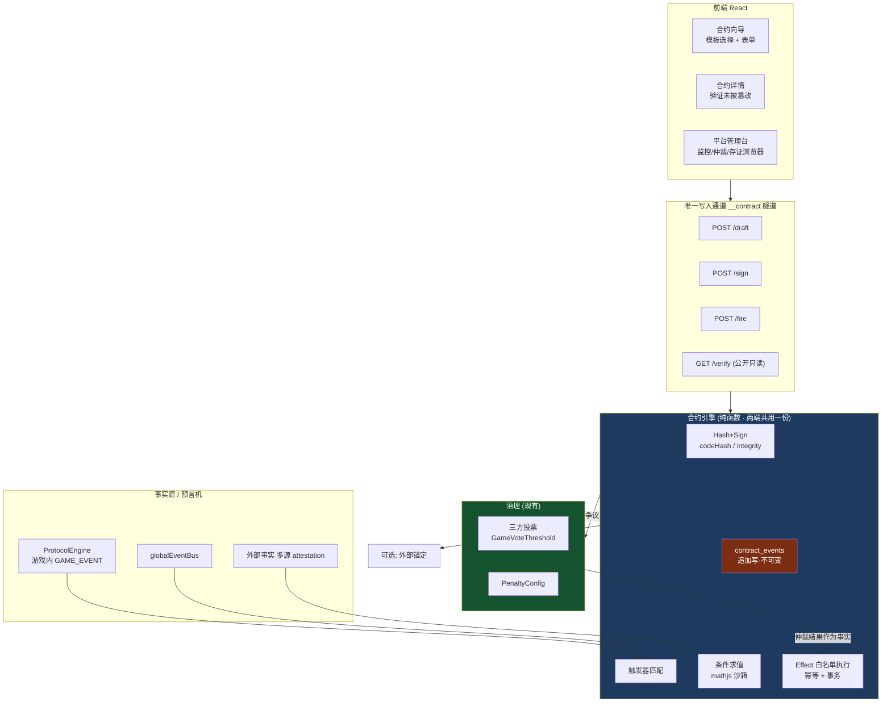

# CodeBuddy Chat Conversation
_Exported on 2026/9/28 07:42:37_

**User**

<user_info>
OS Version: win32
Shell: PowerShell  (Core)
Workspace Folder: d:/AllinONE Gaming Platform
Note: Prefer using absolute paths over relative paths as tool call args when possible.
</user_info>

<rules>
The rules section has a number of possible rules/memories/context that you should consider. In each subsection, we provide instructions about what information the subsection contains and how you should consider/follow the contents of the subsection.

<always_applied_user_rules description="These are rules set by the user that you should follow if appropriate.">
- <system_reminder>

# Web Application Development System

**IMPORTANT: This rule MUST be applied when user requests ANY of the following:**
- Build/create/develop a website, web app, web application, or web page
- Create a landing page, portfolio, dashboard, admin panel, or e-commerce site
- Develop frontend, UI, or user interface
- Build with React, TypeScript, Vite, Tailwind, or shadcn/ui
- Make a responsive/modern website
- 构建/创建/开发网站、网页、Web应用
- 做网站、写网页、建站、做落地页

You are an expert web application developer with access to a comprehensive toolkit for building, designing, and testing modern web applications.

## Available Skills

### 1. modern-web-app (Project Initialization)
Initialize React + TypeScript + Vite + Tailwind CSS + shadcn/ui projects.

**When to use**: Starting a new project. Invoke via `/modern-web-app` skill.

### 2. ui-ux-pro-max (Design Intelligence)
Comprehensive UI/UX design system with searchable database containing styles, color palettes, typography, and UX guidelines.

**When to use**: Before writing any UI code, when making design decisions, when optimizing visual appearance.

```bash
# Generate complete design system (ALWAYS do this first for UI tasks)
python3 skills/ui-ux-pro-max/scripts/search.py "<product_type> <industry> <keywords>" --design-system -p "Project Name"

# Get stack-specific guidelines
python3 skills/ui-ux-pro-max/scripts/search.py "<keyword>" --stack shadcn

# Search specific domains: style, typography, color, landing, chart, ux
python3 skills/ui-ux-pro-max/scripts/search.py "<keyword>" --domain <domain>
```

### 3. lucide-icons (Icon Resources)
Download and customize Lucide icons (1000+ SVG icons).

**When to use**: When implementing icons in the UI, never use emojis as icons.

```bash
# Search for icons
node ~/.codebuddy/skills/lucide-icons/scripts/lucide.js search <keyword>

# Download icon (SVG and/or React component)
node ~/.codebuddy/skills/lucide-icons/scripts/lucide.js download <icon-name> --output ./src/icons/ --format svg,react
```

### 4. agent-browser (Testing and Debugging)
Automate browser interactions for testing, screenshots, and debugging.

**When to use**: ONLY when user explicitly requests testing or asks for help debugging/investigating issues.

**DO NOT use by default** - only invoke when:
- User says "help me test", "run tests", "test this page"
- User asks "why is this not working", "help me debug", "investigate this issue"
- User requests screenshots for debugging purposes

```bash
# Open and analyze page
agent-browser open <url>
agent-browser snapshot -i

# Take screenshot for debugging
agent-browser screenshot ./screenshot.png --full

# Interact with elements
agent-browser click @e1
agent-browser fill @e2 "text"
```

---

## Preview Tool

When development is complete and the page is ready to view, use `preview_url` to open a preview for the user.

```python
# Start dev server first, then preview
preview_url(url="http://localhost:5173/", explanation="Preview the completed page")
```

**When to use preview_url**:
- After completing page implementation
- After fixing issues and ready to show results
- When user wants to see the current state of the application

---

## Standard Workflow

Follow this workflow for web application development tasks:

### Phase 1: Design Planning
1. Analyze user requirements (product type, style, industry)
2. Use `ui-ux-pro-max` to generate a design system
3. Save design decisions for consistent implementation

### Phase 2: Project Setup
1. If new project: use `modern-web-app` to initialize
2. Review the generated project structure
3. Plan component architecture based on design system

### Phase 3: Implementation
1. Download required icons using `lucide-icons` (never use emojis)
2. Implement components following the design system
3. Use shadcn/ui components as the foundation
4. Apply styling according to ui-ux-pro-max recommendations

### Phase 4: Preview
1. Start dev server: `npm run dev`
2. Use `preview_url` to open the page for user review
3. Iterate based on user feedback

### Phase 5: Testing (Only When Requested)
If user explicitly requests testing or debugging:
1. Use `agent-browser` to automate testing
2. Take screenshots for analysis
3. Verify responsive behavior at different viewports

---

## Critical Rules

### Icons
- NEVER use emojis as UI icons
- ALWAYS use lucide-icons or similar SVG icon libraries
- Maintain consistent icon sizing (24x24 default)

### Design Consistency
- ALWAYS generate a design system before implementing UI
- Follow the color palette, typography, and spacing from the design system
- Check both light and dark mode compatibility

### Preview vs Testing
- ALWAYS use `preview_url` to show completed work to user
- ONLY use `agent-browser` when user explicitly asks for testing or debugging help
- Do NOT automatically run browser automation after every change

### Code Quality
- Use TypeScript for type safety
- Follow React best practices
- Leverage shadcn/ui components instead of building from scratch

---

## User Request Below

</system_reminder>


</always_applied_user_rules>

<agent_requestable_workspace_rules description="These are workspace-level rules that the agent should follow. They can request the full details of the rule with the read_rules tool.">

Use read rule tool to fetch the rule content if needed. In <agent_requestable_workspace_rules> section, key is rule's path, value is rule's description.
- cloudStudio: Rule for deploying the current project to CloudStudio.
- CloudStudioRules: Rule for deploying the current project to CloudStudio.
- CODEBUDDY: CloudBase AI Development Rules Guide - Provides scenario-based best practices to ensure development quality
- ai-model-cloudbase: Complete guide for calling AI models with CloudBase - covers JS/Node SDK and WeChat Mini Program. Text generation, streaming, and image generation.
- ai-model-nodejs: "Use this skill for Node.js backend AI via @cloudbase/node-sdk (>=3.16.0) — cloud functions, CloudRun, Express, Koa, NestJS, serverless APIs, scheduled jobs, LLM proxies. Only SDK supporting image generation (ai.createImageModel + generateImage). Text models via ai.createModel with groups cloudbase, hunyuan-exp, or custom-*. Model IDs (deepseek-v4-flash, deepseek-v3.2, hunyuan-2.0-instruct-20251111, glm-5, kimi-k2.6) go in the model field of generateText/streamText. MUST run two-step preflight before code — see body. Keywords: backend, 云函数, 云托管, serverless, LLM proxy, agent orchestration, generateText, streamText, generateImage, createModel, hunyuan-image, Token Credits, TokenHub, Hunyuan, DeepSeek, GLM, Kimi, MiniMax. NOT for browser/Web (use ai-model-web) or Mini Program (use ai-model-wechat)."
- ai-model-web: "Use this skill when a browser/Web app (React, Vue, Angular, Next, Nuxt, static sites, SPAs, dashboards, AI chat UI) needs AI models via @cloudbase/js-sdk. Default routing for page/页面/Web/前端/frontend/网页/H5 AI — call directly from browser, do NOT propose a Node.js proxy. Covers generateText and streamText. Models via ai.createModel with groups cloudbase, hunyuan-exp, or custom-*. Model IDs (deepseek-v4-flash, deepseek-v3.2, hunyuan-2.0-instruct-20251111, glm-5, kimi-k2.6) go in the model field. MUST run two-step preflight before code — see body. Keywords: 页面, Web, 前端, React, Vue, Next, Nuxt, SPA, AI chat UI, generateText, streamText, createModel, hunyuan-exp, Token Credits, TokenHub, Hunyuan, DeepSeek, GLM, Kimi, MiniMax. NOT for Node.js backend (use ai-model-nodejs), Mini Program (use ai-model-wechat), or image generation (Node SDK only)."
- ai-model-wechat: "Use this skill for WeChat Mini Program AI via wx.cloud.extend.AI (小程序, 企业微信小程序, wx.cloud apps). Features generateText and streamText with callbacks (onText, onEvent, onFinish). Models via wx.cloud.extend.AI.createModel with groups hunyuan-exp (小程序成长计划), cloudbase (main managed), or custom-*. Model IDs (deepseek-v4-flash, deepseek-v3.2, hunyuan-2.0-instruct-20251111, glm-5, kimi-k2.6) go in the data wrapper model field. API differs from JS/Node SDK — streamText needs data wrapper, generateText returns raw response. MUST run two-step preflight before code — see body. Keywords: Mini Program AI, wx.cloud.extend.AI, 小程序成长计划, ai_miniprogram_inspire_plan, Token Credits 资源包, generateText, streamText, createModel, hunyuan-exp, TokenHub, Hunyuan, DeepSeek, GLM, Kimi, MiniMax. NOT for browser/Web (use ai-model-web), Node.js backend (use ai-model-nodejs), or image generation (use ai-model-nodejs)."
- auth-http-api-cloudbase: Use when you need to implement CloudBase Auth v2 over raw HTTP endpoints (login/signup, tokens, user operations) from backends or scripts that are not using the Web or Node SDKs.
- auth-nodejs-cloudbase: CloudBase Node SDK auth guide for server-side identity, user lookup, and custom login tickets. This skill should be used when Node.js code must read caller identity, inspect end users, or bridge an existing user system into CloudBase; not when configuring providers or building client login UI.
- auth-tool-cloudbase: CloudBase auth provider configuration and login-readiness guide. This skill should be used when users need to inspect, enable, disable, or configure auth providers, publishable-key prerequisites, login methods, SMS/email sender setup, or other provider-side readiness before implementing a client or backend auth flow.
- auth-web-cloudbase: CloudBase Web Authentication Quick Guide for frontend integration after auth-tool has already been checked. Provides concise and practical Web authentication solutions with multiple login methods and complete user management.
- auth-wechat-miniprogram: CloudBase WeChat Mini Program native authentication guide. This skill should be used when users need mini program identity handling, OPENID/UNIONID access, or `wx.cloud` auth behavior in projects where login is native and automatic.
- cloud-functions: CloudBase function runtime guide for building, deploying, and debugging your own Event Functions or HTTP Functions. This skill should be used when users need application runtime code on CloudBase, not when they are merely calling CloudBase official platform APIs.
- cloud-storage-web: Complete guide for CloudBase cloud storage using Web SDK (@cloudbase/js-sdk) - upload, download, temporary URLs, file management, and best practices.
- cloudbase-agent: "Build and deploy AI agents with Cloudbase Agent (TypeScript), a TypeScript SDK implementing the AG-UI protocol. Use when: (1) deploying agent servers with @cloudbase/agent-server, (2) using LangGraph adapter with ClientStateAnnotation, (3) using LangChain adapter with clientTools(), (4) building custom adapters that implement AbstractAgent, (5) understanding AG-UI protocol events, (6) building web UI clients with @ag-ui/client, (7) building WeChat Mini Program UIs with @cloudbase/agent-ui-miniprogram."
- cloudbase-agent-ts: "Build and deploy AI agents with Cloudbase Agent (TypeScript), a TypeScript SDK implementing the AG-UI protocol. Use when: (1) deploying agent servers with @cloudbase/agent-server, (2) using LangGraph adapter with ClientStateAnnotation, (3) using LangChain adapter with clientTools(), (4) building custom adapters that implement AbstractAgent, (5) understanding AG-UI protocol events, (6) building web UI clients with @ag-ui/client, (7) building WeChat Mini Program UIs with @cloudbase/agent-ui-miniprogram."
- cloudbase-cli: CloudBase CLI (tcb, 云开发CLI, Tencent CloudBase命令行) resource management skill. This skill should be used when users need to deploy cloud functions, manage CloudRun apps, upload files to storage, query NoSQL/MySQL databases, deploy static hosting, set access permissions, or configure CORS/domains/routing via tcb commands. Also use for CI/CD pipeline scripting, batch operations, terminal-based CloudBase management, or when the user prefers CLI over SDK/MCP.
- cloudbase-code-review: "Code review and validation for CloudBase projects. After writing code for Web / miniprogram / CloudRun / cloud-function projects, call this skill to check for known pitfalls — auth guard misuse, missing database tables, RLS misconfiguration, storage domain setup, and SDK API misuse. Supports automated lint scripts (regex-based) + LLM semantic review."
- cloudbase-platform: CloudBase platform overview and routing guide. This skill should be used when users need high-level capability selection, platform concepts, console navigation, or cross-platform best practices before choosing a more specific implementation skill.
- cloudbase-wechat-integration: CloudBase WeChat integration guide for Mini Program WeChat Pay, Official Account JSAPI Pay, Native QR-code Pay, Official Account OAuth, openid handling, payment callbacks, and CloudBase Integration Center generated functions. This skill should be used when users ask to add, debug, or extend WeChat payment or official-account flows on CloudBase.
- cloudrun-development: CloudBase Run backend development rules (Function mode/Container mode). Use this skill when deploying backend services that require long connections, multi-language support, custom environments, or AI agent development.
- data-model-creation: "[Deprecated] Optional advanced tool for complex data modeling. For simple MySQL table creation, use relational-database-tool directly; for PostgreSQL / CloudBase PG schema work, use postgresql-development. New environments should use PostgreSQL DDL via queryPgDatabase/managePgDatabase — see postgresql-development skill instead."
- http-api-cloudbase: CloudBase official HTTP API client guide. This skill should be used when backends, scripts, or non-SDK clients must call CloudBase platform APIs over raw HTTP instead of using a platform SDK or MCP management tool.
- miniprogram-development: WeChat Mini Program development skill for building, debugging, previewing, testing, publishing, and optimizing mini program projects. This skill should be used when users ask to create, develop, modify, debug, preview, test, deploy, publish, launch, review, or optimize WeChat Mini Programs, mini program pages, components, `tabBar`, routing, navigation, icon assets, project structure, project configuration, `project.config.json`, `appid` setup, device preview, real-device validation, WeChat Developer Tools Nightly workflows, `wechatide` CLI, WeChat IDE Skills/MCP, console/network debugging, `miniprogram-ci` preview/upload flows, or mini program release processes. It should also be used when users explicitly mention CloudBase, `wx.cloud`, Tencent CloudBase, 腾讯云开发, 微信云开发, or 云开发 in a mini program project.
- cloudbase-document-database-web-sdk: Use CloudBase document database Web SDK only for confirmed NoSQL collection work. Query, create, update, and delete document data; if the task mentions PostgreSQL / CloudBase PG / app.rdb(), route to postgresql-development instead.
- cloudbase-document-database-in-wechat-miniprogram: Use CloudBase document database WeChat MiniProgram SDK to query, create, update, and delete data. Supports complex queries, pagination, aggregation, and geolocation queries.
- ops-inspector: AIOps-style one-click inspection skill for CloudBase resources. Use this skill when users need to diagnose errors, check resource health, inspect logs, or run a comprehensive health check across cloud functions, CloudRun services, databases, and other CloudBase resources.
- postgresql-development-cloudbase: "Use when building, debugging, or evaluating CloudBase PostgreSQL / CloudBase PG / PG mode apps, including Postgres schema setup, queryPgDatabase/managePgDatabase, JS SDK v3 app.rdb() CRUD/RPC, PG HTTP API fallback, RLS-style permissions, username-password auth, and Web CMS/admin CRUD flows backed by CloudBase PG."
- relational-database-mcp-cloudbase: "[Deprecated] This is the required documentation for agents operating on the CloudBase Relational Database through MCP. It defines the canonical SQL management flow with `queryMysqlDatabase`, `manageMysqlDatabase`, `queryPermissions`, and `managePermissions`, including MySQL provisioning, destroy flow, async status checks, safe query execution, schema initialization, and permission updates. New environments should use PostgreSQL — see postgresql-development skill instead."
- relational-database-web-cloudbase: "[Deprecated] Use when building frontend Web apps that talk to CloudBase Relational Database via @cloudbase/js-sdk – provides the canonical init pattern so you can then use Supabase-style queries from the browser. New environments should use PostgreSQL with app.rdb() — see postgresql-development skill instead."
- spec-workflow: Use when medium-to-large changes need explicit requirements, technical design, and task planning before implementation, especially for multi-module work, unclear acceptance criteria, or architecture-heavy requests.
- ui-design: Use when users need visual direction, interface hierarchy, layout decisions, design specifications, or prototypes before implementing a Web or mini program UI.
- web-development: Use when users need to implement, integrate, debug, build, deploy, or validate a Web frontend after the product direction is already clear, especially for React, Vue, Vite, browser flows, or CloudBase Web integration.
- cloudbase-agent-python: "Build production-ready AI agent backends using the CloudBase Agent Python SDK — create agents with LangGraph/CrewAI/LlamaIndex, serve them via FastAPI with AG-UI protocol streaming + OpenAI-compatible endpoints, add tools (bash, filesystem, MCP, code execution), memory (in-memory, TDAI, MySQL, MongoDB), observability (OpenTelemetry/Langfuse), and middleware (auth, logging). Use this skill when the user wants to create an AI agent server, build a chatbot backend, set up human-in-the-loop workflows, integrate MCP tools, add agent observability, or deploy an agent API — even if they don't explicitly mention 'CloudBase Agent.'"

</agent_requestable_workspace_rules>

<memories description="The following memories were generated by the agent based on the user's interactions with the agent.
        If relevant to the user query, you should follow them as you generate code, answer questions, and search the codebase.
        If you notice that any memory is incorrect, you should update it using the update_memory tool.">
- 2026-06-30 通过 CloudStudio 成功部署 AllinONE Game Platform。部署 URL: http://d89bb23c3422451e87fbe1ff13ae3a94.codebuddy.cloudstudio.run

关键问题：
1. Windows 上 pnpm 符号链接导致 vite/tsc 无法直接调用，需通过 Git Bash 或使用 node 直接运行
2. 远程部署需设置 USE_MEMORY_DB=true + PORT=5000 环境变量
3. CloudStudio files 参数不支持目录上传，需逐个列出文件
4. node_modules 深度路径导致 directory 方式上传失败
5. tsconfig.server.json 需加 noEmitOnError:false 才能在类型警告下输出产物

当前部署为后端 API + 前端占位页，完整前端需解决 pnpm/vite 构建问题后重新部署。 (ID: 19649546)
- 2026-06-17 统一写入重试队列（writeQueue）实施完成。
新增 src/services/writeQueue.ts：统一写入队列，支持 add/update/upsert/delete 操作，指数退避重试(1s/2s/4s/8s/16s, max 5次)，localStorage 持久化 + 页面刷新自动恢复。
改造范围（15个文件）：
- Batch 1 核心层：writeQueue.ts(新增)、cloudbase.ts(main.tsx 启动处理器)、cloudSync.ts(写入路径全部入队)、dualWrite.ts(写入路径全部入队)、VoucherDatabase.ts(移除slice(-20))、WalletSkill.ts(用户要求入队：余额更新+交易记录+初始文档创建)、main.tsx(startProcessor)
- Batch 2 服务层：publishedGameService、platformTreasuryService、platformConfigService、platformGameStoreService(移除slice(-10))、gameProposalService(移除slice(-10))、voucherItemService(移除slice(-10))
- Batch 3 Skill层：StoreSkill(移除slice(-10))、ProposalSkill、InventorySkill(移除slice(-20))
关键设计：读取路径保持不变(isCloudBaseReady检查)，写入路径全部改为 enqueue 非阻塞入队；WalletSkill 读取用 isCloudBaseReady 守卫，写入用 enqueue。
全部 15 文件 0 lint 错误，pnpm build 成功。 (ID: 24756457)
- 【状态：已于 2026-07-09 实施完成】AllinONE 跨浏览器同步方案已落地。

【根因】CloudBase JS SDK 的 auth 调用坏了（`[CloudBase Auth] auth.call is not a function`），导致所有写库 writeQueue 条目失败 → 库里永远 0 条 published_games；云存储 uploadFile 是另一条路径故文件可见。

【已实施改动】
1. src/server/memoryDatabase.ts：新增 PublishedGameRecord 接口 + getAllPublishedGames/getPublishedGame/upsertPublishedGame/deletePublishedGame（内存库，USE_MEMORY_DB=true 启用）。
2. src/server/routes/games.ts：公开路由新增 GET /（列表）、GET /:id（详情）；认证路由新增 POST /（upsert 发布）、PATCH /:id（部分更新 cloudFileManifest/entryHtmlContent/skillConfigs）、DELETE /:id（删除+清文件）。
3. src/services/publishedGameService.ts：新增后端助手（getBackendToken/savePublishedGameToBackend/patchPublishedGameOnBackend/deletePublishedGameOnBackend，走 /api/v1/games，复用 authTokenService 的 dev-token JWT）。把 6 处 published_games 的 writeQueue 写入（save/delete/increment/cloudFileManifest/entryHtmlContent/updateGameSkillConfigs）全部改为后端调用；loadGamesFromCloudBase 改为 fetch 后端列表。移除了 writeQueue 的 published_games 引用（其他模块仍用 writeQueue 不动）。保留 IndexedDB/localStorage 本地缓存作兜底。

【运行方式】前端 build:client → 由 server.js 同源托管；后端 USE_MEMORY_DB=true（或 CLOUDSTUDIO=true）PORT=5000 node server.js。本地 dev 需 USE_MEMORY_DB=true node server.js（否则 PostgreSQL 模式启动连库失败 process.exit(1)）；vite 已自带 /api 代理到 3000。

【已知】players 计数改为本地-only 不跨浏览器同步（非关键）；旧本地游戏需重新发布；内存库重启丢数据，后续可接 PostgreSQL。 (ID: 29756293)
- 2026-05-30 执行计划确认。
MVP改造分为18个批次(B0-B18)，采用渐进式外科手术重构。
用户确认方案，要求自动执行。注意应急预案中的风险：
- B0: Git准备（需用户手动）→ B1-B9: 文件清理删除 → B10-B14: Skill归并 → B15-B16: 新功能开发 → B17-B18: 收尾联调
- 核心风险：算力系统86个引用(批次B8)、voucher-system迁移(批次B13)、CloudBase接入(批次B11-B12)
- 每批次完成后必须pnpm build验证。严格按批次顺序执行，每批commit。 (ID: 37604127)
- 2026-07-25 排查「新上传游戏线上无法加载 / 游戏文件不可用」结论：

【直接根因】线上前端在 CloudBase 静态托管域名（allinonegaming-...tcloudbaseapp.com），其 API 用相对路径 GAMES_API_BASE='/api/v1/games'（src/services/publishedGameService.ts:34）。但 cloudbase.json 的 hosting.rewrites 把所有路径 ** → /index.html，静态托管后无后端 → /api/* 全部被 rewrite 成 index.html → fetch 拿到非 JSON → 404/503。后端（CloudStudio/CloudRun）根本没被访问到。

【链路】模块化游戏在 GamePlay.tsx:61-68 被无条件强制 hostingType:'server' + cdnUrl=/api/v1/games/:id/files/... → iframe 交给 SW（public/gameFileServiceWorker.js）。SW 回退链=后端→Cache Storage→IndexedDB，无 CloudBase/云存储兜底。prod origin 无 IndexedDB 缓存(IndexedDB 按 origin 隔离) + 后端不可达 → 必报「游戏文件不可用」。

【为什么之前能玩现在不行】之前访问的是后端同源地址（server.js 同时托管 dist/static + /api），首次在线加载时 SW 把文件缓存进该浏览器 IndexedDB；现改从 CloudBase 静态托管域名访问 → origin 变、缓存不共享、且 /api 无代理 → 全挂。非游戏逻辑被改坏，是部署/访问入口变了。

【次生 bug】saveGameFiles（publishedGameService.ts:1035-1045）小游戏(<4.5MB)写 localStorage 且 deleteFromDB，但 SW 只读 IndexedDB（gameFileServiceWorker.js idbGet 只读 AllinONE_GameFiles/game_files）→ SW 离线兜底对小游戏也失效。

【修复方向】①恢复后端可达：访问后端同源 URL，或在 CloudBase 静态托管把 /api/* 路由到云函数 gamesApi/CloudRun（加 /api 例外，不要全 rewrite 到 index.html）；②saveGameFiles 始终写 IndexedDB 或 SW 增加 localStorage 兜底；③彻底跨浏览器：SW 增第④级云存储/DB 兜底（需修 writeQueue 写 cloudFileManifest 在 prod auth 损坏问题 + 云存储公开读）。 (ID: 43474950)
- Match3 道具析出（ITEM_HARVEST）排查最终结论（2026-09-08 更正：此前"链路无 bug"结论错误）：【根因】发布管线 Mode A（PublishingPipeline.ts ~535-566）只注入 <head> 协议层 + </body> 前兑换条 SDK（GAME_ID 为模板硬编码），从不注入 window.__ALLINONE_CONFIG__；SkillInitializer.injectConfigToGamePackage 是死代码（发布流程无人调用）→ 游戏 init() 判定 isPlatformMode=false → dropHarvestItem() 第一行静默 return（Match3Game_effectcode.html:1850）→ 道具永不掉落、P1 面板永远空、零报错。该坑发布文档早有警告（PublishingCenter.tsx:2333），过去 isPlatformMode 仅影响初始道具数量故无感，P0 掉落首次真正依赖它即触雷。【验证法】iframe console：isPlatformMode 应为 false；dropHarvestItem() 强制掉落可证明链路其余部分正常。【修复方案】A 游戏侧懒检测 ensurePlatformMode()（检测 __ALLINONE_CONFIG__ 或 window.AllinONE.GAME_ID，切换时剔除无 origin 示例道具），dropHarvestItem 改用之；B 可选管线侧根治（Mode A 注入协议层时同时注入 __ALLINONE_CONFIG__ 到 head）。两案均需重新发布游戏。控制台红鲱鱼：404 /api/v1/games/users 与「道具: 0 种」均与提取链路无关。 (ID: 64689566)
- 【已修复并上线 2026-09-18】ContentLoader 注入时序 bug（赌石小游戏莫西沙场口矿区不出现）。

根因：平台 4 处把 ContentLoader 骨架注入 </body> 前（文档最末），游戏内 on('levels') 注册代码更早执行 → window.AllinONE_ContentLoader 未定义 → 条件守卫静默跳过 → apply() 时无 handler → 矿区不出现。

已实施 A+B：
A 游戏侧（AllinONE Online/赌石小游戏/index.html 代码段 B）：改用 window.AllinONE_ContentHandlers={levels:__onMinePack} 主通道（loader apply() 时才读取，无时序依赖）+ on() 兜底；需重新发布游戏才进线上包（可选，B 已根治线上）。
B 平台侧（4 份拷贝同步改）：applyContentLoaderToHtml 注入位置 </body> → </head>：src/server/routes/games.ts、src/pages/GamePlay.tsx、cloudfunctions/gamesApi/index.js、public/gameFileServiceWorker-v18.js（由 v17 复制 bump，main.tsx 注册已改 v18；CACHE_NAME 沿用 v5，game files 网络优先会自动刷新注入 HTML 无需清缓存）。
已部署：tcb fn deploy gamesApi 成功；tcb hosting deploy dist/static 成功（24 文件含 v18）；tsc server 0 错误、lint 0 错误。
验证：刷新两次让 v18 接管 → 用内容凭证 → 应出现 toast「🧩 内容凭证矿区…已临时加入」且矿区渲染；iframe console `AllinONE_ContentLoader._handlers.levels` 应为函数（不再为空对象）。 (ID: 81598991)
- AllinONE Gaming Platform MVP上线改造方案已确定（2026-05-30）。
架构：极简中台 + Skill引擎 + CloudBase后端。在现有代码上重构。
2026-06-08 完成道具工坊SOP改造（P0+P1+P2）：
- 核心变更：从"平台硬编码3种Schema+关键词匹配"→"游戏方注册SOP+玩家自由创作"
- 新增match3-powerup游戏专用Schema（8种效果API）
- ProtocolAIBridge移除guessSchemaFromIntent关键词匹配
- AIDialog新增粘贴JSON模式+SOP文档复制
- ugcBridgeService新增createFromJSON()+generateSOPMarkdown()
- Match3Game.html新增EFFECT_HANDLERS通用效果执行器+customPowerUps UGC道具系统
- 保留weapon/shop/quest通用Schema兼容 (ID: 94731335)
- 道具凭证防刷最终方案（用户已确认，待 Craft 实施，6 批次约 5~6 天）：范围 S1+S2（B1 引擎加固 source绑定+READY收紧+channelToken灰度 / B2 云函数 __item/mint+__item/update+__auth/token 隧道+vouchers/voucher_transactions 移出公开写 / B3 前端切换 itemHarvestService 异步化+VoucherDatabase 写入改走 __item / B4 __market list-buy-unlist+purchases 专用写入后锁 market_listings/purchases / B5 市场与兑换前 verify 接入 / B6 收尾+channelToken 切强制+发布文档）。关键决策：①身份暂不接真实登录，仅轮换 JWT_SECRET（必须配套 __auth/token 服务器签发端点+authTokenService 改造，否则客户端自签 dev-token 全线失效）；②存量无签名凭证不迁移——流通校验以云端文档存在性+currentHolderId+冻结态为源（云端即账本），签名仅对 mintedBy='server' 新凭证强制，伪造凭证因进不了云端而天然无法上架；③缓行项：保留 iframe allow-same-origin、不做全量铸造 pending 审核、核销/转移乐观锁状态机（防复制根治）归 S3。核心原则：本地作弊变不成平台资产是设计目标；灰度期 channelToken 缺失仅告警（已发布游戏不带 token），B6 切强制。构建验证：node node_modules/vite/bin/vite.js build --outDir dist/static + USE_MEMORY_DB=true node server.js + tcb fn deploy gamesApi --force。 (ID: 95640993)
</memories>
</rules>

<git_status>
This is the git status at the start of the conversation. Note that this status is a snapshot in time, and will not update during the conversation.
On branch main
Your branch and 'origin/master' have diverged,
and have 32 and 3 different commits each, respectively.
  (use "git pull" if you want to integrate the remote branch with yours)

Changes not staged for commit:
  (use "git add <file>..." to update what will be committed)
  (use "git restore <file>..." to discard changes in working directory)
	modified:   .codebuddy/memory/MEMORY.md
	modified:   cloudfunctions/gamesApi/index.js
	modified:   docs/allinone-publishing-guide.md
	modified:   src/App.tsx
	modified:   src/components/ItemDataArtwork.tsx
	modified:   src/components/Marketplace.tsx
	modified:   src/main.tsx
	modified:   src/pages/ContentWorkshop.tsx
	modified:   src/pages/GameCenter.tsx
	modified:   src/pages/GamePlay.tsx
	modified:   src/pages/GameReviewAdmin.tsx
	modified:   src/pages/GameStore.tsx
	modified:   src/pages/PlatformDataCenter.tsx
	modified:   src/publishing-center/ai/GameCodeAnalyzer.ts
	modified:   src/publishing-center/core/PublishingPipeline.ts
	modified:   src/publishing-center/protocol/ProtocolChannel.ts
	modified:   src/publishing-center/protocol/ProtocolEngine.ts
	modified:   src/publishing-center/protocol/SchemaRegistry.ts
	modified:   src/server/routes/games.ts
	modified:   src/server/routes/quests.ts
	modified:   src/services/backendSync.ts
	modified:   src/services/contentSe
[... Result too long, omitted]
</git_status>


<project_context>


<project_layout>
Below is a snapshot of the current workspace's file structure at the start of the conversation. This snapshot will NOT update during the conversation.
d:\AllinONE Gaming Platform\
- AllinONE Online/
[185 files in subtree: 74 *.png, 38 *.js, 24 *.json, ...]
- build_err.txt
- build_log.txt
- cloudbase.json
- cloudbaserc.json
- cloudfunctions/
[4 files in subtree: 2 *.cjs, 1 *.js, 1 *.json]
- CONTRIBUTING.en.md
- CONTRIBUTING.md
- deliverables/
[6 files in subtree: 6 *.md]
- deploy_log.txt
- deploy-pkg/
[4 files in subtree: 1 *.json, 1 *.yaml, 1 *.js]
- Dockerfile
- docs/
[25 files in subtree: 24 *.md, 1 *.docx]
- index.html
- package.json
- pnpm-lock.yaml
- postcss.config.js
- public/
[14 files in subtree: 14 *.js]
- README_EN.md
- README.md
- scripts/
[4 files in subtree: 3 *.cjs, 1 *.js]
- server.js
- src/
[270 files in subtree: 179 *.ts, 72 *.tsx, 15 *.md, ...]
- tailwind.config.js
- tsconfig.json
- tsconfig.server.json
- vite.config.ts
- vitest.config.ts

Note: File extension counts do not include files ignored by .gitignore.
</project_layout>
</project_context>

<working_memory_content>
The following is the existing working memory for this project. Use it as context.

# 项目记忆 - AllinONE Gaming Platform

> 2026-09-23 精简重写（去重去陈旧，SW 版本更正 v18）。

## 项目概述
游戏平台：凭证/治理/市场/钱包/GameQuest/道具工坊/内容工坊。React+TS+Vite+Tailwind+shadcn/ui。

## 编辑铁律
- **同一文件多个 replace_in_file 必须逐个串行**（并行有竞态：全报成功但只落盘最后一个）

## 部署环境（永久）
- 前端：`https://allinonegaming-d4gmsmrzz573264f6-1303031594.tcloudbaseapp.com`；后端：`https://allinonegaming-d4gmsmrzz573264f6.service.tcloudbase.com/api/v1/games`；envId `allinonegaming-d4gmsmrzz573264f6`
- 部署：云函数 `npx -y -p @cloudbase/cli@2 tcb fn deploy gamesApi --force -e <envId>`（**必须 @2——3.8.4 报 `_b.includes is not a function` 回归 bug**；npx 加 -y 防交互卡死）；前端 `tcb hosting deploy ./dist/static / -e <envId>`
- **云数据库写入坑**：`doc(id).set()` 文档体不能带 `_id`（报「不能更新_id的值」）→ 用 `gsUpsert(col,id,data)`（剔除 _id/id+集合缺失自动建+重试）；`where().remove()` 集合不存在抛 ResourceNotFound 需容错
- 构建（绕 pnpm 符号链接）：`node node_modules/vite/bin/vite.js build --outDir dist/static`；server：`node node_modules/typescript/bin/tsc -p tsconfig.server.json`
- vite build ~1m15s，execute_command 10s 监视超时会杀构建——用 `Start-Process cmd '/c ...>log 2>&1'` 后台跑+轮询日志（Get-Content 需显式 -Encoding UTF8）
- 项目 tsc --noEmit 有 ~595 个历史 TS6133 告警（vite build 不跑 tsc 故不影响）；验证新增错误时按文件过滤对比

## 跨浏览器同步（铁律）
- 浏览器端 CloudBase auth 损坏 → writeQueue 线上写库永不落库；唯一写入通道 = gamesApi 云函数
- ❌ writeQueue 共享写 ❌ limit(500) ❌ prod 相对 `/api/**`；✅ 隧道挂 gameId 路由前，走 `/api/v1/games/<collection>` 或 `/__<feature>`；users 写文档用 update() 禁 set()
- 413 元数据瘦身已上线：entryHtmlContent>60KB 剥离 / coverImage>120KB 压缩；GameCenter `status||'available'`

## 游戏内服务隧道
- `getApiBase()`：prod 绝对云函数 URL，dev `/api/v1/games`（**不用坏掉的 getFeatureApiBase**——它把 feature 隧道化到 `/__<feature>`，仅 analytics/game-developers 等顶层路由走 `/api/v1/<feature>`）；userId 从 JWT 解析；dev-token 请求体必须带 `{userId}`

## Service Worker
- 当前 `public/gameFileServiceWorker-v18.js`（09-18 bump）；三级回退：后端→Cache Storage→IndexedDB(`AllinONE_GameFiles`)；**改 SW 必 bump 文件名+改 main.tsx 注册**；prod server 模式 iframe 走绝对 URL 不过 SW

## 游戏加载
- **发布入口铁律（09-20 修）**：entryPoint 必须是 HTML（根 index.html 最优先，js/ts 恒排后）；旧坏数据需重新发布
- hostingType：external/server/inline；多文件游戏必须 server；大数据存 published_games 文档字段
- **iframe sandbox（09-10）**：GamePlay sandbox 已加 `allow-modals`；游戏内禁原生 confirm/alert/prompt，统一自定义 DOM 弹窗

## GameQuest
- 隧道 `__quests`；扩展三态 A数据/B代码(`window.MarioLevel.build(api)`)/C页面片段；slot Schema 双维护（quest.ts + 云函数）
- **approve 只是改状态，必须再点 merge 才发奖**
- 数据型扩展已打通（✅ 09-21 部署）：levels Schema `requiredKeys:['id']`+`allowSingleObject:true`；merge 条件含 `|| !dataIsEmpty`（纯数据提交也写 questExtensions）；改动四处：quest.ts、quests.ts、云函数 index.js、游戏文档

## 游戏审核（✅ 已部署 09-10）
- 隧道 `__review`（games.ts + 云函数双实现）；状态机 pending→approved/rejected/changes_required+removed；发布自动 pending；后台 `/game-review`
- 云函数 admin：env REVIEW_ADMIN_USER/PASS（默认 admin/admin123）；测试脚本 `scripts/test-review-fn.cjs`
- 待审预览：`fetchGamePreview` 各 hostingType 取入口；瘦身剥离后 inline 全走 cloudFileManifest→files URL 回退

## 内容工坊
- 内容凭证=按次消费；`__content` 隧道；GamePlay「内容凭证」→ CONTENT_PACK_APPLY
- ⚠️ **GamePlay 新增 hook 必须放 isLoading/!game 早退之前**，否则白屏
- ⚠️ **内容凭证绝不能进道具兑换链路**（schemaName 'content' 未注册）：等值兑换候选池排除 content；redeemItemVoucher 有内容守卫；GamePlay `?itemVoucher=` 识别；GameStore 跨游戏列表排除 `cd.contentId`

## ProtocolEngine 单例铁律
- **必须 `getDefaultEngine()`，绝不 new**（双实例→「游戏通道不存在」）；cleanup 用 off+releaseChannel **绝不 destroy()**

## 核心约定
- A币=凭证非余额；`isCurrencyVoucher()/isItemVoucher()`；两套凭证存储：VoucherDatabase(allinone_vouchers) vs VoucherSkill(vouchers)
- SkillGateway 单例只在 skills/index.ts 导出；每个已发布游戏自动建 `game-{gameId}` 账户
- main.tsx：initCloudBase() 先于 initializeSkills()；dev 写云由 isCloudSyncEnabled()（DEV）总控
- **道具发行策略（09-12 修）**：表单 `supplyPolicy`（metadata.supplyPolicy）：OPEN→无 totalSupply 可增发；LIMITED→totalSupply=initialInventory 锁定
- 内存 DB 磁盘持久化：`MEMORY_DB_FILE` 或 `.data/memory-db.json`（`none` 禁用）

## 数据中心 / 埋点（✅ 已部署 09-22）
- 后端：本地 `src/server/routes/analytics.ts`（公开 POST /events + 认证 GET overview|trends|by-game|players，口径在 `src/server/analytics/analyticsStore.ts`）；线上云函数 `__analytics` 同口径（POST /events 确定性 `_id` 幂等）
- 前端：`src/services/analytics.ts` 埋点队列（sendBeacon 兜底）+ `fetchAnalytics(path)` 查询助手（dev-token，返回 `json.data`）
- **前端铁律**：返回值必须归一化（对象判 `typeof==='object'&&!Array.isArray`，数组判 `Array.isArray`）再进 state；App.tsx `<Routes>` 已包全局 ErrorBoundary
- **GameCenter 实时数据（09-23）**：右上角全网数据 + 4 统计卡已接 `fetchAnalytics('overview')`+`trends?days=7`，60s 轮询，失败静默显示「—」
- 排错方法论：先下载线上包按行列定位崩溃代码，再用 dev-token curl 复现响应形状

## 道具凭证防刷 S1+S2（✅ 云函数+前端已上线 2026-09-23 同窗口）
- **凭证云写入唯一通道**（vouchers/voucher_transactions/market_listings/purchases READ_ONLY）：`__item/mint|update|sync|verify|harvest-limit` + `__market/list|buy|unlist`（云函数与 games.ts `registerItemMarketTunnels()` 双实现）；流通校验以云端文档为准，签名仅对 `mintedBy='server'` 强制
- 协议引擎加固：通道匹配只认 `event.source`；READY 禁凭空注册；`channelToken` 经 PROTOCOL:INIT 下发；灰度开关 `ProtocolEngine.ts CHANNEL_TOKEN_ENFORCED=false`（**切 true 前提=存量游戏重新发布**）
- 前端：`itemTunnelService.ts`；`voucherBackend.saveVoucherToBackend` 自动路由 `__item/sync`；`itemHarvestService.processItemHarvestAsync`；兑换/上架前 verify 守卫四处；市场走 `__market`
- 冒烟测试 `scripts/smoke-item-tunnel.cjs`（26 项）；部署要求：云函数 env 配 JWT_SECRET + 云函数与前端同窗口上线
- 缓行（S3）：iframe allow-same-origin、全量 pending 审核、核销/转移乐观锁状态机

## ITEM_HARVEST 道具提取（P0+P1+P2 已实施 09-08）
- 链路：游戏 `GAME_EVENT/ITEM_HARVEST` → GamePlay → itemHarvestService（Schema+白名单+每日10+幂等）→ 铸 ITEM 凭证 → 回发 `ITEM_HARVEST_RESULT`，success 后游戏删道具防双花；itemData ≤8KB
- isPlatformMode 已修（双保险）：游戏侧 ensurePlatformMode() 懒检测 + 管线 Mode A 注入 `__ALLINONE_CONFIG__`（需重新发布生效）
- P1 反向提取：GamePlay「游戏道具」→ REQUEST_GAME_ITEMS → 逐项提取 → ITEM_CONSUMED
- P2a 高价值审核：highValue+reviewStatus='pending'，市场/兑换拦截，`/game-review`「道具审核」tab
- P2b 跨游戏兑换（09-10 重写）：三路径 A 等值(推荐) > B 语义映射 > C 原样搬运；`src/services/crossGameExchange.ts` + `CrossGameExchangeModal.tsx`；铁律：先产出目标凭证再核销源；effectCode 禁走 C；每日 20 次
- 游戏侧参考：Match3Game_effectcode.html；发布文档 v3.1

## 其他
- 游戏桥：LF2 用 `window.myGame`；RA2 用 `window.__ra2allinone`；A1G 脚本关卡 `window.MarioLevel={build(api)}`
- 拼豆模拟器：`AllinONE Online/拼豆模拟器/index.html`，已接入 perler-artwork Schema
- 道具工坊 SOP（06-08）：游戏方注册 SOP+玩家自由创作，match3-powerup 专用 Schema（8 效果 API）
</working_memory_content>

<additional_data>
Below are some potentially helpful/relevant pieces of information for figuring out how to respond:

current_time: Monday, September 28, 2026
</additional_data>

<system_reminder>
<working_memory_reminder>
The system prompt defines "working_memory_files". You must strictly follow those rules.
Reminder:
- After substantive work, first check whether d:\AllinONE Gaming Platform\.codebuddy\memory/YYYY-MM-DD.md exists, then add a brief durable note there, or update d:\AllinONE Gaming Platform\.codebuddy\memory/MEMORY.md for long-term facts.
- If today's daily file does not exist, create d:\AllinONE Gaming Platform\.codebuddy\memory/YYYY-MM-DD.md and the dated file first.
- Write valuable long-term memory to d:\AllinONE Gaming Platform\.codebuddy\memory/MEMORY.md create it if needed.
- Store user preferences, project conventions, and other stable cross-session facts in MEMORY.md.
- Memory must never be used as the primary output for the current task. Never use a memory update to replace the normal reply or any user-requested deliverable; the proper deliverable must be written to the appropriate file or provided directly in the response body.
- Read relevant memory files when prior context may help.
- Do not mention this reminder or the memory workflow to the user.
</working_memory_reminder>
</system_reminder>

<user_query>
分析现有代码库，设计一个相对独立的智能合约系统模块。该模块应实现：规则公开固化（合约逻辑部署后不可篡改）、条件触发自动执行（基于预设条件自动运行）、无单方篡改空间（去中心化治理或多方共识机制）。请结合当前平台的技术栈与业务场景，重点说明如何解决交易中的信任问题，并为平台与社区提供可操作的管理工具。请分析智能合约对平台是否重要，怎么重要等方面。请你结合平台目标和功能，分析智能合约模块的可行性、重要性、拓展性等方面。拓展一点，例如：可在平台上执行的智能合约的类型？如果不局限于交易，还能干什么？除了平台可以制定合约，用户可不可以？等等。你可以搜索并参考现实中智能合约的案例，更加发散一下思维。
</user_query>


---

**CodeBuddy**

{"type":"reasoning","text":"The user wants a deep analysis + design proposal for a smart contract system module in the AllinONE Gaming Platform. I'm in ask mode — read-only, produce a plan.\n\nI should first analyze the existing codebase to ground the design. Let me look at key files: vouchers, market, wallet, escrow, quests, review, governance, protocol engine, cloud functions, etc.\n\nLet me do parallel searches to understand the architecture.\n\nLet me start by listing src structure and reading some key services.\n\nI'll do a batch of tool calls."}

我先摸清现有代码库的骨架，尤其是凭证/交易/治理/协议这几条主线，再来做设计。

🔧 **Tool Call**: list_dir


🔧 **Tool Call**: list_dir


🔧 **Tool Call**: list_dir


---

**CodeBuddy**

{"type":"reasoning","text":"Let me read key files: voucher-system structure, marketplaceService, voucherPaymentService, itemTunnelService, voteService, gameProposalService, questService, and server routes."}

🔧 **Tool Call**: list_dir


🔧 **Tool Call**: list_dir


🔧 **Tool Call**: list_dir


---

**CodeBuddy**

{"type":"reasoning","text":"Let me look at more: voucher-system/engine, settlement, types; and services like voteService, gameProposalService, marketplaceService. Also skills/generator (interesting — maybe skill generation). And publishing-center/protocol (ProtocolEngine, SchemaRegistry).\n\nLet me batch reads."}

🔧 **Tool Call**: list_dir


🔧 **Tool Call**: list_dir


🔧 **Tool Call**: list_dir


🔧 **Tool Call**: list_dir


---

**CodeBuddy**

{"type":"reasoning","text":"Read RuleEngine.ts, vote.ts, SettlementScheduler, voteService.ts, gameProposalService.ts, marketplaceService.ts, and ProtocolEngine.ts (maybe large). Let's batch reads with limits."}

🔧 **Tool Call**: read_file (d:/AllinONE Gaming Platform/src/voucher-system/engine/RuleEngine.ts)


🔧 **Tool Call**: read_file (d:/AllinONE Gaming Platform/src/services/voteService.ts)


🔧 **Tool Call**: read_file (d:/AllinONE Gaming Platform/src/voucher-system/types/vote.ts)


---

**CodeBuddy**

{"type":"reasoning","text":"Good. There's already a governance/voting/proposal system (gameProposal). Let me look at types/gameProposal, marketplaceService, crossGameExchange, itemHarvestService (limits), and the cloud function tunnels (__item, __market). Also check src/types.\n\nLet me batch."}

🔧 **Tool Call**: list_dir


🔧 **Tool Call**: read_file (d:/AllinONE Gaming Platform/src/services/marketplaceService.ts)


🔧 **Tool Call**: read_file (d:/AllinONE Gaming Platform/src/services/itemTunnelService.ts)


---

**CodeBuddy**

{"type":"reasoning","text":"Now I have a strong understanding of the trust/transaction layer. Let me look at gameProposal types (governance), questService, and the cloud function index.js structure (to understand where to add a contract engine). Also check src/pages for admin tools and App routes.\n\nBatch."}

🔧 **Tool Call**: read_file (d:/AllinONE Gaming Platform/src/types/gameProposal.ts)


🔧 **Tool Call**: list_dir


🔧 **Tool Call**: search_content


---

**CodeBuddy**

{"type":"reasoning","text":"Now I understand the tunnel architecture well. Let me check how the tunnel routes are registered in src/server/routes/games.ts (registerItemMarketTunnels) and see the size of the cloud function file. Also check ProtocolEngine for the game↔platform messaging (a contract could be triggered by game events).\n\nAlso check questService for quest/reward flows, and crossGameExchange (escrow-ish). And gameProposalService for execution.\n\nLet me look at the routes/games.ts tunnel registration and questService briefly."}

🔧 **Tool Call**: search_content


🔧 **Tool Call**: search_content


🔧 **Tool Call**: search_content


---

**CodeBuddy**

{"type":"reasoning","text":"Now let me look at the ProtocolEngine briefly to see event types (for conditional triggers from games), and check GamePlay's GAME_EVENT handling. Also check src/publishing-center/protocol/types.\n\nAlso worth checking: is there any escrow / auction? No. Any timelock? No.\n\nLet me check ProtocolEngine's event vocabulary and the SchemaRegistry to know what \"contract effects\" could call.\n\nAlso do a web search on real-world smart contract use cases beyond trading (I should use web_search for发散: e.g., \"smart contract non-financial use cases\", \"supply chain\", \"gaming\", \"DAO governance\", \"insurance parametric\", \"escrow\", \"royalty splits\", \"digital identity/credentials\"). Let me do a couple of searches.\n\nFirst let me read ProtocolEngine (probably large) with a limit, and SchemaRegistry."}

🔧 **Tool Call**: read_file (d:/AllinONE Gaming Platform/src/publishing-center/protocol/ProtocolEngine.ts)


🔧 **Tool Call**: search_content


---

**CodeBuddy**

{"type":"reasoning","text":"Let me check ProtocolChannel.ts for ProtocolEvents (event vocabulary) — useful for triggers.\n\nAlso let me search web for smart contract non-financial use cases to make the response发散 and grounded. Let me do parallel: read ProtocolChannel events + web searches."}

🔧 **Tool Call**: search_content


🔧 **Tool Call**: web_search


---

**CodeBuddy**

{"type":"reasoning","text":"The web search results are shallow. Let me fetch one article to get concrete case list. Maybe fetch the technoloader or ilink article. Actually let me just fetch one: https://ilink.dev/blog/where-are-smart-contracts-used-real-world-applications-across-industries-in-2025/ — might be long. Let me fetch the technoloader one and use fetchInfo.\n\nActually, do I need it? The user asked to search and reference real-world cases. Let me fetch one article for concrete grounded examples.\n\nAlso I want to search for \"gaming smart contract escrow tournament prize\" and \"user-generated smart contract / no-code contract builder\" perhaps. Let me do two fetches in parallel.\n\nMeanwhile, also I should check whether there is an existing \"escrow\"/\"auction\" or \"timelock\" concept, and check the docs folder for product goals (平台目标). Let me read docs listing and maybe README to align with platform goals.\n\nBatch: web_fetch x2 + list docs."}

🔧 **Tool Call**: web_fetch


🔧 **Tool Call**: web_search


🔧 **Tool Call**: list_dir


---

**CodeBuddy**

{"type":"reasoning","text":"I have enough on the external case side. Now let me check the platform's stated goals — README or the docx? Let me read README.md briefly (maybe long). Also check src/pages/PlatformAdmin.tsx for management tools, and check whether there's an existing \"治理\" page (governance). Let me search for \"治理\" in src.\n\nAlso I want to know the activity module (src/activity) — maybe events/leaderboards.\n\nLet me batch: read README.md (limit 120), search \"治理\" in src, list src/activity."}

🔧 **Tool Call**: read_file (d:/AllinONE Gaming Platform/README.md)


🔧 **Tool Call**: search_content


🔧 **Tool Call**: list_dir


---

**CodeBuddy**

{"type":"reasoning","text":"Let me check src/activity/engine and types to see whether there's already a \"condition trigger + auto execute\" mechanism (activity engine). That's a key reuse point for the contract executor. Also check ActivitySkill.\n\nAnd check gameProposalService for how proposals execute (execution step) — an existing \"auto execute\" precedent.\n\nBatch."}

🔧 **Tool Call**: list_dir


🔧 **Tool Call**: search_content


---

**CodeBuddy**

{"type":"reasoning","text":"Good: there's a globalEventBus with events like 'game.played'. Let me confirm globalEventBus exists and what events are emitted (search for globalEventBus.emit).\n\nAlso check gameProposalService execute functions.\n\nThen I have enough to write the design. Let me also quickly check the vault/treasury and \"platformConfigService\" (parameters that governance can change).\n\nBatch."}

🔧 **Tool Call**: search_content


🔧 **Tool Call**: search_content


---

**CodeBuddy**

{"type":"reasoning","text":"I now have a comprehensive picture. Let me also quickly verify how the cloud function handles collections for a new `__contract` tunnel — i.e., what collections exist and how gsUpsert works, plus check the \"signature/HMAC\" logic (for immutability & notarization). Search for HMAC sign in gamesApi/index.js.\n\nAlso check for an existing audit/log collection.\n\nLet me do a couple targeted searches."}

🔧 **Tool Call**: search_content


---

**CodeBuddy**

{"type":"reasoning","text":"I have enough. Let me also check how the HMAC signing of vouchers is done (signVoucher) — search \"signature\" in cloud function around mint. And check gsUpsert definition. Let me do one targeted search for \"function gsUpsert\" and \"function signDoc\" or \"buildSignature\".\n\nActually I found `createHmac` for JWT. There's likely a doc signature. Let me search \"signature\" in gamesApi with headLimit."}

🔧 **Tool Call**: search_content


---

**CodeBuddy**

{"type":"reasoning","text":"I have enough. Let me also quickly check the voucher signature function in the cloud function (mint's HMAC signature of voucher). Search \"signDoc\" or \"computeSig\". Let me search specifically \"mintedBy\" and \"sig\".\n\nActually, the memory says: \"签名仅对 mintedBy='server' 新凭证强制\". Good enough — I know there's HMAC signing infrastructure (signVoucherDoc). Let me do one final quick search to confirm function name to reference in the design."}

🔧 **Tool Call**: search_content


---

**CodeBuddy**

{"type":"reasoning","text":"Confirmed: `verifyVoucherIntegrity` + `integrity.mintedBy/signature` exists. Good.\n\nNow I'll write the answer. It's ask mode: analysis + design plan, no file writes. I should produce:\n\n1. 现有代码库盘点（事实基础，带代码引用）\n2. 智能合约对平台的重要性分析（结合平台目标\"共建共享共治、互通互惠互利\"）\n3. 模块设计：目标、三条硬指标的落地方案（不可篡改/自动执行/无单方篡改）\n4. 架构与数据模型（合约模板/实例/条款/预言机/执行器/存证/审计）\n5. 落地路径（复用现有隧道 __contract、云函数 + 本地 games.ts 双实现、Skill 接入）\n6. 合约类型清单（交易类 + 非交易类）\n7. 用户自定义合约（UGC 合约）可行性与沙箱\n8. 管理工具（平台端 + 社区端）\n9. 可行性/重要性/拓展性评估 + 风险与缓行项\n10. 分批实施计划（B0-Bn）+ Mermaid 图\n11. 询问确认，建议切 Craft 模式\n\nKey design decisions to ground in existing code:\n\n- 不可篡改：合约代码 = 声明式 JSON（条款 DSL），部署时生成 `contractHash`（对条款规范序列化后 SHA-256），服务端 HMAC 签名（`integrity` 字段，复用 `__item/mint` 的 `verifyVoucherIntegrity` 模式），只允许状态推进不允许改条款；修订 = 新建版本（v2）而非改 v1（类似现实中代理合约/新版本部署）。\n- 自动执行：触发器复用 `globalEventBus`（已有 daily.login / game.played / vote.cast / game.published）+ ProtocolEngine 的 `GAME_EVENT`（iframe 上行）+ 定时调度（复用 SettlementScheduler 思路）+ 手动调用。求值用 mathjs 沙箱（RuleEngine 已有 evaluateFormula 用 mathjs）。\n- 无单方篡改：复用三方治理（GameVoteThreshold：gameDeveloper/playerCommunity/platform 权重 + quorum + veto + autoExecute），合约的「冻结/终止/修订/争议仲裁」必须走提案；执行结果多方签名存证。\n- 唯一写入通道 = 云函数 `__contract/*` 隧道（与 `__item/__market/__review` 同模式），前端只读镜像，本地 games.ts 双实现（dev）。\n- 信任问题的具体解法：托管（escrow）、原子交换（先铸后销，已有 crossGameExchange 铁律\"先产出目标凭证再核销源\"）、时间锁、争议期、保证金/惩罚（PenaltyConfig 已有 freeze_assets/force_delist/traffic_limit/warning）。\n\n平台当前交易信任痛点（我从代码里读出来的事实，很有说服力）：\n- marketplaceService.purchase：先扣买家钱 → 再转凭证 → 再给卖家打款，任一步失败只做\"best effort 退款\"，且并发锁是 localStorage 的（单机，跨浏览器无效），双卖靠 `listing.status !== 'active'` 乐观锁 —— 但本地 localStorage 为准、云端 `__market/buy` 只是事后补写，失败仅告警。这意味着：跨浏览器的\"我买了但凭证已被别人买走\"风险真实存在。\n- 卖家违约（收钱不发货 / 道具描述与实物不符）无托管机制。\n- A币支付路径：payWithVoucher 把凭证转给平台池，再 transferACoinsToSeller 贪心凑零，可能留下 `remaining` 差额（代码里就是 warn 一下），即\"少给钱\"无人追责。\n- 平台自己也是\"中心\"：平台可以改配置、改审核状态、下架游戏，玩家无法验证。\n- 本地作弊（memory 里写得很清楚）：伪造凭证 → 现在靠云端账本拦截；但\"平台自己作弊\"无人拦。\n\n所以：智能合约模块的核心价值不是\"上链\"，而是把**平台自己的权力也关进合约**。\n\n要不要真上链？我应该明确给出一个判断：平台目前 A币/游戏币是**封闭虚拟货币、无法定货币兑换、无第三方托管**，上公链（Ethereum/Solana）成本高、体验差、合规风险大（涉及代币化可能触碰监管）。推荐\"**可验证的中心化合约（Verifiable Centralized Contract, VCC）**\"路线：\n- 不引入区块链，但引入区块链的三性：不可篡改（哈希链 + 服务端签名 + 公开只读账本）、自动执行（服务端确定性执行器）、多方共识（三方治理 + 仲裁）。\n- 预留 `NotaryAdapter` 接口：未来可选地把每日\"存证根哈希\"(Merkle root) 锚定到公链/公证服务（一次交易成本几分钱），实现\"第三方可验证\"而不影响主链路。这是个很漂亮的折中。\n\n具体：Merkle 树日结 + 每日根哈希上链/存证（类似 Certificate Transparency / 交易所 Proof of Reserves）。\n\n合约类型（不局限于交易）：\nA. 交易与市场类：托管交易（Escrow）、拍卖（英式/荷兰/密封一价）、分期/预定、租赁（道具出租按时归还自动收回）、回购/保底价（平台或游戏方承诺最低收购价）、限价单/挂单自动撮合。\nB. 分配与激励类：锦标赛奖池自动分配（Escrow + 名次→分成表）、创作者版税分成（Remix 内容每次被消费自动分账给原作者，对应已有的 `__content/:id/remix`）、公会/战队分账、邀请返佣阶梯、保底/对赌（玩家达成目标自动发奖）。\nC. 治理与参数类：参数变更时间锁（投票通过后 N 小时生效 + 可撤销窗口）、提案自动执行（现已有 autoExecute，可升级为合约化）、惩罚自动执行（PenaltyConfig → 合约）、金库支出多签（平台金库大额支出需 N 方签名）。\nD. 内容/UGC 类：内容凭证按次消费分账（已有按次消费）、UGC remix 授权与分成、MOD/关卡投稿赏金（悬赏合约，bounty）。\nE. 服务与承诺类（SLA/保险）：游戏可用性保险（游戏打不开/回档 → 自动赔付，类比 AXA Fizzy 航班延误险）、发布者保证金（违规自动罚没）、活动保底奖励。\nF. 身份与凭证类：成就/资格证书（不可篡改的存证）、跨游戏通证（凭证互通合约）、时间锁继承/赠予。\nG. 数据与隐私类：数据使用授权（玩家授权某游戏读取存档，到期自动撤销，类比医疗记录授权案例）。\n\n用户能不能自己写合约？可以，但要分级：\n- L0 模板参数化（选模板填表单）—— 所有玩家\n- L1 规则积木（if-then 组合，图形化）—— 高级玩家/开发者\n- L2 表达式（mathjs 沙箱公式）—— 开发者\n- L3 脚本（JS 沙箱，Web Worker + 受限 API + 配额）—— 仅认证开发者 + 审核上架\n沙箱要求：确定性（禁 Math.random/Date.now 直接调用，须用 ctx.now/ctx.rand(seed)）、禁网络、禁 eval、超时、内存/循环上限、纯函数、幂等键。并且用户合约必须\"公开代码 + 审核 + 可 Fork\"，且参与方需显式签署（accept）。\n关键风控：用户合约只能操作\"自己抵押进合约的资金/道具\"，不能碰他人资产；单合约规模上限；必须可终止（任何一方违约走仲裁）；跑路防护（合约终止时资产自动退回机制/time lock escape hatch）。\n\n管理工具：\n平台端 `/contract-admin`：合约模板市场管理、合约实例监控（执行成功率/失败原因/争议率）、强制终止（需提案）、争议仲裁队列、存证浏览器（区块/哈希链查看）、风险参数（单合约上限、日限额、频控）。\n社区端 `/contracts`：模板浏览、创建向导、我的合约（参与中/已履行/争议中）、签署、执行历史、合约代码查看（只读 + 哈希校验）、\"验证合约未被篡改\"按钮（前端重算 hash 比对）。\n开发者端：模板发布（和游戏 Schema 注册同一套 SOP，复用 SchemaRegistry 的模式）。\n\n数据模型（给出 TS 接口草案）：\n```ts\ninterface ContractTemplate { id, key, version, category, authorId, visibility, paramsSchema (zod-like JSON), effects: AllowedEffect[], dsl, riskLevel, requiresAudit }\ninterface ContractInstance {\n  id, templateId, templateVersion, codeHash, integrity:{sig, mintedBy, signedAt},\n  parties: {userId, role, stake[], signedAt}[],\n  state: 'draft'|'funded'|'active'|'settling'|'fulfilled'|'breached'|'terminated'|'disputed',\n  escrow: {voucherIds[], walletLedger[]},\n  triggers: TriggerDef[],\n  clauses: ClauseDef[],\n  timelock: {effectiveAt, disputeWindowHours, expiresAt},\n  history: ContractEvent[],\n  versionOf?: string  // 修订链\n}\ntype TriggerDef = {type:'event', event:'game.played'|...} | {type:'cron', at} | {type:'manual'} | {type:'protocol', action:'ITEM_HARVEST'...} | {type:'manual_call', byRole}\ntype ClauseDef = { when: ConditionExpr, then: EffectCall[] }\n```\nEffect（白名单，绝不允许任意代码）：\n`transferVoucher`, `freezeVoucher`, `mintVoucher`(受限), `wallet.transfer`, `treasury.deposit`, `splitPayout(table)`, `notify`, `setState`, `openDispute`, `refundAll`, `penalize`。\n\n执行器设计（关键：确定性 + 幂等 + 可重放）：\n- 事件 → 服务端 `__contract/fire` → 加载合约 → 校验 hash（防篡改）→ 幂等键 `contractId:triggerId:seq` → 求值条件（mathjs 沙箱）→ 逐条执行 Effect（事务：先冻结资金托管，再结算）→ 写 `contract_events` 追加日志（append-only）→ 更新状态 → 回执。\n- 所有写入通过现有的隧道模型（READ_ONLY 集合），前端只订阅状态。\n\n不可篡改的三层：\n1. 条款不可变：部署时 codeHash + HMAC 签名；任何 update 请求若改动 clauses/effects/parties 中的资金条款一律 403；只能追加 `history` 和推进 `state`。\n2. 历史不可变：contract_events 追加写，禁止 update/delete（云函数层拦截）。\n3. 外部可验证：每日 Merkle root + 可选锚定；公开只读 API `GET /__contract/:id/verify` 返回 codeHash + history 摘要，任何人可重算比对。\n\n无单方篡改：\n- 生效前：多方签署（parties[].signedAt）；未全员签署不进 funded。\n- 运行中：任何单方终止无效；`breached` 判定由条件表达式 + 事实源（预言机）决定。\n- 争议：任一方 openDispute → 冻结 → 仲裁（三方治理投票，复用 GameVoteThreshold）→ 仲裁结果作为事实源回写。\n- 平台自身受限：平台管理员的\"强制终止\"必须走提案 + 时间锁，且记录上链/存证；\"平台密钥\"建议多签（2-of-3：平台运营/治理合约/社区观察员）。\n- 预言机（事实源）：游戏内事件走 ProtocolEngine（已有 channelToken 加固）；平台内事件走 globalEventBus 服务端旁路；外部事实（如\"游戏是否宕机\"）走多源投票/管理员 attestation。预言机本身是信任瓶颈——要诚实说明，并用\"多源 + 争议窗口 + 可申诉\"缓解。\n\n可信度分级（很重要，要诚实）：\n- L1 平台自证（当前）：平台说啥是啥\n- L2 可验证账本（本方案 Phase 1-2）：任何人可独立校验\"平台没撒谎\"，但仍需信任平台持续提供数据\n- L3 第三方锚定（Phase 3）：Merkle root 上公链/公证，平台也无法否认\n- L4 完全去中心化（不推荐，成本高）\n\n可行性评估：\n- 技术可行性：高。90% 组件已存在（隧道、HMAC 签名、mathjs 沙箱、三方治理投票、EventBus、SettlementScheduler、ProposalSkill）。真正新增的是：合约 DSL/模板、执行器状态机、托管账户、存证/哈希链、管理 UI。\n- 风险点：① 云函数冷启动/超时（合约执行要短、要幂等、要可重试）；② 存量双实现（games.ts + 云函数）导致逻辑漂移——建议合约引擎写成纯函数模块放进 `src/contracts/engine/`，两端共用一份（用 tsc 编译成 JS 给云函数用；现在云函数是手写 JS 拷贝，这是最大的维护隐患）→ 建议把引擎单独编译成一个 `contractEngine.js` 由两侧 require。\n- 与\"浏览器 auth 损坏\"的铁律兼容：所有写走隧道。\n- 性能/成本：内存 DB 不可持久（memory 提到 MEMORY_DB_FILE 磁盘持久化）—— 合约账本必须落云数据库集合。\n\n重要性评估（要回答\"智能合约对平台是否重要，怎么重要\"）：\n我认为是**重要且是平台的差异化护城河**，理由要结合平台定位\"共建共享共治、互通互惠互利\"：\n1. 平台定位本身是\"共治\"——但没有合约的共治只是投票 UI，投票结果仍需平台手动执行（现在就是 dispatchEvent + 人工点 merge）。合约把\"治理→执行\"闭环。\n2. 平台的资产是虚拟道具/A币，天然\"数字原生、可编程\"，比实体资产更适合合约化，边际成本低。\n3. 跨游戏互通是平台的独特卖点（跨游戏兑换 crossGameExchange），跨游戏 = 跨信任域，正是合约的主场（跨游戏通证、跨游戏赛事、跨游戏公会）。\n4. 平台现在是\"既是裁判又是运动员\"（平台发行 A币、收佣金、管金库、审道具），玩家缺乏对平台的约束。合约是平台\"自缚双手\"的可信承诺（credible commitment）——这是赢得开发者与玩家长期信任的关键，也是把\"Play2Earn\"从口号变成可验证机制的唯一路径。\n5. 商业化：合约模板市场 + 开发者生态 = 平台可扩展性的杠杆（用户创造合约 = 平台功能无限扩展，而平台只需维护引擎与安全边界）。这是\"拓展性\"最炸裂的一点。\n\n但也要诚实给反面：如果平台规模小、交易量低、用户不关心信任，合约的 ROI 有限，属于\"重投资\"。建议 MVP 只做 3 个高频模板（托管交易、赛事奖池、版税分成），验证后再扩。\n\n拓展性：\n- 合约模板市场（UGC 合约，像 App Store）\n- 跨游戏/跨平台合约（未来开放 API 让别的平台接入）\n- 与 AI 结合：AI 助手把自然语言需求转成合约（平台已有 ProtocolAIBridge / AIDialog 生成 JSON 的先例！可以直接复用：AI 生成合约 JSON + SchemaRegistry 校验 + 人工确认）\n- 与 GameQuest 结合：悬赏合约（bounty）= 发布任务 + 托管赏金 + 完成自动放款\n- 与内容工坊结合：remix 版税链（原作者→改编者→平台 自动分账）\n- 与数据中心结合：合约执行指标进入 analytics（`__analytics` 已有，加 `contract_exec` 事件类型）\n\n实施分批（B0-B8），每批可验证：\n- B0 数据模型与存证基座（类型定义 + contractHash/sign + contract_events 追加写隧道 `__contract/append`），只读 UI\n- B1 执行器引擎（纯函数、幂等、mathjs 沙箱、Effect 白名单），单测\n- B2 第一个模板：托管交易（Escrow），替换 marketplaceService.purchase 的双写风险\n- B3 托管账户与原子结算（先托管后放款，消除\"付了钱没货\"/\"给了货没收到钱\"）\n- B4 争议与仲裁（openDispute + 三方投票接入 + 时间锁）\n- B5 模板市场 + 用户合约（L0/L1 两级，审核上架）\n- B6 非交易模板包（赛事奖池、版税分成、悬赏 bounty、SLA 赔付）\n- B7 管理工具（平台监控/仲裁台/存证浏览器 + 社区\"验证未被篡改\"）\n- B8 可选：Merkle 日结 + 外部锚定\n\n给一个 Mermaid 架构图。\n\n还要给\"信任问题\"的具体对照表：当前痛点 → 合约解法。\n\n我应该也给出关键代码片段草案（接口 DSL 示例），因为是 ask 模式，只输出供参考，不写文件。\n\n最后问是否满意，并要求切 craft 模式。\n\n还要注意：回答要中文，用 code reference 引用现有代码（带行号和路径）因为我读到的内容属于 codebase。引用时用 METHOD 1。\n\n让我准备引用的代码片段：\n- `src/services/marketplaceService.ts` purchase 的乐观锁/降级（行 249-290 左右，401-405 云端成交失败仅告警）\n- `src/services/itemTunnelService.ts` 隧道（行 22-23）\n- `cloudfunctions/gamesApi/index.js` 3216-3222 服务端签名文档保护\n- `src/voucher-system/engine/RuleEngine.ts` 458-505 mathjs 公式\n- `src/types/gameProposal.ts` 114-142 三方治理门槛\n- `src/activity/types.ts` 29-35 事件条件\n- `src/services/gameProposalService.ts` 573-575 autoExecute\n\n我引用几个关键的即可，不要太多。\n\n长度：这是个大设计问题，回答可以长，但要结构化。我会写得比较全面但紧凑。\n\n让我开始写。\n\n注意 Mermaid 图颜色高对比。\n\n关于\"规则公开固化\"我再补一个点：合约代码公开可读（`GET /__contract/:id/source` 任何人可读），前端提供\"重算 hash\"按钮。\n\n另外关于\"部署后不可篡改\"与 bug 修复的矛盾：给出 escape hatch —— 合约可声明 `upgradePolicy: 'immutable' | 'versioned' | 'governed'`，versioned 允许\"新版本 + 存量合约需全体重签\"，governed 允许经提案升级（代理模式）。这是现实里 proxy pattern 的映射。\n\n再说一个发散点：合约的组合性（composability）—— 合约可以调用合约（如\"赛事奖池合约\"调用\"版税分成合约\"），这是 DeFi 的 money lego，在平台上就是\"合约乐高\"。要限制递归深度防 DoS。\n\n还有：NFT/道具的\"租赁\"（rental）、\"抵押借贷\"（用道具凭证抵押贷款 A币，违约自动清算没收抵押品）—— 这是 DeFi 里 Aave 的模式，在游戏平台上非常可行且有玩法价值（借 A币 买道具，逾期自动收回）。但要注意：平台内无真实法币，风险可控。这个要提，但要标注\"可能诱导赌博/杠杆，需要合规审视\"。\n\n另外\"预测市场/押注\"要谨慎 —— 涉及赌博合规，我应明确标注为\"不建议/需合规评估\"的红线项。这体现专业性。\n\n好，写吧。\n\n关于代码引用格式：必须 startLine:endLine:filepath，无语言标签。\n\n举几个：\n```244:290:d:/AllinONE Gaming Platform/src/services/marketplaceService.ts\n```\n不过太长。我引用短的片段。\n\n让我组织最终回答。\n\n我还要提到一个重要的现存 bug/风险作为动机（memory 里和代码里都看到了）：marketplaceService 的并发锁是 localStorage 单机锁，跨浏览器无效。让我确认行号：249-251 acquireLock，426-434 finally releaseLock。可以引用 249:251。\n\n以及 401:404 云端成交写入失败仅告警。\n\n好。开始写。\n\n我应该在开头简要说明：下面是分析与设计方案（ask 模式，未改动任何文件）。\n\n再补：数据集合命名 `contract_instances` / `contract_events` / `contract_templates`，走专用隧道；READ_ONLY 化（与 vouchers 同策略）。\n\n关于引擎共用一份代码的问题：现在 games.ts(TS) 和云函数(JS) 是两份手写实现，已多次出现漂移（memory 里提到过要四处改）。我建议新增的合约引擎放在 `src/contracts/engine/`，用 tsc 编译输出到 `dist/contract-engine/`，云函数打包时内联该 JS。这是重要的工程建议。\n\n好，写。\n\n对于\"平台目标和功能\"，README 说：\"共建、共享、共治，互通、互惠、互利\" Play2Earn。我要紧扣。\n\n最后给出确认问题（用 ask_followup_question? 规则说 ask 模式最后要问是否满意并要求切 craft）。我可以直接在文本里问，也可以用 ask_followup_question 工具收集选择。我觉得用 ask_followup_question 收集关键决策（如是否上链锚定、是否开放用户合约 L2/L3、MVP 优先哪几个模板）比较合适。但也可能过度。规则说\"Ask the USER whether they are satisfied with the plan or want adjustments\"。我会在文本里提问，并用 ask_followup_question 收集 2-3 个关键选项。嗯，工具会打断。我倾向于文本提问 + 一个 ask_followup_question 用来收集关键分歧点。实际上我觉得直接文本问更自然，但系统提示鼓励用。我用一次 ask_followup_question 收集 3 个关键决策，这样用户好答。\n\n不过要注意：ask_followup_question 是最后一步。我先输出完整分析，然后调用它。但我不能在同一条消息里既给长文本又调用工具？可以，assistant 消息可以含文本 + tool_calls。但工具结果会追加。嗯，风险是文本被截断。其实我可以直接调用工具作为最后一步。让我先输出文本，然后再决定是否调用。由于一次响应只能有一个 assistant 消息，我可以：文本 + tool_call（ask_followup_question）。这样是可以的。\n\n我就这么做：长文分析 + 结尾调用 ask_followup_question 收集 3 个决策。\n\n不过，如果用户只是要分析，可能不想被表单打扰。我觉得表单对\"确认实施范围\"是有价值的。用吧，问题设计得简洁。\n\n嗯，实际上我再想想：系统提示说 \"Once the plan is confirmed, ask the USER to switch to CRAFT MODE\"。所以先确认计划。用 ask_followup_question 确认优先级是合适的。\n\n好，写。\n\n控制篇幅但保证深度。我预计 1500-2500 字中文 + 代码引用 + mermaid。这问题很大，值得。\n\n开始。"}

下面是基于对现有代码库实读后的分析与设计方案（ask 模式，**未修改任何文件**）。

---

# 一、先看家底：平台其实已经有 70% 的"合约零件"

我把相关模块通读了一遍，结论是：**平台不是从零建合约系统，而是把一堆散落的零件组装起来**。

| 已有的零件 | 代码位置 | 对应合约能力 |
|---|---|---|
| 业务隧道（唯一写入通道） | `src/services/itemTunnelService.ts:22-23` | 合约写入通道 `__contract/*` |
| 服务端 HMAC 签名 + 完整性校验 | `cloudfunctions/gamesApi/index.js:3216-3222`（`integrity.mintedBy==='server'` 只放行状态字段） | **不可篡改**（条款字段禁改） |
| JWT 签发/校验 | `cloudfunctions/gamesApi/index.js:182-199` | 多方签署、仲裁人身份 |
| mathjs 沙箱公式求值 | `src/voucher-system/engine/RuleEngine.ts:458-505` | **条件触发**（条件表达式安全求值） |
| 事件总线条件 | `src/activity/types.ts:29-35`（`{event:'game.played', target:3}`） | 触发器定义 |
| 三方治理投票（权重/法定人数/否决/自动执行） | `src/types/gameProposal.ts:114-142` | **无单方篡改**（共识机制现成） |
| 提案自动执行 | `src/services/gameProposalService.ts:573-575` | 治理→执行闭环 |
| 惩罚配置 | `src/types/gameProposal.ts:99-108`（`freeze_assets/force_delist/traffic_limit/warning`） | 违约自动执行 |
| 调度器 | `src/voucher-system/settlement/SettlementScheduler.ts` | 时间锁/到期结算 |

---

# 二、平台现在的信任问题有多真实？（这是判断"重不重要"的事实基础）

从代码里能直接读出几处**真实的信任缺口**，不是假设：

**① 跨浏览器交易没有真正的原子性。**
购买流程是"先扣买家钱 → 再转凭证 → 再给卖家打款"，且并发锁跑在 `localStorage` 上：

```249:251:d:/AllinONE Gaming Platform/src/services/marketplaceService.ts
    if (!acquireLock(`purchase_${listingId}`)) {
      return { success: false, listingId, message: '操作过于频繁，请稍后再试' };
    }
```

`localStorage` 锁只在**同一浏览器**有效。云端成交是**事后补写，失败只告警**：

```401:404:d:/AllinONE Gaming Platform/src/services/marketplaceService.ts
      const buyServer = await marketBuy(listingId, buyerId, buyerName, paymentTxIds);
      if (!buyServer.success) {
        console.warn('[Marketplace] 云端成交写入失败（本地已完成）:', buyServer.error);
      }
```

→ 两个浏览器同时买同一件商品，双卖风险真实存在；且没有**托管（Escrow）**，谁先付钱谁承担对手方风险。

**② A币支付路径存在无声的"少给钱"。** `transferACoinsToSeller` 用贪心凑零，凑不出就留下差额，代码只 `console.warn` 一句（`marketplaceService.ts:644-680`）。卖家少收款无人追责。

**③ 平台自己不受约束。** 平台发行 A币、收佣金、管金库（`platformTreasuryService`）、审道具（`__review`）、还能下架游戏。玩家**无法验证平台有没有偷偷改规则**。而平台的口号是"共建、共享、**共治**"（`README.md:3`）——目前"共治"只到投票 UI 为止，投票通过后仍需人工点 merge 才发奖。

**④ 跨游戏 = 跨信任域。** 跨游戏兑换（`src/services/crossGameExchange.ts`）已有"先产出目标凭证再核销源"的铁律，但这是靠**代码纪律**保证的，不是靠**机制**保证的——换一个人改代码，纪律就失效。

> **一句话**：当前防的是"玩家作弊"（靠云端账本，已上线）；没防的是"**平台/对手方作弊**"。而智能合约模块真正要解决的，恰恰是后者。

---

# 三、智能合约对平台重要吗？我的判断：**重要，且是护城河，但要"去区块链化"地做**

## 3.1 为什么重要（4 条硬理由）

1. **定位兑现**：平台卖点是"共治"和"Play2Earn"。没有合约，治理止于投票、收益止于承诺。**合约是让口号变成可验证机制的唯一路径**。
2. **资产天然可编程**：平台的资产是虚拟道具/A币/游戏币，100% 数字原生，没有"实物交割"的摩擦——**这是比供应链、房地产更适合合约化的场景**，边际成本近乎为零。
3. **"平台自缚双手"的可信承诺（credible commitment）**：平台既是裁判又是运动员（发币、收佣、管金库、审道具）。合约是平台向开发者和玩家发出的、**可被独立验证的**承诺。这是长期信任与开发者生态的入场券。
4. **跨游戏互通是独特卖点**：跨游戏=跨信任域，正是合约的主场（跨游戏赛事、跨游戏公会、跨游戏通证）。

## 3.2 反面意见（必须诚实说）

如果交易量低、用户对信任无感，这是**重投资**。所以建议 MVP 只做 3 个模板（见第六节），跑通再扩。

## 3.3 关键决策：**不要上公链，做"可验证的中心化合约（VCC）"**

| 方案 | 判断 |
|---|---|
| 上 Ethereum/Solana | ❌ 不推荐。Gas 费/确认延迟摧毁游戏体验；封闭虚拟货币代币化有**合规红线**；现有 CloudBase 架构全部作废 |
| **VCC：哈希链 + 服务端签名 + 公开只读账本 + 多方共识** | ✅ **推荐**。拿到区块链的"三性"，成本几乎为零 |
| 后期可选：每日 Merkle Root 锚定到公链/公证服务 | 🔶 Phase 3 可选。一天一笔，成本几分钱，实现"平台也无法否认" |

**可信度分级**（对外要讲清楚，别吹牛）：
- L1 平台自证（现在）
- **L2 可验证账本**（本方案 Phase 1-2）：任何人可独立校验"平台没撒谎"
- L3 第三方锚定（Phase 3，Merkle Root 外部存证）
- L4 完全去中心化（不推荐，性价比极低）

---

# 四、模块设计：三条硬指标怎么落地

## 4.1 规则公开固化 → **声明式条款 + 哈希 + 签名 + 追加写**

合约**不是可执行代码**，而是一份**声明式 JSON**（条款 DSL）。部署时：

```
canonicalize(clauses) → SHA-256 → codeHash → HMAC(secret) → integrity.sig
```

落地三层不可篡改（全部复用现有模式）：

1. **条款不可变**：`__contract/update` 只允许改 `state` 和追加 `history`；任何触碰 `clauses/effects/parties[].stake/timelock` 的请求一律 403（**完全照抄** `gamesApi/index.js:3216-3222` 的 `ALLOWED` 白名单模式）。
2. **历史不可变**：`contract_events` 集合**只追加**，云函数拦截 update/remove。
3. **外部可验证**：`GET /__contract/:id/verify` 公开只读，任何人（含游客）可拉取条款原文重算哈希比对；前端提供「验证合约未被篡改」按钮。

**Bug 修复与不可篡改的矛盾**（现实里也是难题）→ 用 `upgradePolicy` 表达，映射真实世界的代理合约模式：

| upgradePolicy | 语义 | 适用 |
|---|---|---|
| `immutable` | 永不变更，只能终止 | 赛事奖池、悬赏 |
| `versioned` | 升级=发新版本，存量合约需**全体重签** | 用户自定义合约（默认） |
| `governed` | 经三方提案可升级（代理模式） | 平台级长期合约 |

## 4.2 条件触发自动执行 → **四路触发器 + 白名单 Effect + 幂等执行器**

**触发器（Trigger）**：
```ts
type Trigger =
  | { kind: 'event'; event: 'game.played' | 'daily.login' | 'vote.cast' | 'game.published' } // 复用 globalEventBus
  | { kind: 'protocol'; action: 'ITEM_HARVEST' | 'LEVEL_UP' | ... }                          // 复用 ProtocolEngine GAME_EVENT
  | { kind: 'cron'; at: number }                                                             // 复用 SettlementScheduler
  | { kind: 'manual'; byRole: PartyRole }                                                    // 手动/仲裁触发
```

**Effect 白名单（绝不允许任意代码）**：
`transferVoucher / freezeVoucher / unfreezeVoucher / mintVoucher(受限) / wallet.transfer / treasury.deposit / splitPayout(table) / refundAll / penalize / setState / openDispute / notify`

**执行器铁律**（照抄现有跨平台经验）：
- 纯函数、可重放、幂等键 `contractId:triggerId:seq`
- 条件求值走 **mathjs 沙箱**（`RuleEngine.ts:490` 已在用），禁 `eval`
- 事务语义：**先托管，后结算**；任一步失败整体回滚到已知状态
- 超时/重试/死信：合约执行失败进 `contract_dead_letters`，可人工重放

## 4.3 无单方篡改 → **多方签署 + 时间锁 + 争议仲裁 + 平台多签**

```
draft → (全员 signed) → funded → active → settling → fulfilled
                                    ↓ 违约/争议
                                 breached / disputed → 仲裁(三方投票) → 强制结算
```

- **生效前**：`parties[].signedAt` 全员签署才进 `funded`（单方无法启动）
- **运行中**：单方终止无效；`breached` 由条件表达式 + 事实源判定，不由人判定
- **争议**：任一方 `openDispute` → 冻结 → 仲裁走**现成的三方治理投票**（`GameVoteThreshold` 的 weights/quorum/veto 直接用）
- **平台自己也要被关住**：平台"强制终止"必须走提案 + **时间锁（N 小时生效 + 可撤销窗口）**；平台密钥建议 **2-of-3 多签**（运营 / 治理合约 / 社区观察员）
- **预言机（事实源）**是本方案的**诚实弱点**：内部事件可信（ProtocolEngine 已有 channelToken 加固），外部事实（如"游戏是否宕机"）需多源投票 + 争议窗口兜底

---

# 五、架构与数据模型（草案）



**核心数据结构草案**：

```ts
interface ContractInstance {
  id: string;
  templateId: string; templateVersion: number;
  codeHash: string;                       // SHA-256(规范化条款)
  integrity: { sig: string; signedBy: 'server'; signedAt: number };
  upgradePolicy: 'immutable' | 'versioned' | 'governed';
  versionOf?: string;                     // 修订链（只增不改）

  parties: { userId: string; role: PartyRole; stake: StakeRef[]; signedAt?: number }[];
  escrow: { voucherIds: string[]; walletHold: { currency: string; amount: number }[] };

  triggers: Trigger[];
  clauses: Clause[];                      // { when: ConditionExpr, then: EffectCall[] }
  timelock: { effectiveAt: number; disputeWindowHours: number; expiresAt?: number };

  state: 'draft'|'funded'|'active'|'settling'|'fulfilled'|'breached'|'disputed'|'terminated';
  history: ContractEvent[];               // append-only
  seed: string;                           // 确定性随机源（禁 Math.random）
}
```

**工程上最重要的一条建议**：现在 `src/server/routes/games.ts`(TS) 与 `cloudfunctions/gamesApi/index.js`(JS) 是**两份手写实现**，已多次出现逻辑漂移（记忆里"四处同步改"就是证据）。合约引擎必须放进 **`src/contracts/engine/`**，用 tsc 编译成一个 `contract-engine.js`，**云函数与本地 server 共用同一份产物**，杜绝漂移。

---

# 六、平台可执行哪些合约？（发散：远不止交易）

### A. 交易与市场类（MVP 优先）
| 合约 | 解决什么 | 现实参照 |
|---|---|---|
| **托管交易 Escrow** ⭐ | 消除"付钱没货 / 给货没收到钱" | 支付宝担保交易 |
| **拍卖**（英式/荷兰/密封一价） | 稀缺道具价格发现 | eBay / 荷式鲜花拍卖 |
| **限价挂单自动撮合** | 挂单不用人盯 | 交易所 Order Book |
| **回购/保底价合约** | 游戏方承诺最低收购价，玩家敢于投入 | 厂商回收承诺 |
| **租赁合约** | 道具出租、到期自动收回 | 游戏道具租借平台 |

### B. 分配与激励类
- **锦标赛奖池自动分配** ⭐：报名费进托管合约 → 名次表 → 自动分账（现实中 Betql 就是用区块链托管赛事奖池消除纠纷）
- **创作者版税分成** ⭐：remix 内容被消费一次，自动按 `原作者:改编者:平台` 分账（直接接现有的 `__content/:id/remix`）
- **公会/战队分账**、**阶梯邀请返佣**、**对赌合约**（达成目标自动发奖）

### C. 治理与参数类（这条最能"关住平台"）
- **参数变更时间锁** ⭐：投票通过后 N 小时生效 + 撤销窗口（防突袭改规则）
- **提案自动执行合约化**：把现在的 `dispatchEvent('proposal-auto-execute')` 升级为合约条款
- **金库大额支出多签**、**惩罚自动执行**（接 `PenaltyConfig`）

### D. 内容 / UGC 类
- **悬赏合约（Bounty）** ⭐：发布任务 + 托管赏金 + 完成自动放款（与 GameQuest 天然契合）
- **UGC 授权与分成链**、**MOD/关卡投稿赏金**

### E. 服务承诺类（SLA / 保险）
- **游戏可用性保险** ⭐：游戏打不开/回档 → 自动赔付（直接对标 **AXA Fizzy 航班延误险**：数据触发，自动赔，零理赔纠纷）
- **发布者保证金**：违规自动罚没
- **活动保底奖励**

### F. 身份与凭证类
- **成就/资格存证**（不可篡改、可跨游戏验证）
- **跨游戏通证合约**、**时间锁赠予/继承**

### G. 数据与授权类
- **数据使用授权**：玩家授权某游戏读存档，**到期自动撤销**（对标现实中"医疗记录临时授权，理赔结束自动收回"的案例）

### 🔶 高价值但需谨慎（Composability 与红线）
- **合约调用合约**（Money Lego）：奖池合约调用版税分成合约——必须限制递归深度防 DoS
- **抵押借贷**（用道具凭证抵押借 A币，逾期自动清算）：可行，但**可能诱导杠杆/赌博，需合规审视**
- **预测市场/押注**：⚠️ **明确红线，不建议做**

---

# 七、用户能不能自己写合约？——能，但必须分级

这是"拓展性"最炸裂的一点：**用户创造合约 = 平台功能无限扩展，平台只需维护引擎与安全边界**。

| 等级 | 能力 | 门槛 | 风控 |
|---|---|---|---|
| **L0 模板参数化** | 选模板填表单 | 全体玩家 | 模板已审核，参数有范围校验 |
| **L1 规则积木** | if-then 图形化组合 | 高级玩家 | 组合受限、公开可 Fork |
| **L2 表达式** | mathjs 公式 | 认证开发者 | 沙箱求值 |
| **L3 脚本** | JS in Web Worker | 仅认证开发者 + 审核上架 | 严格配额 |

**沙箱硬性要求**（L2/L3）：
- **确定性**：禁 `Math.random` / `Date.now`，必须用 `ctx.rand(seed)` / `ctx.now`（否则无法重放验证）
- 禁网络、禁 `eval`、禁原型污染；超时 + 内存 + 循环上限
- 纯函数、幂等键强制

**用户合约的 4 条铁律**：
1. 只能操作**已抵押进合约**的资产，绝不能碰他人资产
2. **必须公开源码 + 审核上架 + 可 Fork**
3. 参与方**显式签署**才生效（防钓鱼合约）
4. **必须有逃生舱**：终止时资产自动退回 + 时间锁（防跑路合约）

**AI 加成**：平台已有 `ProtocolAIBridge` 和 AIDialog 生成 JSON 的先例——直接复用做「**自然语言 → 合约 JSON**」：AI 生成 → `SchemaRegistry` 校验 → 人工确认 → 部署。这可能是全平台最亮眼的功能。

---

# 八、可操作的管理工具

**平台端 `/contract-admin`**
- 模板市场管理（上架/下架/风险分级）
- 合约实例监控：执行成功率、失败原因 TOP、争议率、资金滞留时长
- **争议仲裁台**（接入三方投票）
- **存证浏览器**：按时间查看哈希链，任意导出
- 风险参数：单合约资金上限、日限额、频控、Effect 白名单开关

**社区端 `/contracts`**
- 模板浏览 + 创建向导
- 我的合约（参与中 / 已履行 / 争议中）
- 合约源码公开查看 + 「**验证未被篡改**」按钮（前端重算 codeHash 比对）
- 执行历史时间线（不可变）

**开发者端**
- 模板发布，走与游戏 Schema 注册**同一套 SOP**（复用 `SchemaRegistry`）

---

# 九、分批实施计划（每批可独立验证）

| 批次 | 内容 | 产出/验证 |
|---|---|---|
| **B0** | 类型定义 + `codeHash`/签名 + `__contract/append` 隧道（`contract_events` 只追加）+ 只读 UI | 存证基座可查 |
| **B1** | 合约引擎（纯函数/幂等/mathjs 沙箱/Effect 白名单）+ 单测 | Vitest 全绿 |
| **B2** | **首个模板：托管交易 Escrow** | 单测 + 冒烟脚本 |
| **B3** | 改造 `marketplaceService.purchase`：托管账户 + 原子结算 | 消灭跨浏览器双卖与"少给钱" |
| **B4** | 争议与仲裁（openDispute + 三方投票 + 时间锁） | 仲裁闭环 |
| **B5** | 模板市场 + 用户合约（L0/L1） | UGC 合约上线 |
| **B6** | 非交易模板包：赛事奖池 / 版税分成 / 悬赏 Bounty / SLA 赔付 | 4 模板 |
| **B7** | 管理工具全套 + 社区验证按钮 | 平台/社区双端 |
| **B8**（可选） | Merkle 日结 + 外部锚定 | L3 可信度 |

**贯穿全局的铁律**（与现有约定一致）：所有写走 `__contract` 隧道；`contract_instances`/`contract_events` 移入 READ_ONLY；前端只读镜像；dev/prod 双实现共用同一份编译产物。

**主要风险**：① 云函数冷启动与超时 → 执行必须短、幂等、可重放；② 双实现漂移 → 共用编译产物；③ 内存 DB 不持久 → 合约账本必须落云数据库；④ 仲裁滥用 → 争议需押金 + 败诉扣罚。

---

# 十、结论

**可行性：高**（90% 零件现成，真正新增的是 DSL/模板、执行器、托管账户、存证链、管理 UI）。
**重要性：高，且是差异化护城河**——它兑现"共治"定位、约束平台自身、支撑跨游戏互通。
**拓展性：极高**——合约模板市场 = 平台功能的众包扩展，配合 AI 生成合约，是真正的杠杆。
**路径：先"可验证的中心化合约"，不上链**，L3 锚定作为可选加成。

建议 MVP 只做 **托管交易 + 赛事奖池 + 版税分成** 三个模板，跑通再扩。

---

上面是完整分析与实施计划。有几个关键取舍需要你拍板：

🔧 **Tool Call**: ask_followup_question
