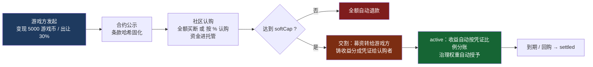
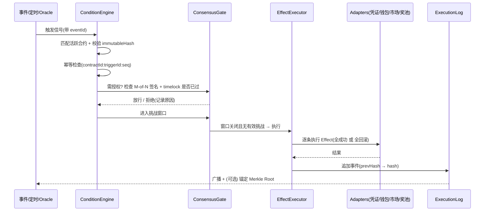

# AllinONE 智能合约模块 · 完整设计方案（终版待确认）

> 版本：v1.0（综合终版）
> 日期：2026-10-03
> 状态：**待用户最终确认**，确认后进入实施（B0 起）
> 定位：把散落硬编码的经济/社会规则，收敛为"公开、可哈希验证、治理门控、条件触发自动执行"的合约，形成**可信中性化的规则层（Rules-as-Code Governance）**，暂时代替分布式结构所能提供的可信环境。

---

## 目录

- [第 0 章 一页速览（决策摘要）](#第-0-章-一页速览决策摘要)
- [第 1 章 背景与目标](#第-1-章-背景与目标)
- [第 2 章 现状盘点：平台已有的"合约零件"](#第-2-章-现状盘点平台已有的合约零件)
- [第 3 章 信任缺口诊断（为什么必须做）](#第-3-章-信任缺口诊断为什么必须做)
- [第 4 章 两份他方方案对比与取舍](#第-4-章-两份他方方案对比与取舍)
- [第 5 章 范围界定：只做两类合约](#第-5-章-范围界定只做两类合约)
- [第 6 章 类型一：GSO 游戏主权/收益权认购合约](#第-6-章-类型一gso-游戏主权收益权认购合约)
- [第 7 章 类型二：Team 组团合约族](#第-7-章-类型二team-组团合约族)
- [第 8 章 三条硬保证的技术实现](#第-8-章-三条硬保证的技术实现)
- [第 9 章 相对独立模块架构（硬性要求）](#第-9-章-相对独立模块架构硬性要求)
- [第 10 章 执行策略：三档逐步开闸 + 影子对照](#第-10-章-执行策略三档逐步开闸--影子对照)
- [第 11 章 管理工具（平台端 + 社区端）](#第-11-章-管理工具平台端--社区端)
- [第 12 章 功能边界与既有系统共存](#第-12-章-功能边界与既有系统共存)
- [第 13 章 合规红线与话术](#第-13-章-合规红线与话术)
- [第 14 章 风险清单与缓解](#第-14-章-风险清单与缓解)
- [第 15 章 实施路线 B0–B6](#第-15-章-实施路线-b0b6)
- [第 16 章 验收 KPI](#第-16-章-验收-kpi)
- [第 17 章 待确认清单](#第-17-章-待确认清单)
- [附录 A 术语表](#附录-a-术语表)
- [附录 B 决策记录](#附录-b-决策记录)

---

## 第 0 章 一页速览（决策摘要）

| 项目 | 结论 |
|---|---|
| **要不要做智能合约** | **要**。但不是"上链发币"，而是"**合约化**"：链下引擎 + 哈希固化 + 治理门控 + 自动执行 + 可复算存证 |
| **必要性等级** | 平台定位"共建、共享、共治"，而"共治"目前只是 UI 上的投票模拟 → 合约层是**信任底座**，非锦上添花 |
| **本次范围** | **只做 2 类合约**：① GSO 游戏主权/收益权认购；② Team 组团（TeamQuest + GroupBuy） |
| **是否上链** | ❌ 不上链、不发币、不接钱包。可选 B6 阶段做"哈希锚定外部存证"（只存证，不带资产） |
| **是否动钱** | 分三档开闸：GroupBuy（低）→ TeamQuest（中）→ GSO 收益分成（高），每档先**影子对照** |
| **模块独立性** | 硬性要求。`src/contracts/` 零业务依赖（ESLint 强制）+ `src/contracts-adapters/` 唯一耦合处 |
| **收益来源** | 仅**平台可观测收益**：市场佣金、内容按次消费、商店销售、道具销售（游戏内自有经济不纳入） |
| **治理范围** | 白名单化：ADJUST_PRICE / GAME_CONFIG / MINT_CURRENCY（排除下架游戏、核心资产变更） |
| **平台权限** | 密钥 2-of-3 多签（运营 / 治理合约 / 社区观察员）+ timelock + 争议窗口，杜绝单方篡改 |
| **最大风险** | **合规**（收益权份额化最接近证券化）→ 必须"社区共持虚拟权益"包装，设锁定期、限额、冷静期、不做二级炒作 |

---

## 第 1 章 背景与目标

### 1.1 平台定位

AllinONE Gaming Platform 的产品叙事是"**共建、共享、共治**"：

- **共建**：游戏方接入、玩家创作内容、社区共创扩展
- **共享**：A币/游戏币/道具凭证在多游戏间流通
- **共治**：游戏方 / 玩家社区 / 平台三方共同治理游戏经济

### 1.2 核心矛盾

当前架构下，"规则"与"执行"都掌握在平台单点：

- 规则以**硬编码常量 + 可写配置文档**形式存在，随时可改；
- 执行在**前端浏览器 + 平台管理后台**完成，第三方无法验证；
- 治理投票有完整模型，但**计票与执行仍是前端函数 + 人工操作**。

这导致平台既是"规则制定者"又是"规则执行者"，**缺少可信第三方的角色**。

### 1.3 本模块的目标

> 用"合约"替代"平台作为中介的信任"，把平台从"裁判+执行者"转变为"**中立的合约运行环境**"。

三条必须实现的能力（用户原始要求）：

1. **规则公开固化** —— 合约逻辑部署后不可篡改
2. **条件触发自动执行** —— 基于预设条件自动运行
3. **无单方篡改空间** —— 去中心化治理或多方共识机制

---

## 第 2 章 现状盘点：平台已有的"合约零件"

> **关键发现**：平台已经建好了约 80% 的"合约零件"，缺的只是**固化 + 自动执行 + 存证**。这大幅降低实现风险——**不需要造治理，只需要给治理上锁**。

### 2.1 可直接复用的资产清单

| 已有部件 | 位置 | 对合约的用处 |
|---|---|---|
| **三方治理投票**（游戏方/玩家社区/平台权重、法定人数、通过阈值、否决权、惩罚规则、自动执行开关） | `src/types/gameProposal.ts:114-142` | 直接就是"合约的治理门" |
| **收益分成结构**（gameShare / platformShare / creatorShare，UI 已渲染） | `src/types/gameProposal.ts:219-223`；`GameProposalDetailModal.tsx:426-452` | 直接就是"分成合约"字段 |
| **惩罚机制**（PenaltyType / PenaltyConfig / PenaltyLog） | `src/types/gameProposal.ts:99-108` | 直接就是"违约条款"执行器 |
| **动态投票权重输入**（活跃天数/A币余额/投票参与率/社区信誉） | `src/types/gameProposal.ts:287-298` | 防买票的时间加权权重 |
| **用户奖池**（含 maxPerUser / dailyLimit / cooldownMinutes） | `src/voucher-system/types/pool.ts:11-52` | 直接就是"组团任务奖池" |
| **市场成交 + 服务端核验** | `marketplaceService.purchase`、`itemTunnelService.marketBuy`（210 行） | 收益来源之一 |
| **内容按次消费 + remix 审核链** | `src/services/contentService.ts:170-171` | 收益来源之二 |
| **服务端权威校验范式** | `itemTunnelService.verifyVouchers`（107）、`verifyVoucherForCirculation`（126） | 合约断言可直接复用 |
| **提案类型全集** | `src/types/gameProposal.ts:5-25` | 社区治理"可投事项白名单" |
| **影子模式灰度先例** | `src/publishing-center/protocol/ProtocolEngine.ts:42` `CHANNEL_TOKEN_ENFORCED = false` | 三档开闸的现成范式 |

### 2.2 关键代码引用

三方治理的定义本身就是"合约的共识参数"：

```114:124:src/types/gameProposal.ts
export interface GameVoteThreshold {
  gameId: string;

  // 三方投票权重 (总和应等于1.0)
  weights: {
    gameDeveloper: number;      // 游戏方权重
    playerCommunity: number;    // 玩家社区权重
    platform: number;           // 平台方权重
  };
```

收益分成已经是 UI 可配置的字段（`GameProposalCreateModal.tsx:192-197` 写入，`GameProposalDetailModal.tsx:426-452` 渲染）：

```218:223:src/types/gameProposal.ts
  // 收益分成
  revenueSharing?: {
    gameShare: number;
    platformShare: number;
    creatorShare?: number;
  };
```

动态权重输入已经存在：

```290:297:src/types/gameProposal.ts
export interface PlayerMetrics {
  playerId: string;
  activeDaysLast30: number;
  acoinBalance: number;
  voucherCount: number;
  voteParticipationRate: number;
  gameItemHoldings: { [key: string]: number };
  communityReputation: number;
```

奖池的使用配额规则也现成：

```39:52:src/voucher-system/types/pool.ts
export interface PoolVoucherConfig {
  voucherId: string;             // 凭证ID
  denomination: number;          // 面额
  initialQuantity: number;       // 初始数量
  remainingQuantity: number;     // 剩余数量
  depositedAt: number;           // 存入时间
  
  // 使用限制
  usageRules?: {
    maxPerUser?: number;         // 每用户最多获得次数
    dailyLimit?: number;         // 每日发放上限
    cooldownMinutes?: number;    // 冷却时间
  };
}
```

**结论**：合约层的工作量集中在"托管 / 固化 / 自动结算 / 存证"，而非"重建治理模型"。

---

## 第 3 章 信任缺口诊断（为什么必须做）

平台目前**很好地防住了"玩家作弊"，但完全没有防"平台/对手方作弊"**。以下 5 类缺口经代码复核确认成立。

### 缺口 1：交易并发锁是单机的，跨浏览器无效

```249:251:src/services/marketplaceService.ts
    if (!acquireLock(`purchase_${listingId}`)) {
      return { success: false, listingId, message: '操作过于频繁，请稍后再试' };
    }
```

`acquireLock` 是内存级单机锁，两台设备/两个浏览器可绕过 → 理论上一物二卖。

### 缺口 2：云端成交是"事后补写、失败只告警"

```401:404:src/services/marketplaceService.ts
      const buyServer = await marketBuy(listingId, buyerId, buyerName, paymentTxIds);
      if (!buyServer.success) {
        console.warn('[Marketplace] 云端成交写入失败（本地已完成）:', buyServer.error);
      }
```

本地状态已变更，云端失败仅打日志 → 账本与事实可能不一致，且**玩家无法验证哪边是权威**。

### 缺口 3：卖家收款存在"无声的少给钱"

```375:377:src/services/marketplaceService.ts
        if (change > 0) {
          console.warn(`[Marketplace] 卖家收款有差额: ${change}`);
        }
```

差额仅告警，不留证据、不可追溯。

### 缺口 4：治理通过后靠"事件 + 人工"执行，不是机制

```573:575:src/services/gameProposalService.ts
    // 🆕 自动执行逻辑：提案通过 + autoExecute=true → 触发自动执行事件
    if (freshProposal.status === ProposalStatus.PASSED && freshProposal.voteThreshold.autoExecute) {
      window.dispatchEvent(new CustomEvent('proposal-auto-execute', {
```

`window.dispatchEvent` 在浏览器内触发，**关页面即消失**，无重试、无审计。

### 缺口 5：平台自身权力不受约束

```103:104:src/types/marketplace.ts
/** 佣金配置 */
export const MARKET_COMMISSION_RATE = 0.05; // 5% P2P 交易佣金
```

佣金比例是硬编码常量、金库入账是本地服务，**玩家无法验证比例未被暗中修改**。

### 缺口汇总

| 缺口 | 影响的合约类型 | 严重度 |
|---|---|---|
| 单机锁 + 非原子交易编排 | GSO / GroupBuy / TeamQuest | 高 |
| 云端补写失败仅告警 | 全部 | 高 |
| 无账本、无举证 | 全部 | 高 |
| 治理执行靠前端事件 | GSO 治理权 | 高 |
| 平台参数不可验证 | GSO 收益分成 | 中高 |

---

## 第 4 章 两份他方方案对比与取舍

对比对象：

- `AllinONE Online/智能合约方案设计hy3_202609271544.md`（4 轮演进的对话记录）
- `AllinONE Online/智能合约方案设计hy4pre_202609280719.md`（单轮超长输出）

### 4.1 差异对照

| 维度 | hy3 | hy4pre | 本方案采纳 |
|---|---|---|---|
| **定位叙事** | "游戏的可编程经济与社会层" / Rules-as-Code | "**可验证的中心化合约 VCC**"（不吹去中心化） | 采纳 hy4pre 的 VCC + hy3 的规则中性化 |
| **论证方式** | 从平台目标反推 | 从**代码实读的真实 bug** 论证 | 采纳 hy4pre（证据更硬） |
| **不可篡改** | codeHash + 哈希链 + 代理模式 | codeHash + HMAC + **三层** + **字段白名单 403** | **hy4pre 三层** |
| **升级策略** | OpenZeppelin 式完整代理 | **`upgradePolicy` 三态** | **hy4pre 三态**（代理作为 governed 的实现） |
| **执行引擎** | TriggerEngine + EffectExecutor | **四路触发器** + 幂等键 + **死信队列** | **hy4pre** |
| **共识机制** | multisigService + 桥接 gameProposal | 多方签署 + 时间锁 + 争议仲裁 + 平台 2-of-3 | 两者合取 + 我方的 **challenge window** |
| **诚实边界** | 坦承单服务器无法去中心化 | 坦承**预言机是信任瓶颈** + L1–L4 分级 | **hy4pre 分级** |
| **用户自写** | L0/L1/L2 三级 | L0–L3 四级（含 JS 沙箱、确定性 ctx.rand） | 四级，但**简化**为 3 档权限 |
| **工程风险** | 未涉及 | ★ **TS/JS 双实现漂移 → 单一编译产物** | ★ **必须采纳** |
| **生命周期/角色** | 最完整（状态机 + Role 定义 + "合约发布≈游戏发布"） | 较弱 | **hy3** |
| **落地颗粒度** | 批次 B1–B9（模块清单） | 批次 B0–B8（**具体到改造函数**） | hy4pre + 我方 6 批 |

### 4.2 各自强项与硬伤

**hy3 强项**：战略分析最系统（重要性/可行性/拓展性三问皆有答案）；生命周期与角色权限定义最完整；`合约发布 ≈ 游戏发布（复用 __review）` 洞察极佳。
**hy3 硬伤**：偏抽象，未落到任一真实 bug；后一轮自我降级代理模式，前后不自洽；八类合约大而全无裁剪。

**hy4pre 强项**：**证据最硬**（挖出三处真实信任缺口）；`upgradePolicy` 三态务实；三层不可篡改 + 死信队列 + 单一编译产物等工程细节最扎实；可信度分级是对外话术护身符。
**hy4pre 硬伤**：战略层偏薄；同样"八类合约大而全"；生命周期与角色权限不如 hy3 完整。

### 4.3 两者共同盲点（本方案补齐）

1. **功能边界未划**：合约 vs `activity` vs `Skill` vs `gameProposal` 谁管什么未定义 → 易做出两套奖励系统。
2. **无验收指标**：没有 KPI。
3. **忽略开发者接入成本**：未给"游戏方接入合约 SOP"。
4. **无退场机制**：合约终止/迁移/退市只提一半。
5. **合规仅"不上链"一句**：无具体红线清单。
6. **对既有铁律兼容不足**：内存 DB 不持久、413 瘦身、幂等重放。

---

## 第 5 章 范围界定：只做两类合约

摸索期**严格只做两类**，验证跑通后再扩展。两类不是并列，而是**一个闭环**：


### 5.1 用户对两类合约的原始定义（需求基线）

**类型 1（游戏变现）**：
> 社区玩家可以用 A币或游戏币购买游戏方主权。玩家自发组建公会，玩家质押 A币给某游戏 → 获治理权重或收益分成凭证，自治分配战利品。例如：游戏方想以 5000 个游戏币变现，社区玩家可以按百分比进行认购，也可以直接购买，游戏方出让后社区持有者按出资比例对游戏收益进行分成和管理。这些合约细节可以设置模板，也可以生成自制的合约。**我们平台要做的是作为第三方保证合约能够正常运行。**

**类型 2（组团）**：
> 团队任务收益自动化分配的智能合约：玩家自发组队完成任务，获得奖励，应按照合约规定自动执行，并加入**违约条款**。另认可并入 **GroupBuy 拼团**。

### 5.2 本方案的三个模板

| 编号 | 模板 | 所属族 | 一句话 | 开闸档位 |
|---|---|---|---|---|
| **M1** | `gso` | 变现 | 游戏方出让收益权+治理权，社区认购，收益自动分成 | 第 3 档（最后） |
| **M2** | `team-quest` | 组团 | 组队完成任务，奖励自动分配 + 违约罚没 | 第 2 档 |
| **M3** | `group-buy` | 组团 | N 人成团享折扣，未成团全额自动退款 | 第 1 档（最先） |

---

## 第 6 章 类型一：GSO 游戏主权/收益权认购合约

### 6.1 业务流程图



### 6.2 参数定义

```ts
export interface GameSovereigntyOfferingParams {
  gameId: string;
  issuerId: string;                  // 出让方（游戏方）

  /** 变现目标 */
  raiseTarget: number;               // 例：5000
  currency: 'gameCoins' | 'aCoins';

  /** 出让的权利（两者可不等） */
  revenueShareBps: number;           // 收益权 例：3000 = 30%
  governanceShareBps: number;        // 治理权 例：3000 = 30%

  /** 认购窗口 */
  openAt: number; closeAt: number;
  softCap: number;                   // 最低成筹额（未达则全额退款）
  hardCap?: number;                  // 上限（超出按比例配售）
  perUserCap: number;                // 单人认购上限（合规）
  coolDownMs: number;                // 冷静期（认购后 N 内可无理由退出）

  /** 权利约束 */
  lockupMs: number;                  // 收益凭证锁定期（防炒作）
  transferableAfterLockup: boolean;   // 锁定期后是否允许转让
  buyback?: { priceBps: number; until: number };   // 游戏方回购权

  /** 收益来源（必须是平台可观测的） */
  revenueSources: ('market_commission' | 'content_consume'
                 | 'store_sale' | 'item_sale')[];
  settlementCron: string;            // 'weekly' | 'monthly'

  /** 治理范围白名单 —— 游戏方只让出这些事项的表决权 */
  governableTopics: GameProposalType[];   // 如 [ADJUST_PRICE, GAME_CONFIG, MINT_CURRENCY]

  /** 治理权重是否时间加权（防买票） */
  votingWeightRule: 'share_linear' | 'share_time_weighted';
  minHoldingMsForVote: number;       // 例：持有 7 天才有投票权
}
```

### 6.3 三个必须讲清的判断

#### 判断 1：收益来源必须"平台可观测"

| 收益来源 | 能否自动分成 |
|---|---|
| 市场佣金、内容凭证按次消费、商店销售、道具销售 | ✅ 全在平台账本内，可自动归集 |
| 游戏内的自有经济（金币、经验、装备掉落） | ❌ 平台看不见 → 只能靠游戏方**申报**，是弱信任 |

> **决策（已确认）**：首发**只允许平台可观测收益**入合约。想纳入游戏内收益，必须要求游戏方上报关键事件（走 ProtocolEngine `GAME_EVENT` + channelToken），否则该合约会破坏整体信任叙事。

#### 判断 2：治理权重不能"按出资即时线性"——防买票攻击

若收益权凭证一买入即可投票，会出现"**临时买入 → 投票 → 立刻卖出**"的攻击。且注意现有投票权重规则（`ProposalSkill.finalizeProposal`）是 `A币×0.3 + gameCoins×0.1` 的简单加权。

> **决策**：`votingWeightRule: 'share_time_weighted'`，权重 = RSV 份额 × 时间系数，复用 `PlayerMetrics`（`src/types/gameProposal.ts:290-297`）。

#### 判断 3：游戏方出让的是"收益权 + 部分治理权"，不是"经营权"

> **决策（已确认）**：`governableTopics` 白名单化。社区可投"道具定价、玩法配置、游戏币增发"；**不可投**"下架游戏、罢免开发者、核心资产变更"。这是游戏方愿意签这份合约的前置条件。

### 6.4 收益分账口径

复用现有三方分成结构 `revenueSharing{gameShare, platformShare, creatorShare}`（`src/types/gameProposal.ts:219-223`），GSO 在其上追加第四方（社区认购者）：

```
总收入 100%
 ├─ gameShare        → 游戏方（出让后为其保留部分）
 ├─ platformShare    → 平台金库
 ├─ creatorShare     → 内容创作者（如有）
 └─ communityShare   → 按 RSV 持有比例分配（= revenueShareBps）
```

结算周期由 `settlementCron` 决定，**由服务端调度器执行**（不是前端 `window.setInterval`）。

### 6.5 平台"第三方保证"的准确表述（法务级）

| 能保证 ✅ | 不能保证 ❌ |
|---|---|
| 规则按公开条款执行 | 收益水平、回本周期 |
| 达标才交割、未达标自动退款 | "保本" |
| 分成比例不可事后篡改 | 游戏方的经营能力 |
| 违规自动罚没、争议可仲裁 | 凭证的升值 |

> 对外统一话术：**"平台保证合约按公布的规则执行，不保证任何收益结果。"** 必须写进合约首页。

---

## 第 7 章 类型二：Team 组团合约族

### 7.1 M2 `team-quest` 组团任务合约（用户主诉求）

```ts
export interface TeamQuestParams {
  questId: string; gameId?: string;
  initiatorId: string;                       // 团长

  minMembers: number; maxMembers: number;
  recruitmentDeadline: number;               // 招募截止
  taskDeadline: number;                      // 任务截止

  /** 任务目标（复用现有事件条件） */
  objectives: { event: string; target: number; weightBps?: number }[];

  /** 奖池来源 */
  rewardPool: {
    source: 'platform' | 'game' | 'members';
    currency: 'gameCoins' | 'aCoins' | 'item';
    amount?: number; poolId?: string;        // 复用 UserRewardPool
  };

  /** 团员保证金（违约时罚没） */
  memberBond: number;

  /** 分配规则 */
  payoutRule:
    | { kind: 'equal' }
    | { kind: 'byContribution' }             // 按 objectives 完成度
    | { kind: 'byRank'; ranks: { rank: number; bps: number }[] }
    | { kind: 'custom'; table: { userId: string; bps: number }[] };

  /** 违约条款（核心） */
  breach: {
    underContributionBps: number;   // 个人未达最低贡献 → 罚没比例
    earlyExitBps: number;           // 中途退出 → 罚没比例
    earlyExitRejoinable: boolean;
    leaderFailBps: number;          // 团长未在时限内开局 → 罚没团长保证金
    forfeitTo: 'rewardPool' | 'treasury' | 'members';
  };

  /** 任务整体未达成 */
  onMiss: 'refundInitiator' | 'refundAll' | 'toTreasury';

  disputeWindowMs: number;
}
```

**铁律**：违约判定必须是**自动的**——由 `objectives` 完成度 + `deadline` 判定，**人不介入**。只有判定有歧义时才进仲裁。违约事实源必须可信（走 ProtocolEngine 的游戏事件要带 `channelToken`），否则"任务完成"可被伪造。

### 7.2 M3 `group-buy` 拼团

- N 人成团享折扣；到期未成团 **全额自动退款**；资金全在托管。
- 与 TeamQuest 同属 `teamup` 族，**共用托管与结算引擎**。
- 路径最简单（成团发货 / 流团退款二选一），故安排**第 1 档开闸**。

### 7.3 违约条款的三档执行方式

| 情形 | 判定依据 | 执行 |
|---|---|---|
| 个人贡献不足 | `objectives` 完成度 < `underContributionBps` | 按比例罚没保证金 → `forfeitTo` |
| 中途退出 | 退出事件 + 时间戳 | 罚没 `earlyExitBps`，剩余退还 |
| 团长未开局 | `leaderFailBps` + `recruitmentDeadline` 未达 `minMembers` | 罚没团长保证金，团员全额退 |
| 争议 | 任一方在 `disputeWindowMs` 内质押挑战 | 进仲裁（三方投票），恶意挑战者罚没 |

---

## 第 8 章 三条硬保证的技术实现

### 8.1 规则公开固化

| 措施 | 实现 |
|---|---|
| 固化指纹 | `immutableHash = SHA-256(canonicalize(clauses))`，部署时写入 `codeHash` |
| 签名存证 | `HMAC(codeHash, serverKey)` 写入 `integrity{sig, signedBy:'server', signedAt}` |
| 写入白名单 | `__contract/update` **只允许改 `state` 和追加 `history`**；触碰 `clauses / effects / parties[].stake / timelock` 一律 **403** |
| 公开可复算 | `GET /__contract/:id/verify` 公开只读，返回 `{intact, codeHash, recomputed}` |
| 升级约束 | `upgradePolicy: 'immutable' | 'versioned' | 'governed'` |

> 该模式**照抄现有 `integrity.mintedBy === 'server'` 的字段白名单做法**（已在道具凭证防刷中验证）。

### 8.2 条件触发自动执行

**四路触发器**：

| 触发器 | 来源 | 用途 |
|---|---|---|
| `event` | `globalEventBus` 平台事件 | 成交、消费、加入 |
| `protocol` | ProtocolEngine `GAME_EVENT`（带 channelToken） | 游戏内任务完成、掉落 |
| `cron` | 服务端调度器（非 `window.setInterval`） | 认购截止、结算周期、超时退款 |
| `manual` | 用户/治理显式调用 | 签署、仲裁、回购 |

**执行保障**：
- 沙箱求值：复用 `RuleEngine` 的 **mathjs** 模式（禁 eval）
- 幂等键：`contractId:triggerId:seq`，重复投递直接忽略
- 原子语义：**先托管后结算**，全成功或全回滚
- 死信队列：失败进死信，可人工/自动重放，**不丢事件**

### 8.3 无单方篡改空间

| 机制 | 说明 |
|---|---|
| 全员签署 | `parties[].signedAt` 全部就绪才进 `funded`，否则不可执行 |
| 平台密钥多签 | **2-of-3**：运营 / 治理合约 / 社区观察员（任一方无法单独行动） |
| 时间锁 | 关键动作（终止、改参）`timelock.effectiveAt` 延后生效 |
| 争议窗口 | 结算后留 `disputeWindowMs` 挑战期，可冻结 |
| 违约自动判定 | 由条件表达式判定，人不介入 |
| 治理仲裁 | 复用三方投票（`GameVoteThreshold`）+ `PenaltyConfig` 罚没 |

---

## 第 9 章 相对独立模块架构（硬性要求）

### 9.1 依赖倒置架构

```
src/contracts/                      ← 独立模块，可整体复制到别的项目
├─ types.ts                         # 零依赖纯类型
├─ engine/                          # ★ 纯函数，0 IO，0 业务 import
│   ├─ canonical.ts                 # 规范化 JSON → sha256（codeHash）
│   ├─ validate.ts                  # 模板参数 + Effect 白名单 + DSL 静态校验
│   ├─ evaluate.ts                  # 条件求值（沙箱注入，默认 mathjs）
│   ├─ execute.ts                   # 纯函数：(state, event) → EffectPlan
│   └─ ledger.ts                    # 事件哈希链 + Merkle root
├─ runtime/                         # 编排：仅依赖 engine + 注入的 adapters/tunnel
│   ├─ ContractRuntime.ts
│   └─ TriggerEngine.ts             # event / protocol / cron / manual 四路
├─ adapters/
│   ├─ types.ts                     # ★ EffectAdapter 接口定义（依赖倒置的接口）
│   └─ index.ts                     # 注册表
├─ templates/                       # 纯数据：gso / team-quest / group-buy
├─ client/                          # 隧道客户端 + React hooks
└─ ui/                              # 合约中心 / 治理面板 / 存证浏览器 / 仲裁台

src/contracts-adapters/             ← 平台侧**唯一的耦合处**（薄适配层）
├─ voucherAdapter.ts                # 铸/转/冻结 → 现有 voucher 系统
├─ walletAdapter.ts
├─ treasuryAdapter.ts
├─ marketAdapter.ts
└─ poolAdapter.ts                   # 接 UserRewardPool
```

**核心**：合约核心只依赖 `EffectAdapter` **接口**，平台在 `src/contracts-adapters/` 实现它。因此合约模块可独立单测、独立开关、甚至整体移植。

### 9.2 Effect 白名单（绝不执行任意代码）

```
freezeVoucher / unfreezeVoucher / transferVoucher / mintVoucher(受限)
wallet.transfer / treasury.deposit / splitPayout(table) / refundAll
penalize / setState / openDispute / notify
```

### 9.3 独立性可被"机器验证"

| 措施 | 说明 |
|---|---|
| ESLint 硬约束 | `src/contracts/**` **禁止** import `src/services/**`、`src/skills/**`、`src/voucher-system/**` |
| 零 mock 单测 | `engine/` 为纯函数，vitest 不需 mock 任何业务模块 |
| ★ 单一编译产物 | `contract-engine.js` 编译后 **本地 server 与云函数共用同一份**（防 TS/JS 双实现漂移） |
| feature flag | `CONTRACTS_ENABLED` 独立开关，可整体灰度/停用 |
| 独立集合 | `contract_templates` / `contract_instances` / `contract_events` 全部 **READ_ONLY**，仅 `__contract` 隧道可写 |

### 9.4 对外 6 个动词（最小接口面）

```ts
interface ContractModule {
  deploy(templateKey: string, params: unknown, parties: PartySpec[]): Promise<ContractInstance>;
  sign(contractId: string, asRole: PartyRole): Promise<void>;
  invoke(contractId: string, action: ContractAction, payload?: unknown): Promise<EffectResult>;
  query(filter: ContractQuery): Promise<ContractInstance[]>;
  ratify(contractId: string, decision: 'approve' | 'reject'): Promise<void>;
  verify(contractId: string): Promise<{ intact: boolean; codeHash: string; recomputed: string }>;
}
```

### 9.5 隧道设计

- 新增 `__contract` 隧道，**server（`src/server/routes/games.ts`）与云函数（`cloudfunctions/gamesApi/index.js`）双实现**，与现有 `__item` / `__market` 同构。
- 前端走 `getApiBase()`（`src/services/apiBase.ts:26-28`：prod 绝对云函数 URL，dev 相对路径）。
- 路由示例：`__contract/deploy`、`__contract/sign`、`__contract/invoke`、`__contract/query`、`__contract/ratify`、`__contract/verify`、`__contract/update`（受限）。

### 9.6 契约数据模型

```ts
export type ContractFamily = 'community_revenue' | 'teamup';

export interface ContractTemplate {
  key: string;                 // 'gso' | 'team-quest' | 'group-buy'
  family: ContractFamily;
  version: number;
  paramsSchema: Record<string, unknown>;
  effectsWhitelist: EffectType[];
  riskLevel: 'low' | 'medium' | 'high';
  requiresAudit: boolean;
}

export interface ContractInstance {
  id: string;
  templateKey: string; templateVersion: number; family: ContractFamily;
  codeHash: string;                        // SHA-256(规范化条款)
  integrity: { sig: string; signedBy: 'server'; signedAt: number };
  upgradePolicy: 'immutable' | 'versioned' | 'governed';
  initiatorId: string; gameId?: string;
  parties: { userId: string; role: PartyRole; stake: StakeRef[]; signedAt?: number }[];
  escrow: { voucherIds: string[]; walletHold: { currency: string; amount: number }[] };
  triggers: Trigger[]; clauses: Clause[];
  timelock: { effectiveAt: number; disputeWindowMs: number; expiresAt?: number };
  state: 'draft'|'signing'|'funded'|'active'|'settling'|'fulfilled'
       |'breached'|'disputed'|'refunded'|'terminated';
  history: ContractEvent[];                // 只追加
  seed: string;                            // 确定性随机源（禁 Math.random）
}
```

### 9.7 执行流水线



---

## 第 10 章 执行策略：三档逐步开闸 + 影子对照

> **用户已确认采纳此节奏。**

### 10.1 合约的两件可分离能力

| 能力 | 做什么 | 碰不碰钱 | 何时开启 |
|---|---|---|---|
| **(a) 固化 + 存证** | 规则哈希锁死 + 事件记入不可篡改账本，任何人可查可复算 | ❌ 不碰钱 | **B0/B1 起永久开启**（必修，非可选阶段） |
| **(b) 自动执行** | 真的动钱：托管、分账、退款、罚没 | ✅ 真金白银 | **分三档** |

### 10.2 影子模式（Shadow Mode）

1. 合约上线，规则公开固化、账本开始记录；
2. 现实操作**仍按现在老流程走**（现有代码 / 人工）；
3. 合约引擎在后台**同时空跑**：喂同样数据，算出"按合约应该怎么做"，写日志；
4. **两边对照**：合约算的 == 实际发生的？
5. 连续一段时间完全一致 → 再开真实自动执行。

**对照示例（GSO）**：某周实际分 1,000 游戏币；合约空跑算出 1,000 → 一致 ✅；若算出 980 → 有 bug，先修，绝不开闸。

**平台已有先例**：

```42:42:src/publishing-center/protocol/ProtocolEngine.ts
const CHANNEL_TOKEN_ENFORCED = false;
```

先只告警、不拦截，验证无误再切 `true`。

### 10.3 三档开闸顺序

| 顺序 | 合约 | 为什么排这个位置 | 风险 |
|---|---|---|---|
| 1️⃣ 先开 | **M3 GroupBuy 拼团** | 钱始终是参与者自己的，只在"成团发货 / 流团原路退款"间二选一，路径最简 | 低 |
| 2️⃣ 再开 | **M2 TeamQuest 组团** | 涉及奖金池分配与保证金罚没，稍复杂但金额可控、参与方是小团体 | 中 |
| 3️⃣ 最后开 | **M1 GSO 收益分成** | 游戏方 + 大批社区持有者的真实收入，涉及面最大、金额最高、合规最敏感 | 高 |

三档**共用同一套合约与账本**，区别只是"自动执行开关"逐个打开，每开一档先影子跑一轮。出问题损失可控、可回退。

### 10.4 开关设计

```ts
// src/contracts/config.ts
export const CONTRACTS_ENABLED = true;              // 模块总开关（B0 起 true）
export const CONTRACT_AUTO_EXECUTE = {              // 分档自动执行开关
  'group-buy':  true,        // 第 1 档：先影子 → 开
  'team-quest': false,       // 第 2 档：待影子通过
  'gso':        false,       // 第 3 档：最后开
};
```

---

## 第 11 章 管理工具（平台端 + 社区端）

### 11.1 社区端 `/contracts`

| 工具 | 功能 |
|---|---|
| **合约市场**（合约中心） | 浏览平台预置模板（GSO / TeamQuest / GroupBuy），一看二改三发布 |
| **认购大厅** | GSO 认购（按 % 或买断）、进度、成筹倒计时、退款状态 |
| **我的合约** | 我参与的 GSO 持有的 RSV 凭证、收益流水、治理投票入口 |
| **组团大厅** | 发起/加入拼团，发起/加入组队任务，进度与分配预览 |
| **合约详情** | 条款全文（人类可读）+ `codeHash` + "**验证未被篡改**"按钮 |
| **合约创建向导** | 模板选择（GSO 需审核；TeamQuest/GroupBuy 可自由实例化） |

### 11.2 平台端 `/contract-admin`

| 工具 | 功能 |
|---|---|
| **合约监控台** | 活跃合约数、托管总额、异常/死信队列、待仲裁列表 |
| **存证浏览器**（重中之重） | 按合约/时间/参与方检索事件流，每条带 `prevHash/hash`，提供"**从原始事件重算 Merkle Root**"按钮 |
| **争议仲裁台** | 挑战队列、证据附件、仲裁员投票、裁决执行 |
| **金库透明页** | 金库余额、每笔支出对应的合约 ID 与签名，公共资金可查 |
| **风险参数面板** | 限额、冷静期、锁定期、佣金比例（改这些需走治理） |
| **影子对照台** | 展示"合约算出 vs 实际发生"的差异报表，作为开闸依据 |

---

## 第 12 章 功能边界与既有系统共存

> **不划清会做出两套并存的奖励系统。**

| 模块 | 管什么 | 不管什么 |
|---|---|---|
| `activity` 活动中心 | **单人**任务、签到、抽奖、排行榜 | 任何多方资金托管 |
| `UserRewardPool` | 奖池**余额**与发放配额 | 分配规则、违约判定 |
| `gameProposal` | 提案、投票、门槛、惩罚 | 资金托管、自动分账 |
| `Skill` | 游戏内运行时能力 | 平台级协议 |
| **`contracts`（新）** | **多方之间的权利义务与资金**：认购托管、收益分账、组团结算、违约罚没、共识、存证 | 单机行为、游戏内玩法 |

### 12.1 与既有铁律的兼容

| 铁律 | 兼容方式 |
|---|---|
| 唯一写入通道 = `gamesApi` 云函数 | `__contract` 走同一通道 |
| 集合 READ_ONLY | `contract_*` 三集合设只读 |
| TS/JS 双实现漂移风险 | ★ 引擎单一编译产物双端共用 |
| 内存 DB 不持久 | 合约状态必须落盘（`MEMORY_DB_FILE`），或接 PostgreSQL |
| 413 元数据瘦身 | 合约条款不塞进游戏文档，独立集合存储 |
| 幂等重放 | 幂等键 + 死信队列 |
| 用户自建合约分级 | 复用 `SchemaRegistry` 的 preset/intermediate/advanced 范式 |

### 12.2 用户自建合约的权限分级

| 档位 | 谁能发 | 能做什么 | 门槛 |
|---|---|---|---|
| **Open** | 任何认证用户 | 只能编排**自己名下资产**与自己创建的活动：组团任务、拼团、给自己作品设版税 | 参数白名单 + dry-run 校验；可要求质押 |
| **Curated** | 通过审核的开发者/公会 | 可作用于自己游戏的经济、公共市场规则 | M-of-N 审核（复用 `__review`）+ 质押 |
| **System** | 无（平台核心） | 汇率、分红权重、金库、发行上限 | 只能多签 + timelock，**禁止任何单方编辑** |

**GSO 特殊规则**：因涉及资金募集，必须走**平台模板 + 审核**，不允许自由手写。

---

## 第 13 章 合规红线与话术

### 13.1 红线（写死，不做）

- ❌ 不做押注 / 预测市场 / 博彩类合约
- ❌ 不做道具抵押借贷（诱导杠杆）
- ❌ 拼团/赞助**不涉及法定货币**，仅平台内虚拟币，且设单笔与单人上限
- ❌ 游戏币 / A币**不可兑换法币**
- ❌ 不作为"投资收益"宣传，不承诺固定回报
- ❌ 首发**不做二级市场炒作**（锁定期内不可转让，无订单簿）
- ✅ 上链仅哈希存证，不发代币

### 13.2 合规加固措施

| 措施 | 说明 |
|---|---|
| 定位包装 | 统一表述为"**社区共持游戏虚拟权益**"，而非"投资份额" |
| 限额 | `perUserCap` 单人认购上限、单笔上限、总量上限 |
| 冷静期 | `coolDownMs` 内可无理由退出 |
| 锁定期 | `lockupMs` 内不可转让 |
| 资格门槛 | 可要求最低活跃天数/信誉分 |
| 话术 | "平台保证合约按公布的规则执行，不保证任何收益结果" |
| 法务 | **建议 GSO 上线前先过法务** |

### 13.3 外部合规背景（现实参照）

- 2026 年税务系统已可通过平台报送数据穿透网络游戏道具交易的纳税问题（有单案季流水逾千万未申报被查）→ **道具交易越大额，越需要可追溯账本**，这反而是合约层的加分项。
- 参考 Axie Infinity / Ronin 事件：多签的**密钥分散**才是关键，而非"有多签"这个形式。

### 13.4 对外可信度分级

| 级别 | 状态 |
|---|---|
| L1 平台自证 | 现状 |
| **L2 可验证账本** | **本方案目标** |
| L3 第三方锚定 | B6 可选 |
| L4 完全去中心化 | 不做 |

---

## 第 14 章 风险清单与缓解

| # | 风险 | 等级 | 缓解 |
|---|---|---|---|
| 1 | **合规风险**（收益权份额化接近证券化） | 🔴 高 | 定位为虚拟权益、限额、锁定期、冷静期、不做二级、法务前置 |
| 2 | **收益不可观测** → 合约无法自动执行 | 🟠 中高 | 首发只纳入平台可观测收益，模板写死 |
| 3 | **违约判定被质疑"平台说了算"** | 🟠 中高 | 自动判定 + 事实源走 channelToken + 争议仲裁 |
| 4 | **治理买票攻击** | 🟠 中 | 时间加权权重（`PlayerMetrics`） |
| 5 | **合约 bug 不可篡改（改起来更贵）** | 🟠 中 | timelock + 多签紧急暂停 + 影子对照 + 分档开闸 |
| 6 | **TS/JS 双实现漂移** | 🟠 中 | 单一编译产物双端共用 |
| 7 | **过度设计** | 🟡 中 | 严格收敛到 2 类合约，其余缓行 |
| 8 | **内存 DB 重启丢数据** | 🟡 中 | 合约状态落盘或接 PostgreSQL |
| 9 | **游戏方不敢让出治理权** | 🟡 中 | `governableTopics` 白名单 + 保留经营权 |
| 10 | **冷启动（无人认购/无团）** | 🟡 中 | 平台种子奖池 + 首批合作游戏方 + 运营引导 |

---

## 第 15 章 实施路线 B0–B6

| 批次 | 内容 | 验收方式 |
|---|---|---|
| **B0** 契约基座 | `src/contracts/` 骨架 + `engine/` 纯函数（canonical / validate / ledger）+ ESLint 独立性约束 + `types.ts` | engine 单测全绿、零业务 mock |
| **B1** 模板与隧道 | 3 模板（gso / team-quest / group-buy）+ `__contract` 隧道（server + 云函数，**共用编译产物**）+ 独立集合 READ_ONLY | 起草→签署→存证可查；`verify` 可复算 |
| **B2** GSO 认购与交割 | 托管认购 + softCap 判定 + 达标交割 + 铸收益分成凭证（复用 voucher）+ 未达标自动退款 + 冷静期 | 全路径（达标/未达标/冷静期退出）通过 |
| **B3** 收益分成与治理 | 收益归集 → 按 RSV 比例自动分账；治理权重授予（时间加权，复用 `PlayerMetrics`）；`governableTopics` 白名单 | 分账与手工算账一致 |
| **B4** 组团族 | TeamQuest（分配规则 + 违约条款）+ GroupBuy（拼团/退款） | 成团/流团/违约全路径通过 |
| **B5** 管理工具 | `/contracts`（社区）+ `/contract-admin`（监控 / 仲裁 / 存证浏览器 / 影子对照台 / "验证未被篡改"按钮） | 双端可用 |
| **B6**（可选） | Merkle 日结 + 外部锚定；AI 生成合约（复用 `ProtocolAIBridge`） | 可信度升级到 L3 |

### 贯穿铁律

- 所有写走 `__contract` 隧道
- `contract_templates` / `contract_instances` / `contract_events` 设 **READ_ONLY**
- 引擎**单一编译产物**双端共用
- 三档自动执行开关独立控制
- 每批完成后运行 `node node_modules/vite/bin/vite.js build --outDir dist/static` 验证

### 与三档开闸的对应关系

| 批次 | 开闸动作 |
|---|---|
| B0–B1 | 固化 + 存证上线（永久能力，不碰钱） |
| B2–B3 | GSO 影子对照（不开自动执行） |
| B4 | GroupBuy 先影子 → 开（第 1 档）；TeamQuest 影子 |
| B5 | TeamQuest 开（第 2 档）；GSO 影子对照报表 |
| B6 后 | GSO 收益分成开（第 3 档） |

---

## 第 16 章 验收 KPI

| 指标 | 目标 |
|---|---|
| 跨浏览器重复成交（双卖） | **0** |
| 分账"少给钱"告警 | **0** |
| 合约自动结算成功率 | **≥ 99.5%** |
| 死信率 | **< 0.1%** |
| 拼团退款准时率 | **100%** |
| 争议率 | **< 2%** |
| 仲裁平均时长 | 可统计、可优化 |
| 社区认购者收益 T+0 到账率 | 可量化 |
| 影子对照一致率 | 开闸前 **100% 连续一致** |

---

## 第 17 章 待确认清单

| # | 事项 | 状态 |
|---|---|---|
| 1 | 收益来源仅平台内可观测 | ✅ 已确认 |
| 2 | 治理白名单（ADJUST_PRICE / GAME_CONFIG / MINT_CURRENCY） | ✅ 已确认 |
| 3 | 三档逐步开闸 + 影子对照 | ✅ 已确认 |
| 4 | 两类合约范围（GSO + Team 族） | ✅ 已确认 |
| 5 | 模块相对独立（硬性要求） | ✅ 已确认 |
| 6 | 是否认可"合约化"而非"上链发币" | ⏳ 待最终确认 |
| 7 | GSO 首发是否先过法务 | ⏳ 待定 |
| 8 | 平台治理密钥 2-of-3 成员构成是否可行 | ⏳ 待确认 |
| 9 | 是否先将本方案实施为代码（B0 起） | ⏳ 待确认 |

---

## 附录 A 术语表

| 术语 | 含义 |
|---|---|
| **VCC** | Verifiable Centralized Contract，可验证的中心化合约 |
| **GSO** | Game Sovereignty Offering，游戏主权/收益权认购 |
| **RSV** | Revenue Share Voucher，收益分成凭证（认购者持有） |
| **codeHash** | 合约条款的规范化哈希，固化指纹 |
| **影子模式** | 合约空跑对账、不真实动钱的观察期 |
| **Effect** | 合约允许执行的原子副作用（白名单内） |
| **EffectAdapter** | 合约核心调用平台能力的接口（依赖倒置） |
| **M-of-N** | 多签门槛（如 2-of-3） |
| **timelock** | 时间锁，动作延迟生效 |
| **死信队列** | 执行失败事件的可重放队列 |
| **Rules-as-Code** | 规则即代码，规则以可执行、可验证形式存在 |

---

## 附录 B 决策记录

| 日期 | 决策 |
|---|---|
| 2026-09-28 | 首轮分析：结论"必要但不发币，做合约化" |
| 2026-10-03 | 对比 hy3 / hy4pre，收敛为两类合约 |
| 2026-10-03 | 用户澄清两类合约定义（GSO / TeamQuest） |
| 2026-10-03 | 确认：仅平台内可观测收益 |
| 2026-10-03 | 确认：治理范围白名单 |
| 2026-10-03 | **确认：三档逐步开闸 + 影子对照** |
| — | 待确认：是否开始实施（B0 起） |

---

> **下一步**：本方案经确认后，切换到 Craft 模式，从 **B0（契约基座 + engine 纯函数 + ESLint 独立性约束）** 开始实施。
